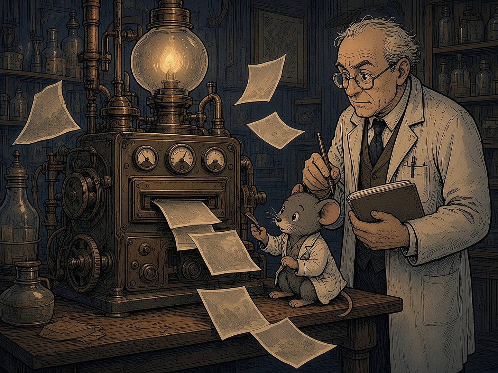

# IX PEATÜKK — Unustamise masin: mida teadus mälu kustutamisest tegelikult teab

Kui eelmine peatükk küsis, kuidas võõras mõte sinu omaks saab, siis see peatükk küsib vastupidist: kas mälestust saab ära võtta? Internetis liigub lugusid salajastest „unustamise masinatest” ja programmidest, mis kustutavad sõdurite mälu. Renee pani 2026. aasta oktoobris kokku nimekirja teadlastest ja rühmadest, kes uurivad mälu nõrgendamist ja unustamist. Nimekiri tugineb ainult avalikule ja akadeemilisele uurimistööle. See peatükk on selle nimekirja lühike kokkuvõte.

### Kõige tähtsam kõigepealt

**Fakt:** inimesel saab mälu mõnikord **nõrgendada**, aga mitte täpselt **kustutada**. Hiirtel ja rottidel on teadlased kindla hirmumälu päriselt välja lülitanud. Selleks on vaja geenitehnikat ja ajusse viidud valgust või toksiini. Inimestel seda teha ei saa. Inimestel on kõige paremini tõestatud **emotsiooni vähendamine**: mälestus jääb alles, aga see ei tee enam nii haiget.

*„Unustamise masin” on kujund. Päris laborites on mälu kustutatud ainult loomadel. Inimestel saab vähendada mälestuse valu, mitte mälestust ennast.*

### Avatud aken

2000. aastal näitas Karim Nader (McGilli Ülikool) rottidel, et meenutatud hirmumälu muutub korraks ebastabiilseks ja see tuleb uuesti „salvestada”. Kui see protsess ajus blokeeriti, kadus hirmureaktsioon. Seda nimetatakse **rekonsolideerimiseks**. Sellele ideele tuginevad mitmed inimkatsed.

Merel Kindt (Amsterdami Ülikool) näitas 2009. aastal, et vererõhuravim propranolool nõrgendas laboris tekitatud hirmu, kui see anti koos meenutamisega. Hilisemad uuringud olid aga nõrgemad: päris ämblikufoobiaga patsientidel ei olnud propranolool platseebost parem. Kindt on kliiniku asutaja, see on huvide konflikt. Alain Brunet' rühm leidis 2018. aastal, et propranolool koos trauma meenutamisega vähendas PTSH sümptomeid. Prantsuse uuring 2021. aastal 66 patsiendiga seda ei kinnitanud. **Järeldus:** mõju on olemas, aga väiksem ja ebakindlam, kui alguses arvati.

Daniela Schiller avaldas 2010. aastal ajakirjas Nature tulemuse, et hirm ei tule tagasi, kui harjutus tehakse „mälu akna” ajal. Hilisem eelregistreeritud kordusuuring mõju ei leidnud.

### Tetris ja EMDR

Emily Holmes (Uppsala Ülikool) leidis, et kui pärast traumat mälestus lühidalt meelde tuletada ja siis kindlal viisil Tetrist mängida, tuleb hiljem vähem pealetükkivaid mälupilte. 2025. aasta suur korduskatse leidis ainult kohese mõju, mitte nädala pärast. Siia kuulub ka EMDR eelmisest peatükist. Ad de Jongh (ACTA, Amsterdam) uuris seda pikalt traumamälu ravina.

### DARPA ei kustutanud mälu

Vandenõulugudes nimetatakse sageli USA kaitseministeeriumi teadusagentuuri DARPA programmi RAM (*Restoring Active Memory*, umbes 2013–2018). **Fakt:** programmi eesmärk oli mälu **taastada** ajukahjustusega sõduritel, mitte kustutada. Michael Kahana rühm (Pennsylvania Ülikool) parandas 2018. aastal ajustimulatsiooniga epilepsiahaigete sõnameenutamist umbes 15%. Ühes uuringus hoopis halvendas hipokampuse stimulatsioon mälu. Wake Foresti ja USC „mäluproteesi” uuringud olid väikesed ja tulemused segased.

### Hiirte engrammid

Mälestus jätab ajju rakkude rühma, mida nimetatakse **engrammiks**. Susumu Tonegawa (MIT, suri 11. juulil 2026) rühm äratas 2012. aastal hiirel valgusega hirmumälu. 2013. aastal tekitati hiirel valemälu. Sheena Josselyn ja Paul Frankland (SickKids, Toronto) kustutasid 2009. aastal hiirel ühe kindla hirmumälu, hävitades valitud närvirakud. Tomás Ryan (Trinity College Dublin) on näidanud, et unustamine on sageli mälu **peitmine**, mitte kustutamine: „kadunud” mälu võib tagasi tulla.

### Valemälu: ohtlikum kui unustamine

Selle peatüki kõige tugevam tõend ei puuduta mälu kustutamist, vaid mälu **tekitamist**. Elizabeth Loftus (UC Irvine) näitas „kaubanduskeskuses ära eksimise” katsega, et osa inimesi hakkab uskuma lapsepõlvesündmust, mida ei olnud. Kimberley Wade (Warwick) tekitas võltsitud fotoga valemälu õhupallisõidust. 2017. aasta koondanalüüs (8 uuringut, 423 inimest) leidis, et umbes **30%** osalejatest tekkis valemälu. Henry Otgaar (Maastricht) on näidanud, et „allasurutud mälestuste” teooria ei ole teaduslikult tõestatud ja võib teraapias viia valemälestusteni.

Siin sulgub ring raamatuga. Kolmas reegel ütleb, et ära aja segamini köögilaua legende ja arhiivifakte. Mälu on köögilaud: see on soe, isiklik ja eksib kergesti. Arhiiv on külm, kuid see ei muuda end järgmisel korral jutustamisel.

### Mida nimekirjast välja jäi

Renee esialgses nimekirjas oli nimi „Bruno Bonin”. Sellenimelist mälu-uurijat ei leitud. On olemas Robert P. Bonin, kes on kirjutanud rekonsolideerimisest ja valust. Võimalik, et nimi läks segamini.

**Väide, mida tõendid ei toeta:** et kuskil on töötav masin või programm, mis kustutab inimeselt valitud mälestusi. Avalikus teadusallikas sellist asja ei ole.

### Peatüki allikad

1. Nader, Schafe, LeDoux 2000 (Nature); Kindt jt 2009 (Nature Neuroscience) ja hilisemad negatiivsed tulemused; Brunet jt 2018 (Am J Psychiatry); Roullet jt 2021.

2. Schiller jt 2010 (Nature) ja kordusuuringud (KU Leuven).

3. Holmes jt (Tetrise uuringud, 2009–2025); de Jongh, ACTA.

4. DARPA RAM programmi kirjeldus; Ezzyat, Kahana jt 2018 (Nature Communications); Hampson jt 2018.

5. Tonegawa labor (MIT) 2012–2015; Han, Josselyn, Frankland jt 2009 (Science); Ryan labor (TCD).

6. Loftus ja Pickrell 1995; Wade jt 2002; Scoboria jt 2017; Otgaar jt 2019.

7. Renee nimekiri „Kes uurib mälu nõrgendamist ja unustamist?” (oktoober 2026).

> **Reegel 10.** Lisareegel: Mälu on köögilaud, mitte arhiiv. Mälestust saab muuta lihtsamini kui kustutada — seepärast vajab iga meenutus dokumenti.
