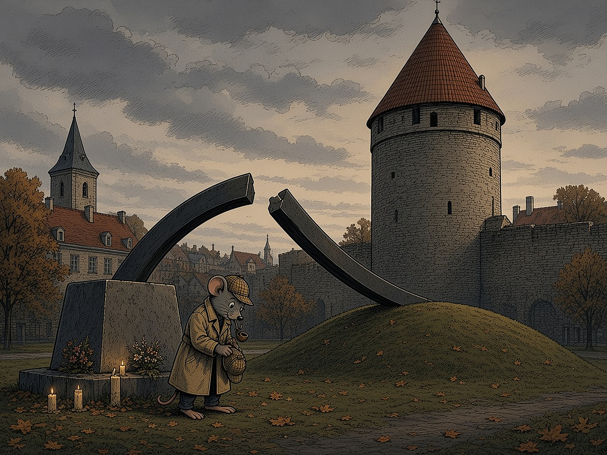

# XI PEATÜKK — Katkenud liin: Utö, MAYDAY ja päästeoperatsioon (28.09.1994)

Saarel, mis on Soome saarestiku viimane asustatud punkt enne avamerd, ei ole tuul kunagi päris vaikne. Renee jõudis Utöle samal põhjusel, miks Tarmo oli aastaid kogunud toimikuid: et näha oma silmaga kohta, mille kohta teised olid ainult rääkinud. Ta ei tulnud sinna turistina. Ta tuli kuulama.

Utö majakas, mille valge torn kõrgub üle graniidi ja madalate punaste majade, on kõige vanem säilinud majakas Soomes. Torni trepid on kitsad ja kumerad, iga keerd viib natuke kõrgemale ja natuke kaugemale kõigest, mis jääb alla. Ülevalt paistab ainult vesi – lõunas ja edelas, sinnapoole, kuhu 28. septembri 1994 öösel jäi parvlaev *Estonia*.

Renee oli kuulnud, et just siin, selles tornis, võeti vastu *Estonia* MAYDAY. Lugu kõlas nagu suur ja lihtne tõde: üks saar, üks torn, üks raadio ja üks hääl pimedas. Seistes klaasi taga, kus valgusvihk kunagi pöörles, otsustas ta selle loo lõpuni kontrollida. Mitte selleks, et seda maha teha, vaid selleks, et teada, milline osa sellest kannab.

### Mida dokumendid tegelikult ütlevad

Eesti, Soome ja Rootsi ühise uurimiskomisjoni (JAIC) 1997. aasta lõpparuande päästetööde peatükk (soomekeelne väljaanne on 2024. aastal uuesti avaldatud Soome Ohutusjuurdluse Ameti veebis) annab sellele ööle kellaajad. Aruanne hoiatab ise, et eri päevikutest ja tunnistustest pärit ajad võivad mõne minuti võrra erineda.

Esimese hädakutse võttis vastu reisiparvlaev **Mariella**, umbes kell 01.22, ja vastas sellele. *Mariella* oli *Estoniale* kõige lähemal, temast kirdes. *Silja Symphony* pardal pandi raadioside peale salvestama magnetofon. Teise hädakutse kell 01.24 võttis aruande tabeli 7.2 järgi vastu **14 raadiojaama**. Nende seas on laevad *Silja Europa*, *Silja Symphony* ja *Finnjet*, Turu mereõnnetuste päästekeskus (MRCC Turku), Turu ja Maarianhamina alamkeskused, Turku Radio, Kökari merevalvejaam – ja **Utö kindlus** (*Utön linnake*), mille kohta on allikana märgitud raadioametnik ja raadiopäevik.

Raadioside juhtjaamaks sai *Silja Europa*, millel oli *Estoniaga* otseühendus. Kell 01.29 andis *Estonia* *Silja Europale* oma asukoha. See oli viimane raadioside. Aruanne märgib ka, et Helsinki Radio ja MRCC Turu kasutasid VHF-kanalil 16 samu tugijaamu Utös, Järsös ja Hangos, ning Turu alamkeskus kasutas samuti Utö tugijaama.

Seega on Renee loo tuum tõsi, kuid see vajab täpsustust. **Utö oli tõepoolest üks paikadest, kus MAYDAY kinni püüti.** See ei olnud aga ainus koht ega ka esimene. Esimesena kuulis hääli *Mariella* ning samal minutil kuulis teist kutset veel kolmteist jaama. Aruanne nimetab vastuvõtjana Utö *kindlust* ja raadioametnikku. Allikad, mida ma läbi vaatasin, ei kinnita, et raadio asus just majakatornis. Võimalik, et kohapealne pärimus seob need kaks kohta kokku. Võimalik, et tugijaama antenn või seade paiknes tornis. Dokumendist ma seda aga ei leidnud, nii et jätan selle avatuks.

### Katkenud liin

Ülejäänu on aruandes kirjas kõledas ametlikus keeles, kuid see keel räägib omaette loo. *Mariella* teatas õnnetusest Helsinki Radiole kell 01.42. Kell 01.45 nõudis MRCC Turu kanalil 16, et Helsinki Radio saadaks välja *Mayday Relay* ehk hädasõnumi teise laeva nimel. Kell 01.50 saatis Helsinki Radio selle asemel kiirteate (*Pan-Pan*). Tegu on madalama astme teatega.

Rootsi päästekeskusele teatas Maarianhamina alamkeskus kell 01.52. Tallinna päästekeskus (MRCC Tallinn) sai teate Helsingist alles kell 02.55, peaaegu poolteist tundi pärast viimast raadiosidet. Aruande järgi käivitas MRCC Tallinn oma häirestuse kell 03.00. Kell 03.02 vastas ta Turule, et pardal oli 679 reisijat ja 188 meeskonnaliiget. Kell 03.58 andis Tallinn häire rannavalve laevale EVA-207, kuid ilm takistas laeval välja sõitmast.

See on see, mida Tarmo oma toimikutes nimetas *katkenud liiniks*. Katkenud liin ei tähenda vandenõud. See tähendab ahelat, kus iga lüli teeb midagi, kuid sõnum liigub aeglasemalt kui vesi. Suuronnettomuuks kuulutas MRCC Turu olukorra kell 02.30. Esimene laev, *Mariella*, jõudis kohale kell 02.12.

### Kopterid pimeduses

Turu valmiskopter **OH-HVG**, Soome piirivalve Super Puma, sai häire kell 01.35, startis kell 02.30 ja jõudis esimese kopterina õnnetuspaigale kell 03.05. Pimedas otsis meeskond prožektoriga vees olevaid inimesi. Esimese Rootsi kopterina jõudis kohale Q 97, õhujõudude Super Puma Visbyst, kell 03.50. Talle järgnesid Rootsi õhujõudude Super Pumad ning mereväe Boeing-Kawasaki kopterid Bergast ja Sävest. Soome piirivalve saatis lisaks Agusta Bell 412 kopterid OH-HVD ja OH-HVH. Soome õhujõudude Mi-8 kopterid said häire Uttis.

Kell 04.15 pakkus Taani merepäästeteenistus kopteriabi. Taani õhujõudude Sea King kopterid **U 280** ja **U 277** Aalborgist jõudsid kohale kell 08.15. Hilja pärastlõunal saabus ka Venemaa tsiviilkasutuses olnud Mi-8 RA 22511.

Aruande koondarv on ühemõtteline: õnnetuspäeval osales päästetöödel ja hukkunute otsingutel **26 kopterit, neist kaheksa Soomest, neliteist Rootsist, üks Eestist, kaks Taanist ja üks Venemaalt**. Lisaks tegi viis kopterit transpordilende. Kopterid päästsid 104 ja laevad 34 inimest. Kokku oli pardal 989 inimest. Ellu jäi 137 ja hukkus 852 inimest.

Siin tuleb Renee loos teha teine parandus. **Norra kopterid JAIC-i aruande kopterite tabelis ei esine.** Seal on Soome, Rootsi, Taani, Eesti ja Venemaa masinad. Norra osaluse kohta ma kontrollitavat allikat ei leidnud. Kui kellelgi on Norra kopteri või meeskonna dokument, kuulub see lisamisele. Seni jääb see väide kinnitamata.

### Eesti kopter ja „remondis olnud” masinad

Eestist osales üks kopter: **ES-XAC, Mi-2**, mis kuulus Tallinna eraettevõttele AeroCo. Häire andis talle kell 07.30 riiklik päästeamet. Kopter tegi otsingulennu mööda Eesti põhjarannikut. Sama ettevõtte teine Mi-2, ES-XAB, jätkas järgmistel päevadel. Lisaks tegi Eesti riigi lennuk L-410 (ES-PLW) otsingulende Eesti rannikul.

Renee on kuulnud, et Eesti kopterid olid tol ajal remondis. Avalikest allikatest, mida ma läbi vaatasin, ma sellele kinnitust ei leidnud ega ka ümberlükkamist. Aruanne kirjeldab, kuidas Eesti merepääste oli 1994. aastal alles üles ehitamisel. Eesti ei olnud enne õnnetust ratifitseerinud rahvusvahelist merepääste konventsiooni. Rootsi oli alates 1991. aastast koolitanud Eesti merepäästjaid. Remondijutt jääb seega **suuliseks pärimuseks**, mida tasub kontrollida tolleaegse piirivalve lennuüksuse dokumentidest või toonastelt lenduritelt.

### Saar, kuhu toodi elavad

Utö roll ei lõppenud raadiosõnumiga. Aruande järgi oli kindlusesaar kõige välimine saar enne õnnetuspaika. Sellest sai **kõige tähtsam päästetute kogumispaik**. Kuna kõiki päästetuid ei saanud laevadele viia, andis MRCC Turu korralduse lennutada neid vajaduse korral Utöle, et lühendada lennuaega ja vähendada alajahtumise ohtu. Kopterid tõid saarele 24 päästetut, kes viidi sealt edasi haiglaravile. Esialgu hoolitses nende eest kindluse personal õdede juhendamisel. Arsti juhitud meditsiinirühm saadeti Maarianhaminast kell 06.20, sest kopterit polnud vaba, ja rühm jõudis kohale umbes kell 06.50. Kell 06.30 sai saarel kopterikütus otsa ja kopterid suunati tankima Nauvosse ja Hankosse. Päeva jooksul toodi Utöle ka hukkunuid.

Kui Renee seisis tornis, vaatas ta seega mitte ainult kohta, kus kuuldi häält. Ta vaatas kohta, kuhu toodi tagasi need, kes ellu jäid. Graniidil, mille vahel praegu kasvab kanarbik, ootasid läbimärjad ja külmunud inimesed kopteri müra keskel järgmist lendu.

### Vrakk ja katmata jäänud haud

Vrakk lebab Soome majandusvööndis rahvusvahelistel vetel umbes 80 meetri sügavusel. Uppumise järel jäi see merepõhja peaaegu kummuli, tüürpoordi küljega pehmesse savisse. Vöörivisiir leiti vrakist eraldi, umbes poolteist kilomeetrit lääne poolt. Rootsi, Soome ja Eesti sõlmisid 1995. aastal lepingu, mis kuulutas vraki hauarahuks.

*Vrakk merepõhjas, illustratsioon on stiliseeritud. Tegelikkuses lebab vrakk umbes 80 m sügavusel peaaegu kummuli ja tüürpoordi küljega savis. 1994. aastal oli kreen umbes 108° ja kurss 091°, 2021–2023 mõõdeti kreeniks umbes 134°. Vöörivisiir leiti vrakist eraldi, umbes 1,5 km lääne poolt.*

Vahetult pärast õnnetust tegi Rockwater A/S (koos Smit Takiga) Rootsi Meresõiduameti tellimusel vraki seisukorra uuringu, ajavahemikus 21.11–08.12.1994. Rockwater vraki **ei katnud**. Rootsi valitsus otsustas 15. detsembril 1994, et vrakk kaetakse. Leping sõlmiti 11. jaanuaril 1996 konsortsiumiga Nordic Marine Contractors, kelle laevad olid Van Oordi kivipuistelaev *Tertnes* ja süvendaja *Volvox Iberia*. Plaani järgi pidi vraki vööri ja ahtri katma kahekordse betoonplokkmatiga ning ümbrus pidi saama liiva- ja kivitäite.

Tööd algasid 19. aprillil 1996. Ümber vraki paigaldati 26 geotekstiilmatti, need stabiliseeriti kruusaga ja peale puistati liiva. Hukkunute lähedaste survel otsustas Rootsi valitsus 19. juunil 1996 katmise lõpetada. Ajakirjanduse andmetel põhjendas transpordiminister Ines Uusmann seda sellega, et õnnetuse põhjus ei olnud veel lõplikult selge. 21. juulil avastati vrakist lõuna pool liivatäites suured deformatsioonid. Töövõtja lõpetas tööd 27. juulil 1996. Selleks ajaks oli puistatud umbes 380 000 m³ liiva. **Betoonmatte vrakile ei paigaldatud.** Vrakk ise jäi katmata, kuid selle ümbrus on sellest ajast saadik inimtekkeline täide. Just sellele viitab ka BMTIG, kui ta küsib, kas hilisematel sonaripiltidel nähtav kõva kiht on aluskivim või 1996. aasta täide.

*1996. aasta katmistööd. Rootsi valitsus otsustas 15.12.1994 vraki katta. Tööd algasid 19.04.1996 ja valitsus otsustas 19.06.1996 katmise lõpetada. Töövõtja lõpetas tööd 27.07.1996. Ümber vraki paigaldati geotekstiil, kruusakiht ja umbes 380 000 m³ liiva. Plaanitud betoonmatid vrakile ei jõudnud.*

### Mida 2025. aasta aruanne muutis

Kolmkümmend üks aastat pärast õnnetust muutis ametlik lõpparuanne kahes kohas pilti, mida JAIC 1997. aastal joonistas. Need muudatused on olulised ka Utö loo jaoks, sest need nihutavad kellaaegu, millest raadiosõnumid sõltusid.

Esiteks hindas aruanne, et visiiri eraldumine ja vee sissevool algasid umbes 10–15 minutit varem, kui JAIC oli arvanud, vahetult pärast kella ühte öösel. Aruande ajajoone järgi tungis vesi autotekilt mitteveekindlate tuletõkkeuste kaudu trepikodadesse ja alla 1. tekile. Kreen ületas 90 kraadi umbes kell 01.35 ja laev uppus ahter ees umbes kell 01.50. See tähendab, et kui MAYDAY kell 01.22 ja 01.24 eetrisse läks, oli laev juba umbes kakskümmend minutit hädas olnud.

Teiseks jõudsid Eesti ja Rootsi uurijad järeldusele, et *Estonia* **ei olnud merekõlblik**. Vöörilukud olid sertifitseerimata ja põrkevahesein oli valel kohal, mistõttu poleks laev tohtinud sõita kaldast nii kaugel. JAIC seda 1997. aastal nii ei sõnastanud. Ka BMTIG nõustub konstruktsiooniliste puuduste kriitikaga. Vaidlus on kitsam, kui avalikkus sageli arvab: mõlemad pooled tunnistavad, et laev oli haavatav. Lahkhelid puudutavad tüürpoordi vigastust.

Tarmo märkmikus on see lõik alla joonitud. Tema jaoks oli see vaikimismustri kõige selgem näide: tõde ei tulnud välja ühe suure paljastusega. See tuli välja aeglaselt, aruandest aruandesse, ja iga parandus tõi kaasa küsimuse, miks seda kohe ei nähtud.

### Teine liin: allveelaeva hüpotees

Utö tornist vaadates on lihtne mõelda, et meri peidab kõike. Just seepärast tuleb järgmine osa lugeda teistmoodi kui eelmised. Eelmised lõigud tuginevad uurimiskomisjoni kellaaegadele ja tabelitele. See osa kirjeldab **hüpoteesi**, mida ametlik uurimine **ei kinnitanud**. Tarmo kirjutas selle oma kaardil eraldi kihile ja tegi kihi serva kirjaga „väide, mitte fakt”.

Hüpotees ütleb, et *Estonia* põrkas hukuööl kokku suure veealuse või pinnal liikuva objektiga, võimalik et allveelaevaga, ning et see kokkupõrge tekitas vraki tüürpoordi suure vigastuse. Hüpoteesi kõige põhjalikum avalik tehniline esitus on Rootsis tegutseva sõltumatu rühma **Baltic Marine Technical Investigation Group (BMTIG)** kümneosaline raportisari R1–R10. See avaldati Stockholmis 10. detsembril 2025, kuus päeva enne Eesti, Soome ja Rootsi ohutusjuurdlusasutuste ametlikku lõpparuannet.

### Mis on vaidluse all

Vaidluse keskmes ei ole vöörivisiir. Sellest on mõlemad pooled ühel meelel: visiir eraldus ja vesi tungis autotekile. 2020. aastal leidsid filmitegijad vraki tüürpoordist ava, mida 1990. aastatel ei olnud filmitud. Hiljem mõõdeti selle vigastusala pikkuseks umbes 22–25 meetrit ja kõrguseks umbes neli meetrit. Küsimus on lihtne: **kas see vigastus tekkis enne uppumist või pärast seda?**

**Ametliku lõpparuande (OJK, SHK ja OTKES, 16.12.2025) seisukoht:** vigastus tekkis siis, kui vrakk vajus ja rullus merepõhjas vastu gneisist aluskivimi paljandit. Vigastus oli 1990. aastatel savi sees peidus. Nähtavale tuli see alles pärast seda, kui vrakk nihkus nõlval ja selle kreen suurenes ligikaudu 108 kraadilt 134 kraadini. Tallinna Tehnikaülikooli arvutimudelid (2023 ja 2025) näitavad, et vrakk võib omaenda raskuse all aluskivimile vajudes sellise vigastuse saada. Eesti Kohtuekspertiisi Instituudi 2023. aasta ekspertiisiakt 23U-AR0075 uuris vigastuse servast lõigatud teraseproovi. Proovil oli plastne venimine, kuid kokkupõrkest metallobjektiga, võõrmetallist või lõhkeainest jälgi ei leitud. Lisaks märgib aruanne, et vähemalt viis tunnistajat nägid väljasirutatud stabilisaatorilaba, kuid vrakil on mõlemad labad sisse tõmmatud ja terved. Ametlike uurijate hinnangul räägib see külgkokkupõrke vastu.

**BMTIG vastuargumendid:** rühm arvutab raportis R3, et tüürpoordi vigastusala tekitamiseks oleks vaja umbes 140–180 megadžauli plastse deformatsiooni energiat. Raportis R5 kritiseerib rühm TalTechi mudelit. BMTIG hinnangul jääb mudeli rullumisenergia alla ühe megadžauli, olles seega umbes 250–300 korda väiksem. Rootsi rühm viitab ka Rockwateri 1994. aasta detsembri puursüdamikele, mille järgi oli vigastusala juures paks pehme savikiht, mitte kaljupaljand. BMTIG-i järeldus on, et vajaliku energia oleks andnud kokkupõrge objektiga, mille efektiivne mass on mõni tuhat tonni ja kiirus umbes 11–14 sõlme. Rühma Bayesi analüüs murdepindade kohta eelistab kiiret löögimurdu. Stabilisaatorite kohta viitab BMTIG kolmanda mehaaniku ütlusele, et labad tõmbusid kiiruse langedes automaatselt sisse.

**Ajakirjanduslik lisa, mitte tõend:** ajakirjanik Lars Borgnäs avaldas 15. detsembril 2025 ajakirjas *Fokus* loo dokumendist. Selle dokumendi oli 1996. aastal saanud Rootsi Meresõiduameti ametnik ning selles väideti muu hulgas kokkupõrget allveelaevaga. Lõpparuande koostanud SHK kinnitas 2025. aasta memos, et ameti arhiivist sellist dokumenti ei leitud. Dokumendi sisu ei ole seega avalikult kontrollitav.

Kumb pool on õigem? Selle peatüki allikad seda ei otsusta. Ametlik uurimine tugineb laboriekspertiisidele ja merepõhja uuringutele. BMTIG tugineb energiabilansile ja kriitikale ametlike mudelite aadressil. Tarmo märkis oma kaardile ainult selle, mida saab kontrollida: **ametlik järeldus on põhjakontakt, allveelaeva kokkupõrget ei ole ükski uurimisasutus kinnitanud ja Rootsi rühma arvutused on avalikud ning kontrollitavad.** Kes tahab vaidlust lõpetada, peab need arvutused ümber lükkama või kinnitama, mitte vaikimisi kõrvale jätma.

***HÜPOTEES – mitte tõestatud fakt.** Kunstniku kujutlus BMTIG-i (2025) esitatud versioonist, mille järgi põrkas *Estonia* kokku allveelaeva või muu suure objektiga. Ametlik lõpparuanne (OJK/SHK/OTKES, 16.12.2025) seda ei kinnita: selle järgi tekkis tüürpoordi vigastus merepõhjas pärast uppumist.*

### Kas Utö ja allveelaev on seotud?

Siin on kiusatus suur. Utö oli kindlussaar, raadioside sõlm ja päästetöö kogumispaik. Allveelaeva lugu räägib sõjaväest. Sellegipoolest **ei ole avalikes allikates, mida ma läbi vaatasin, mitte ühtegi dokumenti, mis seoks Utö kindlust või selle raadioliiklust allveelaeva hüpoteesiga.** Utö raadioametnik kuulis sama MAYDAY-d, mida kuulis veel kolmteist jaama. Uurimiskomisjoni tabelis on tema kellaaeg ja allikas, mitte rohkem.

Seepärast on kahe liini vaheline seos selles peatükis üksnes **küsimuste seos**, mitte väide. Esimene küsimus on, kas Utö kindluse ja teiste rannikujaamade 1994. aasta raadio- ja vaatluspäevikud on täies mahus avalikud ja kas neis on midagi peale hädaliikluse. Teine küsimus on, kas tolleaegsed mereseirevahendid, nii Soome, Rootsi kui ka teiste riikide omad, registreerisid õnnetuspiirkonnas muud liiklust. Kumbki küsimus ei ole süüdistus. Need on päringud, mille vastus võiks hüpoteesi kas nõrgendada või tugevdada.

### Mis jäi uurimata – ja mis on lihtsalt teadmata

See raamat on algusest peale eristanud kahte asja: seda, mida dokument ütleb, ja seda, mida inimesed räägivad. Ka selles peatükis peab see piir olema nähtav.

**Kontrollitud fakt:** MAYDAY kuulsid kell 01.24 neliteist jaama, nende seas Utö kindlus. Esimesena kuulis kutset *Mariella* umbes kell 01.22. Päästetöid juhtis MRCC Turu. Kohal olid Soome, Rootsi, Taani, Eesti ja Venemaa kopterid. Utöst sai päästetute peamine kogumispaik.

**Kontrollitud fakt:** ametlikus ahelas oli viivitusi. Helsinki Radio saatis *Mayday Relay* asemel *Pan-Pan* teate. Tallinn sai teate kell 02.55. Eesti laev ei pääsenud ilma tõttu välja.

**Kinnitamata väide:** raadio, mis kutse vastu võttis, asus majakatornis. Aruanne nimetab kindlust ja raadioametnikku, mitte torni.

**Kinnitamata väide:** Norra õhujõud osalesid päästetöödel. Aruande kopterite tabelis neid ei ole.

**Kinnitamata väide:** Eesti kopterid olid remondis. See on suuline pärimus, mida dokumentides ei leidnud.

**Ametlik järeldus (2025):** tüürpoordi vigastus tekkis merepõhjas pärast uppumist. Ekspertiisid kokkupõrke ega lõhkeaine jälgi ei leidnud.

**Hüpotees, mida ametlikult ei kinnitatud:** vigastuse põhjus oli kokkupõrge allveelaevaga või muu suure objektiga. Selle peamine tehniline alus on BMTIG-i energiaarvutus.

**Tõestamata seos:** Utö ja allveelaeva hüpotees. Dokumenti, mis neid seoks, ei leitud.

**Avatud küsimus, mitte järeldus:** miks liikus teade Tallinna nii aeglaselt ja miks valiti *Mayday Relay* asemel madalam teade? Aruanne kirjeldab, *mis* juhtus. Kas see oli korralduslik nõrkus, kogenematus või midagi muud, seda ei saa selle peatüki allikate põhjal öelda. V peatükis kirjeldatud vaidlused vrakki üle ei ole selle küsimusega tõestatult seotud ja Tarmo hoidis need oma kaardil eraldi kihis.

Tarmo kirjutas oma välimärkmikku lause, mis sobib selle peatüki lõppu: *vaikus ei ole alati kellegi valik – vahel on see lihtsalt liin, mida keegi õigel ajal ei parandanud.* Vaikimismustri tunneb ära alles siis, kui küsitakse, miks liini pärast kunagi ei parandatud, ja kui vastus nõutakse dokumendiga.

Renee laskus mööda kitsast treppi alla. Allpool oli jälle tuul, graniit ja meri, mis ei mäleta midagi. Mäletavad paberid, ja ainult siis, kui keegi neid loeb.

### Kaks katkenud liini

Tallinnas, Paksu Margareeta kahurtorni kõrval Suure Rannavärava bastionil, seisab mälestusmärk, mis **kannab sama nime kui see peatükk**: „Katkenud liin”. Selle autorid on Villu Jaanisoo ja Jorma Mukala. Mälestusmärk avati 27. septembril 1996, kaks aastat pärast huku. Graniitaluselt algav kandiline metallsammas kaardub üle tee ja katkeb keskelt. Graniidile on raiutud õnnetuse kuupäev ja hukkunute nimed. Autorite sõnul sümboliseerib see katkenud teekonda Tallinnast Stockholmi. Reisisadam, kust *Estonia* viimasele reisile läks, on sealt mõne minuti tee kaugusel.

*Mälestusmärk „Katkenud liin” Paksu Margareeta juures Tallinnas (Villu Jaanisoo ja Jorma Mukala, avatud 27.09.1996). Kujutatud on keskelt katkev metallsammas graniitalusel, millele on raiutud hukkunute nimed.*

Renee seisis ühel päeval Utö tornis, kus kuuldi viimaseid sõnu, ja teisel päeval kivisamba juures, kus need sõnad on raiutud nimedeks. Kahe paiga vahel on meri ja kolmkümmend kaks aastat paberit. Peatüki nimi on laenatud monumendilt teadlikult: liin katkes merel, raadios ja aruannetes, kuid nimekiri graniidil ei katke.

### Peatüki allikad

1. Eesti, Soome ja Rootsi ühise uurimiskomisjoni (JAIC) lõpparuanne, 1997. Peatükk 7 „Pelastustoimet”, tabelid 7.2, 7.5, 7.7 ja 7.9 (soomekeelne väljaanne, Turvallisuustutkintakeskus, turvallisuustutkinta.fi, 2024).

2. Riksarkivet, Estoniasamlingen: hädaraadioside salvestus („Mayday-anropet”), sok.riksarkivet.se/estonia.

3. Wikipedia: „MS Estonia” (ingliskeelne), mida kasutasin hukkunute ja pääsenute arvu kontrollimiseks.

4. Eesti Ohutusjuurdluse Keskus, Rootsi SHK ja Soome OTKES: M/S Estonia esialgse hindamise lõpparuanne, 16.12.2025. Sellele lisanduvad TalTechi analüüsid (2023 ja 2025) ning EKEI ekspertiisiakt 23U-AR0075 (2023).

5. Baltic Marine Technical Investigation Group (BMTIG): raportisari R1–R10 ja koondkokkuvõte, Stockholm, 10.12.2025 (estoniainvestigation.com).

6. Lars Borgnäs, ajakiri *Fokus*, 15.12.2025, ja SHK memo S-200/20 (20.08.2025), mõlemad viidatud eelmise allika võrdlusanalüüsi kaudu. Allikat ei ole iseseisvalt kontrollitud.

7. SHK/OJK/OTKES lõpparuanne 2025, lisa O 2.6 ja O 2.10 (Rockwateri uuring 1994, katmistööd 19.04–27.07.1996); SGI aruanne „Fartyget M/S Estonia” (2021/2023); taz/dpa 1996.

8. Tallinna linnaruumikunsti kaart: „Katkenud liin”; et.wikipedia „Katkenud liin”; Visit Tallinn.

> **Reegel 12.** Lisareegel: Hea lugu ei vaja ilustamist. Kontrolli, kes tegelikult kuulis, kes tegelikult tuli ja mis jäi ütlemata. Kinnitamata väide jääb väiteks seni, kuni dokument selle kinnitab.
