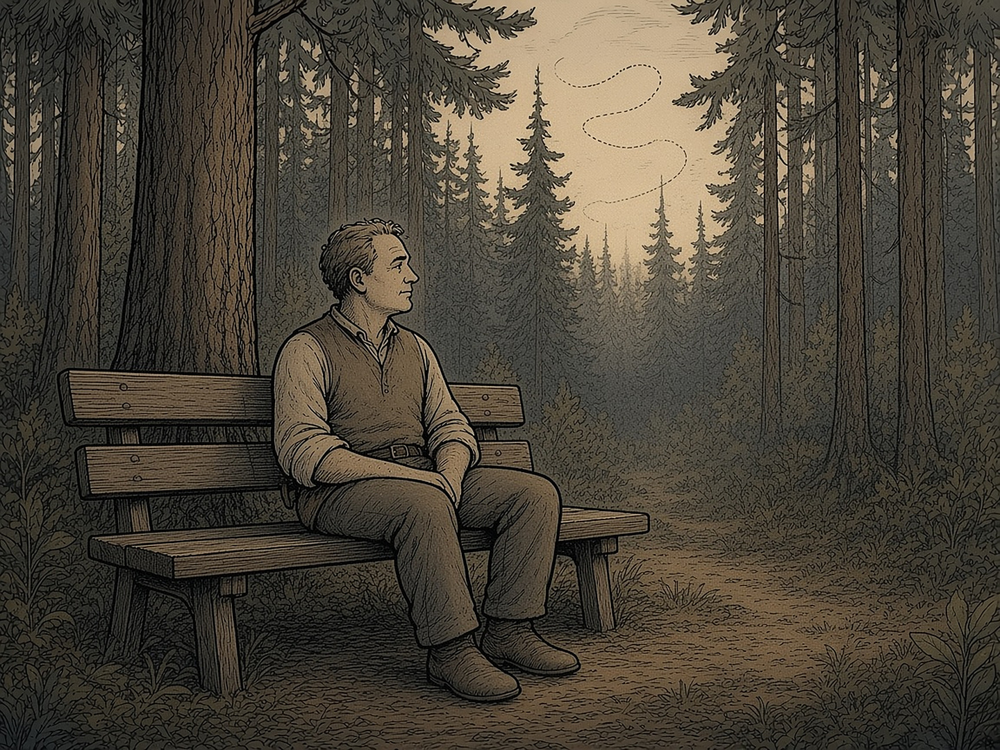

# XVI PEATÜKK — Silmad puude vahel: EMDR, tõendid ja üks isiklik lugu

Pärast raamatut, mis leidis oma lugeja, jõudis Tarmo laual järg küsimuseni, mida ei saa lahendada ühegi registri ega arhiiviga. Kuidas paraneb inimene, kelle sees on vana haav? Selle peatüki keskmes on üks ravimeetod ja üks isiklik lugu. Lugu on Renee oma ja ta on andnud loa seda siin kasutada. Perekonna üksikasju siin ei ole ja ei tule. Need kuuluvad inimestele, kes ei ole selle raamatu tegelased.

### Renee lugu

Renee on rääkinud, et tema lapsepõlves oli kogemus, mis jäi kehasse kauemaks, kui ta oleks tahtnud. Aastaid hiljem käis ta EMDR-teraapias. Ta ei kirjelda seda imena. Ta kirjeldab seda tööna: terapeudi kabinet, ettevalmistus, mälestuse juurde naasmine ja silmad, mis liiguvad küljelt küljele.

Teraapiast jäi talle alles harjumus. Kui ärevus või viha tõuseb, läheb ta võimaluse korral metsa või aknale ja vaatab puid. Ta laseb pilgul liikuda ühelt tüvelt teisele, vasakult paremale ja tagasi, kuni hingamine rahuneb. **See on Renee kogemus, mitte raviskeem.** Allpool on kirjas, mida teadus selle kohta ütleb ja mida mitte.

Nüüd on sellest saanud igapäevane tööriist. Renee ise ütleb nii: *„Kasutan seda nüüd igapäevaselt. Kui tuleb mingi häiriv mõte, lasen silmalihased pingesse ja silmad teevad iseenesest hästi kiiresti paremale-vasakule. Tunnen, kuidas mõte lahustub.”* Kõrvalt vaadates võib see meenutada inimest, kes jälgib väga kiiret tennisemängu. Tegelikult saadab ta lihtsalt ühe mõtte koju.

**See on isiklik praktika, mitte ravisoovitus.** Teadusel on selle kohta lihtne seletus. Hollandi psühholoogid Marcel van den Hout ja Iris Engelhard kirjeldavad **töömälu koormuse teooriat**: töömälu on nagu väike laud, kuhu mahub korraga vähe asju. Kui sinna panna häiriv pilt ja kiired silmaliigutused, jääb pildile vähem ruumi ja see tundub vähem ere. Nad kirjutasid sellest 2012. aastal artiklis „How does EMDR work?” (*Journal of Experimental Psychopathology*). Numbreid on ka: Lee ja Cuijpersi 2013. aasta meta-analüüs koondas 26 uuringut ja 849 osalejat. Laborikatsetes oli silmaliigutuste lisamõju d = 0,74 ja mälupildi eredusele koguni d = 0,91. Kliinilistes uuringutes oli see väiksem, d = 0,41. Aga labor mõõdab lühiajalist muutust, mitte paranemist. Silmad on hea abiline, mitte terapeut. Kui mõte on seotud traumaga või tuleb ikka ja jälle tagasi, mine spetsialisti juurde.

*Puude vaatamine: pilk liigub ühelt tüvelt teisele, kuni hingamine rahuneb. Renee isiklik harjumus pärast teraapiat, mitte raviprotokoll.*

### Mis on EMDR

EMDR on lühend ingliskeelsest nimest *Eye Movement Desensitization and Reprocessing*, eesti keeles silmaliigutustega desensitiseerimine ja ümbertöötlemine. Meetodi töötas välja USA psühholoog Francine Shapiro 1987. aastal. Inimene meenutab häirivat sündmust ja jälgib samal ajal silmadega terapeudi kätt või valgust. Silmaliigutuste asemel võib kasutada ka helisid või koputusi. Eesmärk ei ole mälestust kustutada. Mälestus jääb alles, kuid see ei tekita enam sama tugevat hirmu ega valu.

EMDR on terviklik ravi, millel on kaheksa etappi. Esimesed etapid on inimese loo kuulamine ja ettevalmistus. Briti ravijuhise NICE järgi on täiskasvanul tavaliselt vaja **8–12 seanssi**, keerulise trauma korral rohkem.

*EMDR-seanss: terapeut liigutab kätt ja klient jälgib seda silmadega. Ravi teeb väljaõppe ja järelevalvega spetsialist.*

### Mida ütlevad juhised

**Fakt:** EMDR on sees kõigis suuremates traumajärgse stressihäire (PTSH) ravijuhistes. **WHO** soovitas 2013. aastal kaaluda EMDR-i võrdselt trauma-keskse kognitiiv-käitumisteraapiaga (TF-KKT). WHO 2023. aasta mhGAP juhis annab lastele ja noortele tugeva soovituse, täiskasvanutele tingimusliku. **NICE** (2018) soovitab EMDR-i täiskasvanutele, kui sündmusest on möödas üle kolme kuu. Lastele on NICE esimene valik TF-KKT. **ISTSS** (2019) soovitab EMDR-i tugevalt nii lastele kui ka täiskasvanutele. **APA** uuendas oma juhist 2025. aastal ja paigutas EMDR-i teise valiku raviks (tingimuslik soovitus). Esimesel kohal on seal kognitiivne töötlemisteraapia (CPT), pikaajaline eksponeerimine (PE) ja TF-KKT.

### Mida ütlevad meta-analüüsid

**Fakt:** Cochrane'i ülevaade (Bisson jt 2013) leidis, et EMDR vähendab täiskasvanute kroonilise PTSH sümptomeid rohkem kui ootenimekiri, kuid tõendite kvaliteet on väga madal. Lewis jt (2020) võrdlesid 114 katset ja 8171 täiskasvanut. EMDR oli ootenimekirjast selgelt parem. TF-KKT-st see parem ega halvem ei olnud. Cuijpers jt (2020) leidsid samuti suure efekti, kuid ainult 4 PTSH-uuringut 27-st oli madala nihkeriskiga ja oli märke avaldamisnihkest. Lastel ja noortel (Sutton jt 2025, 8 katset, 794 last) vähendas EMDR sümptomeid ootenimekirjaga võrreldes, kuid ka need uuringud olid mõõduka või kõrge nihkeriskiga.

**Tõlgendus:** EMDR toimib PTSH puhul paremini kui ravi puudumine ja umbes sama hästi kui TF-KKT. Väide, et see on teistest teraapiatest **parem**, ei pea kvaliteetsete uuringute põhjal vastu.

### Kas silmad on üldse olulised?

See on EMDR-i kõige vaieldavam küsimus. Davidson ja Parker (2001) ei leidnud silmaliigutuste lisaefekti. Lee ja Cuijpers (2013) leidsid väikese kuni keskmise lisaefekti, laboris suurema. Kriitikud kasutavad „lilla mütsi” võrdlust: kui foobiaga inimene kannab ravi ajal lillat mütsi ja paraneb, ei tähenda see, et aitas müts. Psühholoog Richard McNally on öelnud: *„Mis on EMDR-is tõhus, ei ole uus, ja mis on uus, ei ole tõhus.”* Mõlemad pooled nõustuvad aga, et EMDR kui tervik vähendab PTSH sümptomeid.

Siit tuleb Renee puude-harjumuse kohta aus vastus. **Uuringud ei näita, et iseseisev silmade liigutamine ravib traumat.** Rahustavad harjutused, näiteks turvalise paiga kujutlemine või rahulik vaatlemine, on madala riskiga ja võivad aidata hetkes maha rahuneda. Traumamälestuste iseseisev töötlemine ilma terapeudita ei ole soovitatav. EMDR-i rahvusvaheline ühing EMDRIA ei toeta „tee-ise” EMDR-i. Shapiro ise hoiatas, et puuduliku ettevalmistusega töötlemine võib olla ohtlik.

### Kellele see ei sobi

Ettevaatust on vaja tugeva dissotsiatsiooni, aktiivse psühhoosi, suitsiidimõtete ja olukorra korral, kus oht kestab veel, näiteks kui inimene elab edasi vägivallaga. NICE rõhutab, et ravi alguses tuleb kõigepealt tagada inimese turvalisus. EMDR on **ravi** inimesele, kellel on traumasümptomid. See ei ole sõeluuring ega ennetus tervetele.

### Eesti olukord

EMDR Eesti Ühing asutati 23. märtsil 2023. 2026. aasta septembri lõpu seisuga oli ühingu nimekirjas 54 inimest, neist 33 baasõppe läbinut ja 16 laste ja noorte EMDR-i õppega. Confidos maksis korduv seanss 190 eurot (100 minutit). Kuriteo või vägivalla ohvri psühhoteraapia eest saab tasuda Sotsiaalkindlustusamet.

**Väide, mida tõendid ei toeta:** et EMDR-i vaigistatakse teadlikult. Kasutamist piiravad terapeutide vähesus, koolituse hind ja nõuded ning põhjendatud teaduslik skepsis. Need on igavamad põhjused kui vandenõu, kuid need on tõesed.

### Miks see peatükk on siin

Raamatu kuues reegel ütleb, et trauma ei ole kurjus, vaid lukustunud valu. Renee lugu näitab, et luku saab avada, aga mitte jõuga ega üksi. Mets aknal võib aidata hingata. Haava ravib väljaõppinud inimene.

### Peatüki allikad

1. WHO (2013) juhis stressiga seotud seisundite kohta (NCBI NBK159721) ja WHO mhGAP (2023).

2. NICE NG116 (2018); ISTSS ravijuhised (2019); APA PTSH juhise uuendus (2025).

3. Bisson jt 2013 (Cochrane); Lewis jt 2020 (Eur J Psychotraumatol); Cuijpers jt 2020 (Cogn Behav Ther); Sutton jt 2025 (doi 10.1002/cpp.70186).

4. van den Hout ja Engelhard 2012, „How does EMDR work?” (Journal of Experimental Psychopathology); Davidson ja Parker 2001; Lee ja Cuijpers 2013; Rosen ja Davison 2003; McNally 1999.

5. EMDRIA seisukoht „tee-ise” EMDR-i kohta; Waterman ja Cooper 2020 (BJPsych Open).

6. EMDR Eesti Ühing (emdr.ee); Confido hinnakiri; Sotsiaalkindlustusamet. Andmed Renee raportitest „EMDR-teraapia koolides” (27.09.2026) ja „EMDR-teraapia: tõendid” (10.10.2026).

7. Renee Aluste suuline meenutus oma teraapiast ja igapäevasest praktikast (01.11.2026). See on märgitud meenutusena.

> **Reegel 17.** Lisareegel: Haav ei parane vaikides ega jõuga. Kasuta meetodit, mille kohta on tõendid, ja inimest, kellel on väljaõpe — ning ära müü oma kogemust teistele raviskeemina.
