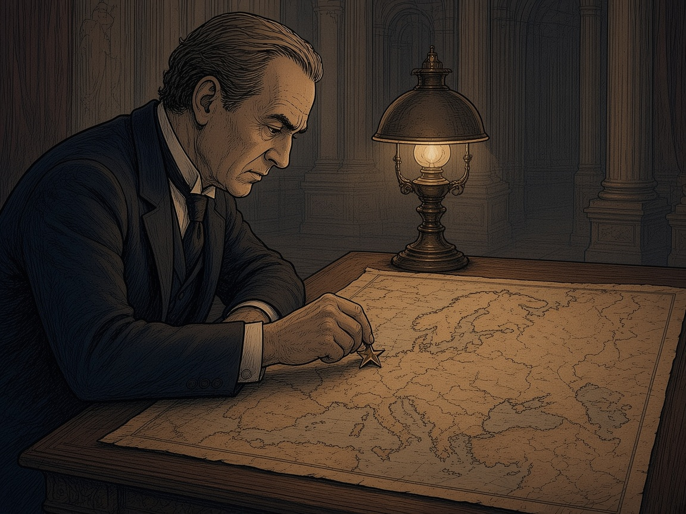
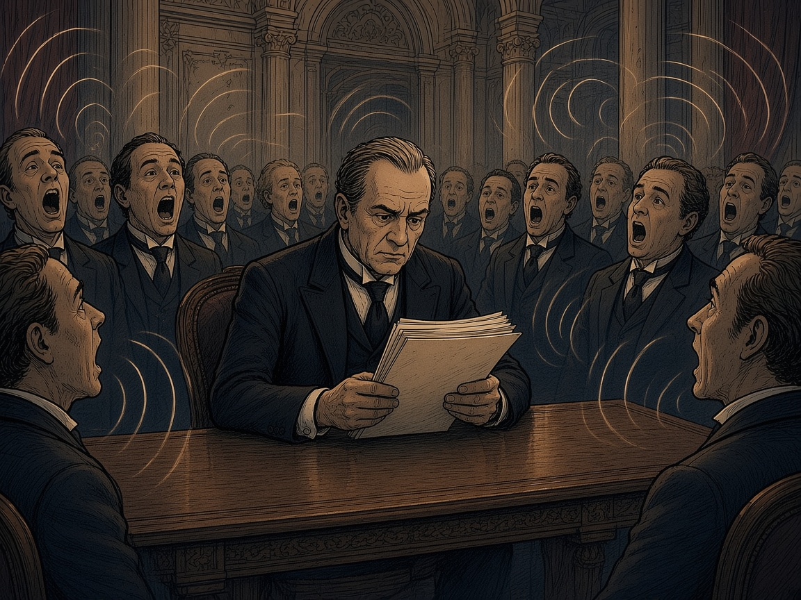
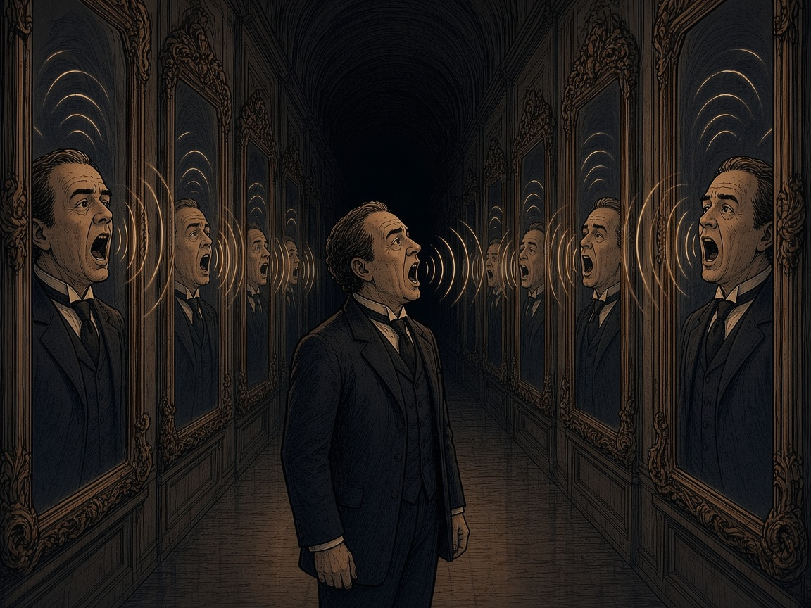
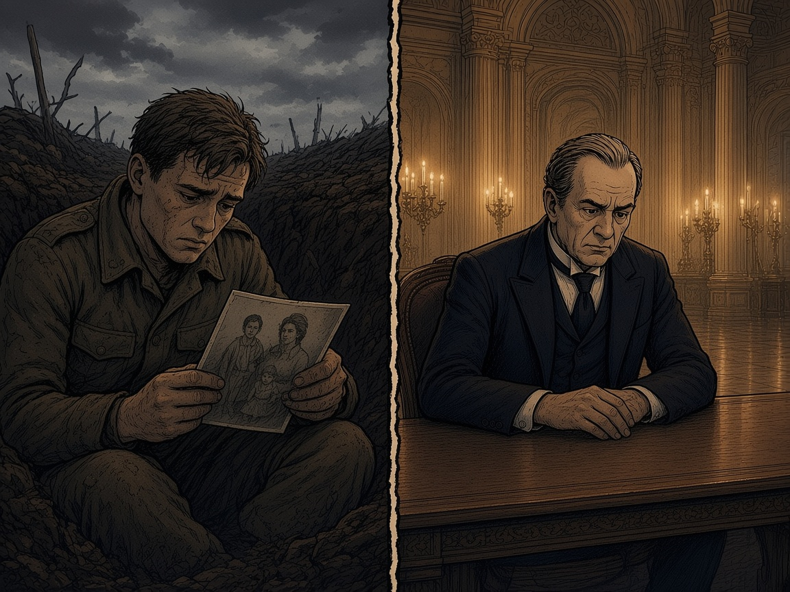
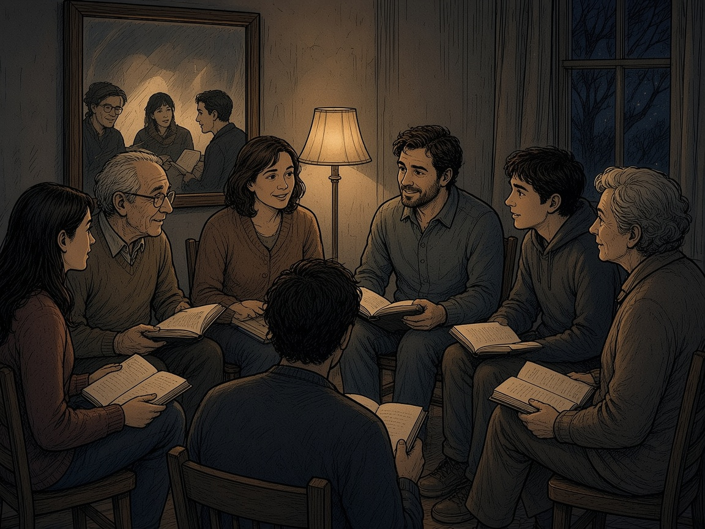
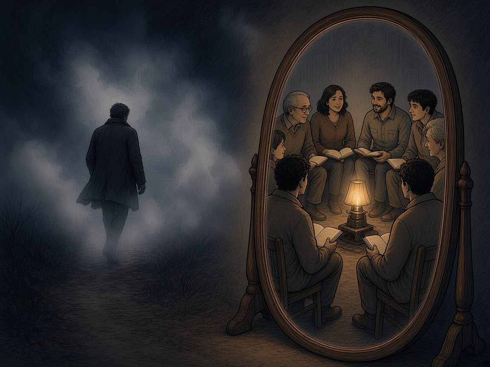

# XVIII PEATÜKK — Kajakamber: kas Putin usub oma valet?

Igal hommikul avab üks mees Moskvas paberkaustad. Selles peatükis küsime lihtsa küsimuse, millele on raske vastata: **kas Putin usub oma valet?** Või õigemini: kas see, mis algas teadliku valena, võib ajapikku muutuda siiraks veendumuseks, kui kõik ümberringi kordavad sama juttu?

**Renee hinnang:** Putin usub siiralt, et Ukraina on ajutiselt „ära antud” Vene territoorium, mis tuleb tagasi võtta. Balti riike ja Poolat näeb ta teistmoodi: need on võõrad, mitte „oma”. See on Renee tunnetus, mitte tõestatud fakt. Allpool vaatame, mida ütlevad dokumendid ja analüüsid.

### Mida on kirjas

**Fakt:** 12. juulil 2021 avaldas Putin Kremli kodulehel pika essee „Venelaste ja ukrainlaste ajaloolisest ühtsusest”. Selles väidab ta, et venelased ja ukrainlased on „üks rahvas” ja et tänapäeva Ukraina on suures osas nõukogude aja looming. Seitse kuud hiljem algas täiemahuline sissetung.

*Kaart laual ja täht ühe piirkonna peal: „see on meie oma”. Kujutis on üldine, mitte kellegi portree.*

**Fakt:** 5. detsembril 1994 allkirjastati **Budapesti memorandum**. Ukraina loobus tuumarelvadest, mis olid jäänud tema territooriumile pärast Nõukogude Liidu lagunemist. Venemaa, USA ja Suurbritannia kinnitasid, et austavad Ukraina iseseisvust, suveräänsust ja olemasolevaid piire. 31. mail 1997 allkirjastasid Venemaa ja Ukraina **sõpruse, koostöö ja partnerluse lepingu**, mis tunnustas olemasolevate piiride puutumatust. Kõik see sisaldas ka Krimmi.

**Fakt:** 2014. aasta märtsis annekteeris Venemaa Krimmi. 24. veebruaril 2022 algas täiemahuline sissetung Ukrainasse. Paberid, millele Moskva oli alla kirjutanud, ei peatanud seda. See ei tõesta, kas Putin uskus oma essee juttu. See tõestab, et allkiri ei olnud tema jaoks takistus.

### Mida ütleb teadus Putini mõtlemise kohta

Stephen Dyson ja Matthew Parent avaldasid 2017. aastal ajakirjas *Intelligence and National Security* nn **operatiivkoodi analüüsi** Putini kohta. Nad kogusid kõik, mida Putin oli 13 välispoliitilisel teemal avalikult öelnud alates esimesest päevast kohusetäitjana kuni 2016. aasta lõpuni: 1 057 709 sõna. Tulemus oli üllatavalt igav: Putini uskumused rahvusvahelise poliitika kohta olid enamasti tavapärased. Erandid olid **ülimalt agressiivne hoiak terrorismi suhtes** ja **hämmastav kinnisidee poliitilisest kontrollist**. Autorite kokkuvõte: Putin on oportunist, mitte strateeg. Ehk teisisõnu: mitte malemängija, vaid inimene, kes haarab võimaluse, kui see tekib.

### Kajakamber

*Kajakamber: kui igaüks ümberringi noogutab, kõlab ka oma vale nagu tõde. Kujutis on üldine, mitte kellegi portree.*

Boriss Bondarev töötas Venemaa välisministeeriumis aastatel 2002–2022, viimati nõunikuna ÜRO Genfi esinduses. 2022. aasta mais astus ta sõja vastu protesteerides tagasi. Sama aasta sügisel kirjeldas ta ajakirjas *Foreign Affairs*, mis juhtub, kui valitsust moonutab aeglaselt tema enda propaganda: *„Lõpuks ei olnud selle propaganda sihtrühm mitte ainult välisriigid, vaid meie oma juhtkond.”* Diplomaadid pidid Kremlile teatama, et maailm on Venemaa suuruses veendunud. Tema sõnul ütlesid Kremli kolleegid talle korduvalt, et Putinile meeldib välisminister Sergei Lavrov, sest temaga on „mugav” töötada: ta ütleb alati jah ja räägib seda, mida president kuulda tahab. Bondarevi järeldus: pole ime, et Putin arvas, et Kiievi alistamine on lihtne.

*The Washington Post* kirjutas 13. detsembril 2025 (Mary Ilyushina), et Putini 25 valitsemisaasta jooksul on teda ümbritsevate arvamuste ring dramaatiliselt ahenenud. Kindralid ütlevad, et kõik sõja eesmärgid saavutatakse. Majandusteadlased ütlevad, et majandus peab vastu. Lehe andmetel oli enne sissetungi peetud julgeolekunõukogu istungil ainus vastuvaidleja kauaaegne abi Dmitri Kozak. Tema märkused telepilti ei jõudnud.

Kuidas info presidendini jõuab? Analüüsiportaal *Geopolitical Monitor* kirjutas 2026. aastal, et Putin **väidetavalt** ei kasuta internetti ja saab info ainult ettevalmistatud kaustade kaudu, mis liiguvad läbi presidendi administratsiooni. Kes kontrollib kaustu, kontrollib presidendi pilti maailmast. **Ausalt:** see on teiste allikate kaudu korratud väide. Endine Kremli ihukaitseteenistuse ohvitser Gleb Karakulov ütles 2023. aastal, et Putin ei kasuta internetti ega mobiiltelefoni. Kremli pressiesindaja Dmitri Peskov ütles 2018. aastal, et telefoni Putinil ei ole, aga ta võib internetti ise arvutis sirvida. Kaustad on kinnitatud, interneti täielik puudumine mitte.

### Kuidas vale muutub tõeks

*Peeglite koridor: üks hääl, mis kordub, kuni see kõlab nagu kogu maailm.*

Hannah Arendt kirjutas 1951. aastal raamatus „Totalitarismi päritolu”: *„Totalitaarse võimu ideaalne alluv ei ole veendunud natsi ega veendunud kommunist, vaid inimene, kelle jaoks fakti ja väljamõeldise vahet ei ole enam olemas.”* Arendt kirjutas alluvast. Selle peatüki küsimus on, kas sama võib juhtuda ka valitsejaga, kelle ümber on 25 aastat ainult kinnitavad hääled.

Carnegie sihtasutuse analüütik Eugene Rumer kirjutas 2026. aasta märtsis ja aprillis, et Putin alustas sõda väära ettekäändega, et iseseisev Ukraina ohustab Venemaad. Sõda muutis Ukraina Venemaa leppimatuks vaenlaseks ja äratas Euroopa ohule. Rumeri sõnul on need täielikult enda tekitatud strateegilised vead. Tema sõnul on Putinil Ukraina suhtes pimetähn: ta ei näe, et Ukrainal on oma tahe, ja peab seda vaenuliku Euroopa etturiks. **Tõlgendus (meie sõnastus, mitte Rumeri tsitaat):** see on eneseteostuv ennustus. Kes kardab vaenlast ja ründab, see loob endale vaenlase.

**Selle peatüki järeldus (tõlgendus):** algus oli tõenäoliselt küüniline, sest essee, memorandumi rikkumine ja „rahuvalvajad” on poliitilised tööriistad. Kuid kajakamber, kus 25 aastat keegi ei julge vastu vaielda, võib osa valest muuta valetaja jaoks tõeks. Bondarev kirjeldas sama protsessi seestpoolt. Täpselt ei tea seda keegi peale Putini enda ja tema ei räägi.

### Ellujäämise matemaatika

Siin on Renee mõte, mis ei vaja allikat, vaid ainult loogikat. Üksikinimese jaoks on ratsionaalne ellu jääda: mitte surra võõra ideoloogia eest, hoida oma peret ja kodu. Riik nõuab aga ohvrit: mine, võitle, sure. Need kaks loogikat lähevad vastuollu. Kõige teravamalt näeb seda selle järgi, kes läheb rindele ja kes mitte. **Fakt:** otsuse teinud juht ise rindele ei lähe. Ohvri toovad teised.

*Ellujäämine ja ohver: sõdur kaevikus pere fotoga, juht kaugel soojas lossis.*

### Kuidas see sinuni jõuab

Tüüpiline näide: X-is levis postitus, kus madala kvaliteediga video esitas Putinit kui ainsat, kes maailmas rahu eest seisab. Autori nime me siin ei nimeta, sest asi ei ole ühes inimeses. Asi on kanalis: lühike video, tugev emotsioon, lihtne kangelane ja lihtne süüdlane. Peatüki XIII seitse küsimust kehtivad siin täies ulatuses. Kajakamber ei ole ainult Kremlis. Iga uudisvoog, kus kõik on sinuga nõus, on väike kajakamber.

### Vastus: operatsioon „Peegel”

*Peegel kajakambri vastu: väike ring inimesi, raamatud, aknal puu. Siin vaieldakse ja kuulatakse.*

Kajakambri vastand ei ole teine kajakamber. See on peegel: koht, kus näed iseennast ja kuuled ka seda, mida kuulda ei taha. Renee on kirja pannud **operatsiooni „Peegel”** viiepunktilise lahingukäsu (OPORD) vormis. Selle põhimõte on: *„Ära usu mind. Kaitse oma uskumusi. Tee uuringud.”*

1. **Olukord.** Tulemused, mitte süüdistused. Statistikaameti andmetel oli Eesti summaarne sündimuskordaja 2025. aastal **1,16** (2024. aastal 1,18), taastootmiseks oleks vaja umbes 2,1. Üksikvanemaga pered on suuremas vaesusriskis kui kahe vanemaga pered. Usaldus valitsuse vastu on madal. Noortel on raske kodu soetada.

2. **Põhiülesanne.** Taastada Eesti rahva inimlikkus iga kodaniku isikliku paranemisteekonna kaudu.

3. **Täitmine.** Põhialused on uni, toit, keha, suhted, lapsed ja juhtimine. Trauma puhul on aluseks traumateadlikkus (Bessel van der Kolk, „Keha peab arvet”; selle raamatu kohta tehtud kriitika on kirjas peatükis XII). Laste puhul Montessori lähenemine: laps ei ole projekt, vaid isiksus. Juhtimise puhul *Extreme Ownership* (Jocko Willink): sa ei saa juhtida teisi, kui sa ei suuda juhtida iseennast. Nimekirjas on ka Steigeri „Inimesekeskne juhtimine”.

4. **Teenindus ja logistika.** Taskukaardid, SOP-id, raamatuklubid (vt peatükk XVII) ja avalik leht **operatsioon-peegel.vercel.app**.

5. **Juhtimine ja side.** Ülesande täitjad on kodanikud. Igaüks on oma üksuse juht.

**Mõõdikud (KPI-d):** sündimuskordaja, üksikvanemate vaesusrisk ja usaldus. Need on numbrid, mida saab iga aasta Statistikaametist üle kontrollida. Kui need ei liigu, ei tööta ka operatsioon, olgu sõnad kui ilusad tahes.

*Peegli teekond: pimedusest välja peegli poole, kus ootab ring inimesi, raamatuklubi ja Kaitseliidu kaaslased.*

Siin sulguvad kolm peatükki. Peatükk XIII näitas, kuidas võõras mõte muutub sinu omaks. Peatükk XVII näitas, et keskkond kujundab mõtteid. See peatükk näitab, mis juhtub, kui keskkond on ainult kaja. Kremli jaoks on liiga hilja. Meie jaoks mitte.

### Peatüki allikad

1. V. Putin, „Об историческом единстве русских и украинцев” (kremlin.ru, 12.07.2021).

2. Budapesti memorandum (05.12.1994, ÜRO dokumendid); Venemaa–Ukraina sõpruse, koostöö ja partnerluse leping (31.05.1997).

3. S. B. Dyson ja M. J. Parent, „The operational code approach to profiling political leaders: understanding Vladimir Putin”, *Intelligence and National Security* (2017), doi 10.1080/02684527.2017.1313523.

4. B. Bondarev, „The Sources of Russian Misconduct”, *Foreign Affairs* (2022); RFE/RL ja AP (mai 2022).

5. M. Ilyushina, „With an army of yes-men, how Putin's world turned into an echo chamber”, *The Washington Post* (13.12.2025).

6. „Is Elite Information War Hollowing Out the Russian State?”, *Geopolitical Monitor* (2026); Newsweek / Dossier Center, G. Karakulov (2023); D. Peskov, Rossija 24 (2018).

7. E. Rumer, „Belligerent and Beleaguered: Russia After the War with Ukraine” (Carnegie, 19.03.2026) ja „Russia Will Be More Dangerous After the War with Ukraine” (Carnegie Emissary, 06.04.2026).

8. H. Arendt, „The Origins of Totalitarianism” (1951).

9. Statistikaamet, „Sünnid” ja rahvastiku uudis (2026): summaarne sündimuskordaja 2025.

10. Renee Aluste, „OPERATSIOON PEEGEL — OPORD (paranemis-teekond)” (Google Drive, 2026) ja operatsioon-peegel.vercel.app. Renee hinnangud on märgitud hinnanguna.

> **9J.** Lisareegel: Kui kõik ümberringi on sinuga alati nõus, ei ole sa juht, vaid kaja. Hoia enda ümber inimesi, kes julgevad öelda „ei”, ja kontrolli kaustu, mida sulle tuuakse.
