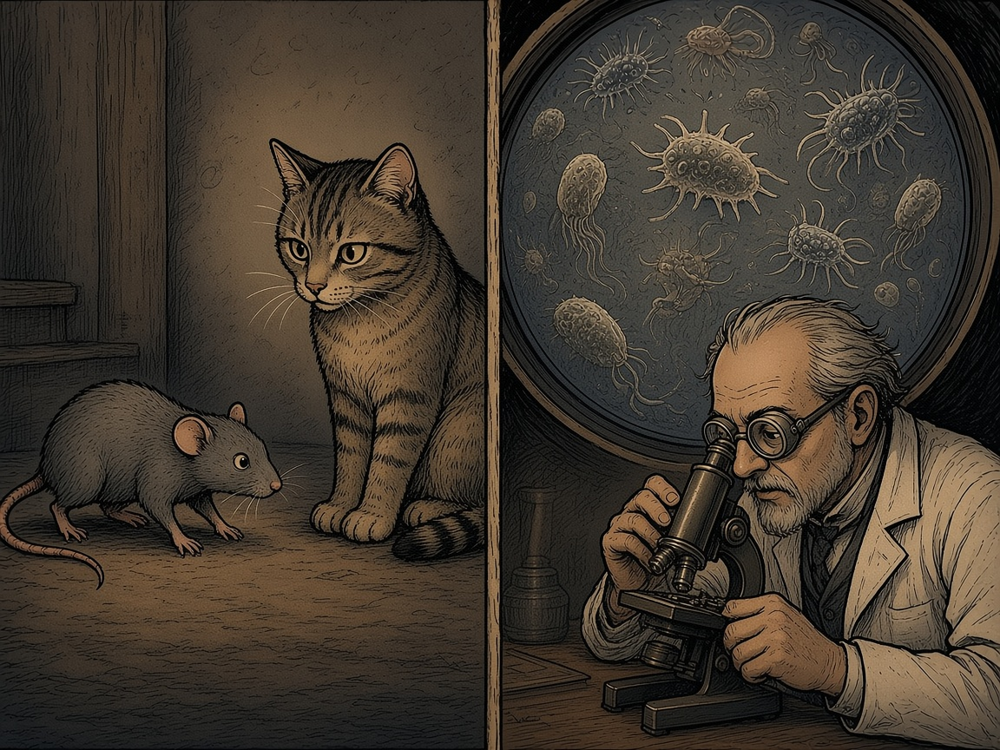

# XV PEATÜKK — Nähtamatud reisijad: parasiidid, mikroobid ja inimese käitumine

Selles raamatus on palju nähtamatuid tegijaid: varifirmad, nominaalhoidjad ja trollikontod. See peatükk räägib kõige väiksematest. Mõned organismid elavad inimese sees ja mõned neist mõjutavad tõesti aju. Internetis tehakse sellest suuri järeldusi, näiteks et „parasiit juhib poolt planeeti”. Renee kirjutas 2026. aasta oktoobris raporti, kus iga väide sai märke. Need märked on siingi:

**TÕESTATUD** — põhjus ja tagajärg on selgelt näidatud. **SEOS** — kaks asja esinevad sageli koos, kuid üks ei pruugi põhjustada teist. **VÄIDE** — keegi ütleb nii, kuid tõendeid on vähe, need on vastuolulised või puuduvad.

### Rott, kes ei karda kassi

**TÕESTATUD (loomadel):** üherakuline parasiit *Toxoplasma gondii* saab paljuneda ainult kassi sooles. Oxfordi uuringus (Berdoy jt 2000) väldivad terved rotid kassi uriini lõhna, nakatunud rotid aga mitte. Osa neist eelistas isegi kassi lõhnaga kohta. Nii jõuab parasiit kergemini kassi kõhtu. Teadlased peavad seda „peremehe manipuleerimise” klassikaliseks näiteks.

*Rott, kes ei karda kassi: toksoplasma mõju rottide käitumisele on tõestatud. Inimeste kohta on leitud ainult seoseid.*

### Iga teine eestlane

**TÕESTATUD:** 2016. aasta uuringus oli toksoplasma antikehad **55,8%** Eesti täiskasvanutest (n = 999). Maailmas on see umbes 26%, Euroopas umbes 30%. Väide „üle poole planeedist on nakatunud” ei pea paika. Eestis on aga tõesti umbes iga teine inimene parasiidiga kokku puutunud. Tartus oli levik üle kahe korra suurem kui Uppsalas. Enamikul nakatunutel ei ole mingeid sümptomeid.

### Mida see inimesega teeb

**SEOS:** 50 uuringu meta-analüüsis (Sutterland jt 2015) oli toksoplasma antikehadega inimeste seas skisofreeniat sagedamini: šansisuhe 1,81, pärast avaldamisnihke parandust 1,43. Liiklusõnnetuste kohta leiti 11 uuringu põhjal šansisuhe 1,69. Ettevõtlusüliõpilaste uuringus olid nakatunud sagedamini äri erialal. **Need on seosed, mitte põhjused.** Taga võivad olla elutingimused, toitumine, loomadega kokkupuude või vaesus. Ka uurijad ise rõhutavad seda.

**Vastutõend:** Uus-Meremaa Dunedini kohordi uuring (Sugden jt 2016, 837 inimest) ei leidnud seost skisofreenia, depressiooni, kuritegevuse, impulsiivsuse ega IQ-ga. Tšehhi Jaroslav Flegri isiksuseuuringud olid väikese valimiga ja testisid palju omadusi korraga.

**VÄIDE:** et toksoplasma muudab dopamiini kaudu inimese iseloomu. Parasiidil on geenid, mis toodavad dopamiini eelainet L-DOPA-t, kuid hiireuuringus ei muutnud ühe geeni eemaldamine looma dopamiini ega käitumist. Mehhanism on lahtine.

### Need, mis päriselt aju kahjustavad

**TÕESTATUD:** mõned organismid mõjutavad aju kindlasti. **Puukentsefaliidi viirus**: Eestis oli 138 juhtu 2024. aastal ja 143 juhtu 2025. aastal, mis on üks Euroopa kõrgemaid näitajaid. Läti uuringus oli peaaegu pooltel haiglapatsientidest püsivad tagajärjed, näiteks keskendumisraskus ja väsimus. **Borrelia** (Lyme'i tõbi): Eestis 3843 juhtu 2024. aastal ja 3276 juhtu 2025. aastal. Neuroborrelioos võib põhjustada närvipõletikku ja näonärvi halvatust. **Sea paeluss** ajus põhjustab WHO järgi kuni 30% epilepsiast piirkondades, kus see levib. Eestis kinnitatud juhte uuringus ei olnud. Siia kuuluvad ka marutaud, neurosüüfilis ja ajumalaaria.

Puugid on selles loetelus kõige eestimaisemad. Nendega algab järgmine peatükk.

### Hallitus, lestad ja seened

**SEOS:** niiske ja hallitanud kodu on seotud halvema vaimse tervisega, umbes 1,3–1,4 korda suurema depressiooni šansiga. Põhjuslikkust ei ole tõestatud. **VÄIDE, mis ei leidnud kinnitust:** „90–97% Eesti majadest on musta hallitusega”. Eesti uuringus oli 97% hoopis kaebus umbse õhu üle. Hallituse üle kaebas 43%. Kogu Eestis elab niiskes või lekkivas kodus 10,5% inimestest.

**TÕESTATUD:** ripsmelestad (*Demodex*) elavad peaaegu kõigil täiskasvanutel. Need on lestad, mitte ussid, ja käitumist nad ei mõjuta. **VÄIDE (müüt):** et „zombiseen” *Cordyceps* võib nakatada inimest. See on sarja- ja mängulugu, mitte bioloogia.

### Luure ja relvad

**Mida ei leitud:** ühtegi dokumenteeritud uuringut ega programmi, kus toksoplasmat oleks kasutatud inimeste käitumise mõjutamiseks või relvana. Sõjandusega seotud uuringud käsitlevad sõdurite tervist, näiteks Tšehhi sõjaväeautojuhte. Kui keegi räägib „luureoperatsioonist”, tuleb küsida allikat.

### Miks see on raamatus

Nähtamatu reisija on hea kujund kõige selle kohta, mida see raamat uurib. Mõju võib olla päris ka siis, kui seda ei näe. Aga seose ja põhjuse vahel on sama suur vahe kui kahtluse ja süüdistuse vahel.

### Peatüki allikad

1. Lassen jt 2016 (Eesti seroepidemioloogia); Birgisdóttir jt 2006; Molan jt 2019.

2. Berdoy, Webster, Macdonald 2000 (Proc R Soc B).

3. Torrey jt 2007; Sutterland jt 2015 ja 2019; Burgdorf jt 2019; Flegr jt 2002; Johnson jt 2018; Sugden jt 2016 (Dunedin).

4. Terviseamet, nakkushaiguste statistika 2024–2025; WHO (tsüstitserkoos, malaaria); Läti puukentsefaliidi uuring.

5. Eesti siseõhu ja paneelmajade uuringud; Statistikaamet (niiske eluase 10,5%).

6. Renee raport „Parasiidid, mikroobid, hallitus ja inimese käitumine” (07.10.2026).

> **9G.** Lisareegel: Seos ei ole põhjus. Märgi iga väite juurde, kas see on tõestatud, seos või väide — sama vahe on kahtlusel ja süüdistusel.
