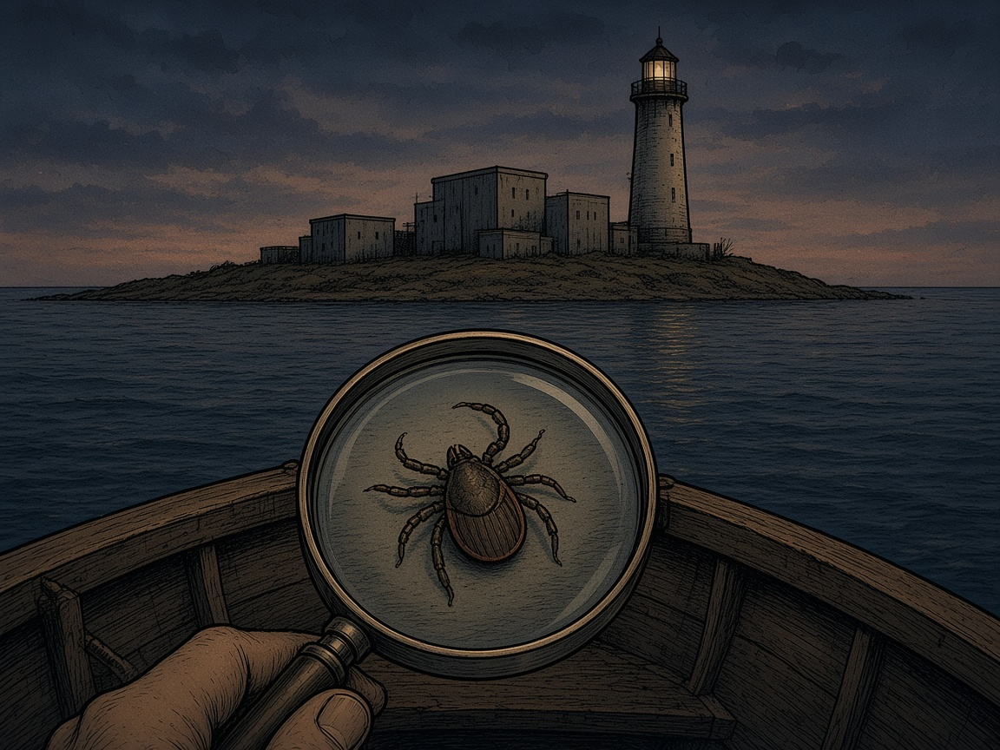

# XVI PEATÜKK — Saar, kust puugid tulid: Plum Island, borrelioos ja uurimine, mis on alles pooleli

Selles raamatus on juba üks saar. Utö on Soome saarestiku välisserval, kus 1994. aasta septembriöö kriisis oli koht majakal ja raadiojaamal. Teine saar asub teisel pool ookeani, New Yorgi osariigis Long Islandi idatipu lähedal. Selle nimi on **Plum Island**. Ka seal on majakas. Ja ka selle saare ümber on aastakümneid räägitud lugu, mida pole keegi tõestanud.

*Plum Island: madal saar, laborihooned ja majakas. Puugi ja saare seos on VÄIDE, mida tõendid ei toeta.*

### Mis saarel tegelikult oli

**LEID:** Plum Islandil asus USA loomahaiguste uurimiskeskus (*Plum Island Animal Disease Center*). DHS-i andmetel uuriti seal loomade haigusi, näiteks suu- ja sõrataudi ning Aafrika seakatku. DHS-i sõnul ei uuritud seal inimeste puugihaigusi ega borrelioosi. Teadustöö saarel lõppes septembris 2025 ja diagnostika oktoobris 2026. Saaste puhastamine kestab DHS-i järgi 2031.–2034. aastani. Töö kolib Kansasesse uude laborisse (NBAF), mis 2026. aasta augusti seisuga veel täies mahus ei töötanud.

### Väide

**VÄIDE:** et borrelioos ehk Lyme'i tõbi pärineb külma sõja aegsest relvaprogrammist ja pääses Plum Islandilt välja. Seda on levitanud raamatud ja poliitikud. Kris Newby raamat „Bitten” (2019) tugineb borrelioosi bakteri avastaja Willy Burgdorferi intervjuudele. Raamatu arvustaja hinnangul ja autori enda tunnistusel kindlat tõendit lekke kohta ei ole. Väidet on korranud ka Robert F. Kennedy Jr ja Tucker Carlson.

### Mida teadlased vastavad

**LEID:** borrelioosi bakter on palju vanem kui labor. Seda on leitud vanadest puukidest ja 5300 aasta vanusest muumiast. Esimene USA haigusjuht diagnoositi 1969. aastal Wisconsinis, kaugel Plum Islandist. Puugiteadlane Sam Telford (Tuftsi ülikool) kirjutas Washington Postis, et bakteri geenid ei näita levikut ühest laborist. PolitiFact hindas Tucker Carlsoni väite 2024. aastal täiesti valeks („Pants on Fire”).

### Mida Kongress tegelikult otsustas

See on koht, kus fakt ja väide kõige kergemini segamini lähevad. **LEID:** 2019. aastal kiitis USA Esindajatekoda heaks kongresmen Chris Smithi paranduse, mille järgi pidi Pentagoni peainspektor uurima, kas aastatel 1950–1975 katsetati puuke relvana. See parandus võeti lõplikust seadusest välja. 2025. aasta detsembris lisati 2026. aasta kaitse-eelarve seadusse (NDAA, §1068) uus ülesanne: riigikontroll GAO peab uurima, kas USA sõjavägi katsetas aastatel 1945–1972 puuke bioloogilise relvana. Aruanne peab valmima umbes 2027. aasta keskel. **Tulemust veel ei ole.**

Uurimise tellimine ei ole tõend. See tähendab ainult, et küsimus on ametlikult esitatud. Vastus võib olla ükskõik milline. Seni jääb relvaväide **VÄITEKS**.

### Miks see lugu ei sure

Kohalik teadlane nimetas borrelioosi lugu CT Posti artiklis müüdiks, mis sündis külma sõja aegsest salastatusest. **Tõlgendus:** kui riik hoiab saart aastakümneid suletuna ega räägi, mida seal tehakse, täidab vaikuse inimeste kujutlusvõime. Kümnes reegel ütleb, et saladus, mida kõik teavad, on kokkulepe vaikida. Plum Island näitab ka teist poolt: vaikus sünnitab lugusid, mis elavad kauem kui saladus ise.

### Kaks saart

Utö ja Plum Island ei ole omavahel seotud. Neid ei ühenda ükski dokument ega sündmus. Raamatus on nad kõrvuti ühel põhjusel. Mõlemal saarel juhtus midagi, mille ümber tekkis rohkem küsimusi kui vastuseid. Utö peatükis jäid lahtiseks mõned küsimused Estonia kohta. Plum Islandi peatükis jääb lahtiseks GAO aruanne. Mõlema puhul kehtib sama reegel: kinnitamata väide jääb väiteks seni, kuni dokument selle kinnitab. Ja dokument, mis väidet ei kinnita, on samuti vastus.

Täna on Plum Islandi tulevik lahtine. Suffolki maakond ja 130 organisatsioonist koosnev koalitsioon tahavad saare looduskaitse alla võtta. Föderaalvalitsus võib saare 2027. aasta alguses üleliigseks kuulutada. Majakas jääb alles. See ei tea midagi puukidest.

### Peatüki allikad

1. DHS, Plum Island Animal Disease Center (dhs.gov).

2. Stars and Stripes (23.01.2026); E&E News / POLITICO (16.12.2025 ja 11.12.2024): NDAA 2026 §1068 ja GAO ülesanne.

3. Newsday (12.04.2025 ja 15.07.2026); CT Post (08.04.2025 ja 24.07.2026); The East Hampton Star (23.07.2026); The Suffolk Times (02.09.2025); Kansas Reflector (18.08.2026).

4. PolitiFact (16.05.2024); The Washington Post (S. Telford, 11.08.2019; 17.07.2019); CNN (17.07.2019); Roll Call (15.07.2019); Portland Press Herald (17.09.2021).

5. Outside (29.05.2019), arvustus K. Newby raamatule „Bitten”.

6. Renee ülevaade „Plum Island ja puugid: uudised USA meedias” (07.10.2026).

> **9H.** Lisareegel: Uurimise tellimine ei ole tõend. Vaikus sünnitab lugusid — vasta neile dokumentidega, mitte uute lugudega.
