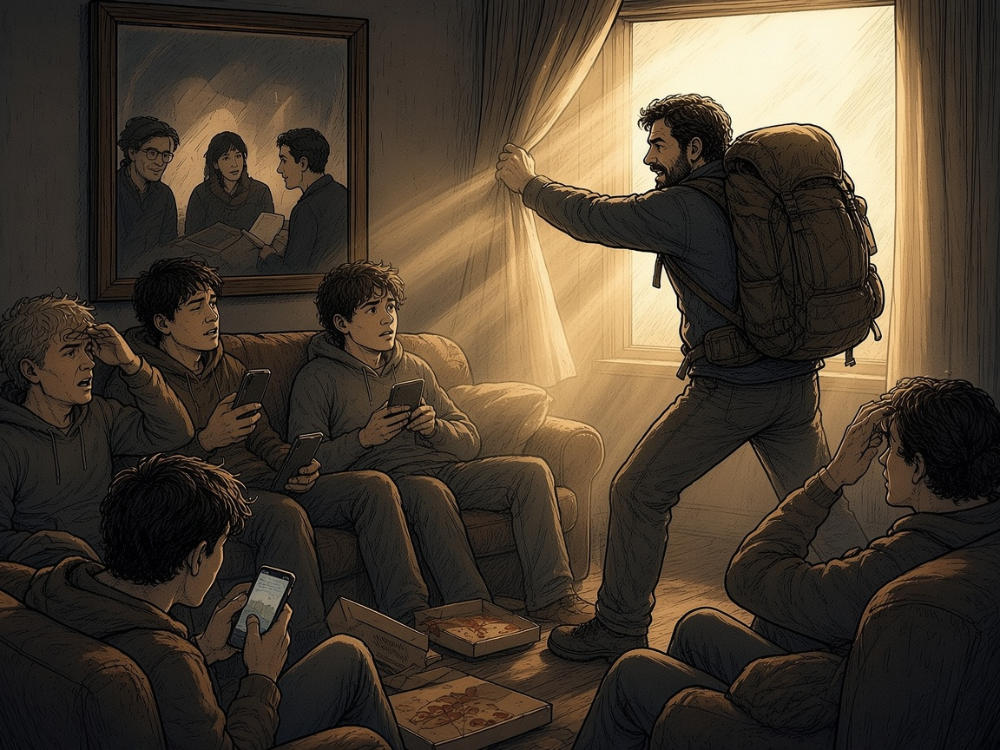
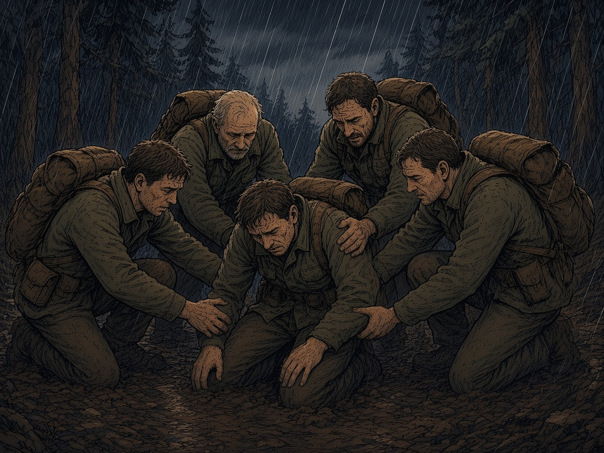

# XIX PEATÜKK — The Path: mees peab minema välja

See peatükk algab nagu halb anekdoot. Kõrge testosterooniga mees astub tuppa, kus diivanil istub viis madala testosterooniga poissi. Kardinad on ees, põrandal on pitsakarbid, telefonide ekraanid helendavad. Mees tõmbab kardinad eest. Keegi kissitab silmi ja keegi küsib: „Kes sa oled?” Üks poiss tõuseb püsti.

Naljakas on see, et selle anekdoodi taga on päris teadus. Veel naljakam on see, et teadus ütleb midagi muud, kui anekdoot arvab.

### Fakt: testosteroon langeb

Thomas Travison ja kolleegid avaldasid 2007. aastal ajakirjas *Journal of Clinical Endocrinology & Metabolism* Massachusettsi vananevate meeste uuringu (MMAS) tulemused. Uuringus osales 1532 Bostoni piirkonna meest vanuses 45–79 ja neilt koguti 2769 mõõtmist aastatel 1987–2004. Samavanuste meeste testosteroon langes aasta-aastalt umbes **1,2% aastas**. Kui arvestada tervist ja eluviisi, sealhulgas suitsetamist ja ülekaalu, jäi langust ikka umbes 1% aastas. Ehk 2003. aasta 65-aastasel mehel oli testosterooni vähem kui 1988. aasta 65-aastasel.

Soum Lokeshwar ja kolleegid vaatasid 2021. aastal (*European Urology Focus*) USA riikliku terviseuuringu NHANES andmeid 4045 noore mehe kohta vanuses 15–39. Keskmine üldtestosteroon langes **605 ng/dl-lt (1999–2000) 451 ng/dl-ni (2015–2016)**. Kehamassiindeksi kasv selgitab osa langusest, kuid langus oli olemas ka normaalkaalus meestel: 665-lt 529-le. **Ausalt:** mõõtmismeetodid muutusid vahepeal ja autorid ise nimetavad seda piiranguks. Need on USA andmed. Eesti kohta sarnast aegrida me ei leidnud.

### Fakt: testosteroon reageerib keskkonnale

Siin muutub anekdoot huvitavaks. Allan Mazur ja Alan Booth kirjutasid 1998. aastal ajakirjas *Behavioral and Brain Sciences* ülevaate „Testosteroon ja domineerimine meestel”. Nende peamine järeldus on, et testosteroon ei ole ainult geenides kirjas. See tõuseb ja langeb vastavalt sellele, mis toimub. Võistluse eel see tõuseb. Pärast võitu jääb see kõrgeks, pärast kaotust langeb. Sama juhtub isegi siis, kui mees ainult vaatab, kuidas tema meeskond võidab. John Archer kirjeldas 2006. aastal nn väljakutse hüpoteesi: hormoon reageerib sotsiaalsele väljakutsele ja staatusele.

Ja nüüd üks fakt, mis anekdoodi pea peale pöörab. Lee Gettler ja kolleegid jälgisid 2011. aastal (*PNAS*) Filipiinidel 624 meest. Need mehed, kellest said isad ja kes hoolitsesid laste eest, kaotasid testosterooni rohkem kui mehed, kellest isa ei saanud. Bioloogia ise ütleb, et pühendunud mehe hormoonid kohanevad. **Järeldus:** testosteroon ei ole võluvõti ega mehelikkuse mõõdupuu. Ta on termomeeter, mis näitab keskkonda. Kui keskkond on diivan ja ekraan, siis termomeeter seda ka näitab.

*Faktiline paroodia: mees seljakotiga tõmbab kardinad eest. Valgus ei paranda kedagi, aga sellest saab alguse küsimus „mis väljas on?”.*

### Fakt: mehed on üksi

Ameerika elu-uuringute keskus (Survey Center on American Life) küsitles 2021. aasta mais 2019 täiskasvanut. **15% meestest** vastas, et neil ei ole ühtegi lähedast sõprust. 1990. aastal oli selliseid mehi 3%. Lähedaste sõprade arv vähenes enim just meeste seas.

Kas see on ainult kurb või ka ohtlik? Julianne Holt-Lunstad koondas 2010. aastal (*PLoS Medicine*) **148 uuringut 308 849 osalejaga**. Tugevamate suhetega inimestel oli uuritud perioodil umbes **50% suurem tõenäosus ellu jääda**. Selle mõju suurus on võrreldav suitsetamisest loobumisega ja suurem kui ülekaalul või liikumisvaegusel.

Harvardi täiskasvanute arengu uuring algas 1938. aastal 724 noormehega: 268 Harvardi tudengit ja 456 Bostoni vaesemate linnaosade poissi. Uuringut on juhtinud mitu põlvkonda teadlasi, praegu Robert Waldinger. Tema kokkuvõte pärast üle 80 aasta: rohkem kui raha või kuulsus hoiavad inimest õnneliku ja tervena head suhted.

Robin Dunbar arvutas 1990. aastatel, et inimene suudab hoida umbes **150** stabiilset suhet. Need jagunevad kihtideks: umbes 5 väga lähedast, 15 head sõpra, 50 sõpra ja 150 tuttavat. Need viis kohta täituvad mehe elus tihti pelgalt naise, ema ja juhuslike inimestega. Ülejäänud kohad jäävad tühjaks, kui ise neid täitma ei lähe.

### Seega: mees peab minema välja

Siin ühenduvad varasemad peatükid. Peatükk XVII ütles, et keskkond kujundab inimest. Peatükk XVIII näitas, mis juhtub, kui ümberringi on ainult kaja. See peatükk ütleb lihtsalt: **mees vajab enda ümber teisi mehi** ja keegi ei too neid talle koju kätte. Uus keskkond tuleb ise üles otsida.

### Teekond ümber maailma

Kujutle seda kui reisi ümber maailma, kus igal etapil on oma sadam.

1. **Lahkumine.** Diivanilt püsti tõusmine. See on kõige raskem etapp, sest midagi ei juhtu veel. Lihtsalt uks läheb lahti.

2. **Esimene sadam: võõrad mehed.** Koht, kus keegi ei tea su minevikku. Sinult küsitakse ainult, kas sa suudad kaasa tulla.

3. **Torm.** Esimene kord, kui jõud saab otsa, kui vihma sajab ja kott on raske. Siin selgub, kas nõrkus jääb varju või tuleb päevavalgele.

4. **Meeskond.** Teised aitavad püsti. Edaspidi aitad sina neid.

5. **Kaardiruum.** Raamatuklubi, kus loetakse, vaieldakse ja kontrollitakse (vt peatükk XVII: Hilli Master Mind, Steigeri inimesekeskne juhtimine).

6. **Kojutulek.** Mees tuleb tagasi oma pere ja töö juurde teistsugusena. Mitte kõvemana, vaid kindlamana.

### Kaitseliit: keskkond, kus nõrkus ei jää varju

Miks just Kaitseliit? Sest see on üks väheseid kohti Eestis, kus eri vanuses ja eri taustaga mehed ja naised teevad vabatahtlikult koos füüsiliselt rasket tööd ühise eesmärgi nimel. Metsas pole tähtis, kui palju sa teenid või mitu jälgijat sul on. Tähtis on, kas sa suudad kaasa tulla ja kas sa aitad teist. Nõrkus ei jää seal varju. See tuleb välja ja seda treenitakse.

*Torm: üks põlvitab mudas, teised tõstavad ta püsti. Sellest saab alguse meeskond.*

**Renee lugu (isiklik kogemus, mitte ametlik seisukoht):** Renee läbis Kaitseliidu Harju malevas sõdurioskuste kursuse. Tema sõnul ei olnud kõige olulisem relv ega rännak, vaid inimesed. Seal olid mehed, kes märkasid, kui keegi jäi maha. Seal olid mehed, kes ütlesid otse, mitte selja taga. Seal oli keskkond, kus enda eest vastutamine oli normaalne, mitte erand. Tema kogemus kattub sellega, mida ülal kirjeldatud uuringud näitavad: kui keskkond muutub, muutub ka inimene.

### Mis see EI ole

**Ausalt.** Kaitseliit ei ole teraapia ega asenda arsti ega psühholoogi. Testosteroon ei ole võluvõti ja hormoonide tarvitamine omal käel on ohtlik. Anekdoodi „kõrge T mees muudab poisid” teadus tegelikult ümber ei lükka, aga keerab selle teistpidi. Asja ei muuda mehe hormoonid, vaid see, et keegi tõi tuppa uue keskkonna. Ja poisid ei ole „nõrgad”. Nad on keskkonnas, mis ei nõua neilt midagi.

### Praktiline tee (60 päeva)

1. Esimesel nädalal vali üks koht, kus on teised mehed: Kaitseliit, spordiklubi, vabatahtlik päästeüksus või raamatuklubi.

2. 2.–4. nädal: käi kohal. Ära kohe midagi muuda, lihtsalt ilmu kohale.

3. 5.–8. nädal: võta üks kohustus, näiteks vastutus varustuse, toidu või järgmise kohtumise eest.

4. Iga nädal: kirjuta üles kolm nime, kellega rääkisid ausalt. Dunbari viis kohta täituvad nii.

### Peatüki allikad

1. T. G. Travison jt, „A Population-Level Decline in Serum Testosterone Levels in American Men”, *J Clin Endocrinol Metab* 92(1):196–202 (2007).

2. S. D. Lokeshwar jt, „Decline in Serum Testosterone Levels Among Adolescent and Young Adult Men in the USA”, *Eur Urol Focus* 7(4):886–889 (2021).

3. A. Mazur ja A. Booth, „Testosterone and dominance in men”, *Behavioral and Brain Sciences* 21:353–397 (1998).

4. J. Archer, „Testosterone and human aggression: an evaluation of the challenge hypothesis”, *Neurosci Biobehav Rev* 30:319–345 (2006).

5. L. T. Gettler jt, „Longitudinal evidence that fatherhood decreases testosterone in human males”, *PNAS* 108(39):16194–16199 (2011).

6. D. A. Cox, „The State of American Friendship: Change, Challenges, and Loss”, Survey Center on American Life (juuni 2021).

7. J. Holt-Lunstad, T. B. Smith, J. B. Layton, „Social Relationships and Mortality Risk: A Meta-analytic Review”, *PLoS Medicine* 7(7):e1000316 (2010).

8. R. Waldinger ja M. Schulz, „The Good Life” (2023); Harvard Study of Adult Development (alates 1938).

9. R. I. M. Dunbar, „Neocortex size as a constraint on group size in primates”, *J Hum Evol* 22:469–493 (1992); „How Many Friends Does One Person Need?” (2010).

10. Renee Aluste, isiklik kogemus Kaitseliidu Harju maleva sõdurioskuste kursusel (meenutus, mitte ametlik seisukoht).

> **9K.** Lisareegel: Sa ei leia oma meest diivanilt. Mine välja, leia mehed, kelle kõrval sa kasvad, ja ole ise see mees, kelle kõrval kasvab keegi teine.
