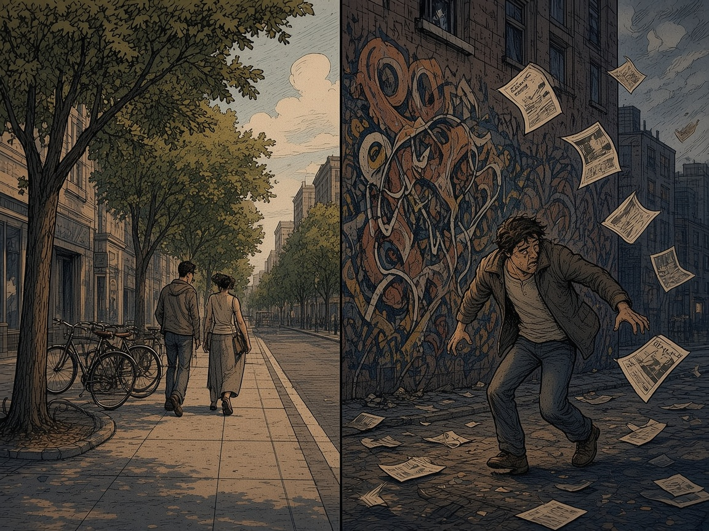
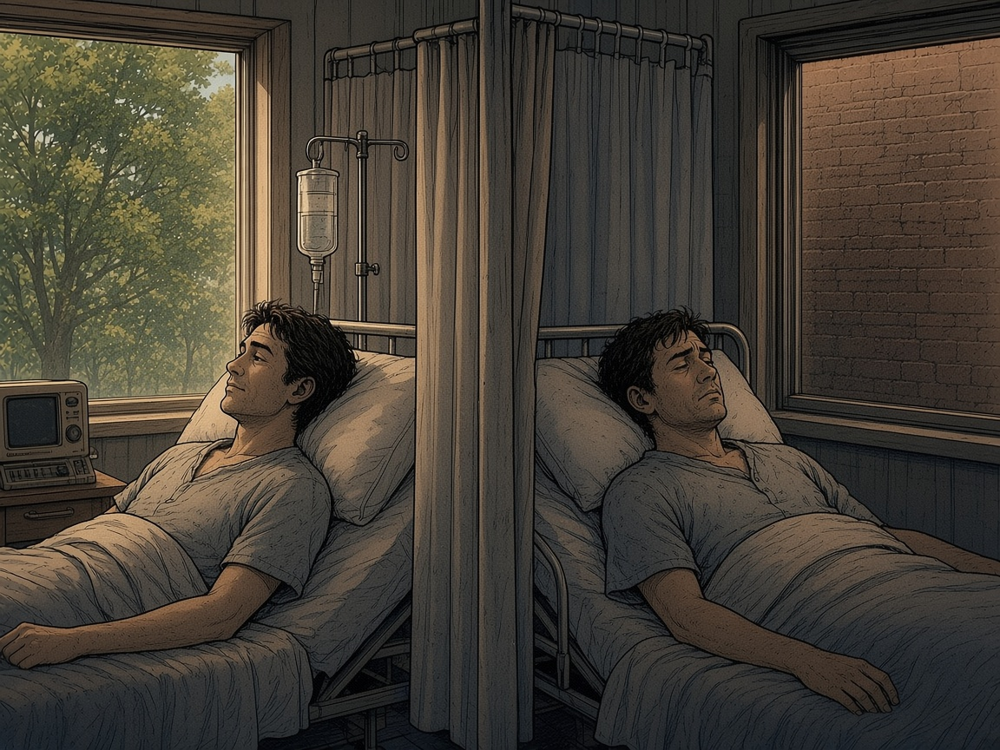

# XVII PEATÜKK — Vastuta keskkonna eest: miks inimese süüdistamine ei tööta

Renee ütles selle peatüki mõtte ühe hingetõmbega välja ja Tarmo kirjutas selle üles: *„Inimese süüdistamine ja tema eest vastutama panemine on haige lähenemine. Käitumine tuleb suures osas keskkonnast. Vastutada tuleb keskkonna kujundamise eest.”* Inimene näeb objekte ja sümboleid. Need käivitavad mõtteahela ja tunde. Kes kujundab keskkonda, see mõjutab, mida inimene mõtleb ja tunneb.

See on tugev väide. Selles peatükis on see pandud teaduse ette nagu sõdur rivi ette: mis peab vastu, mis mitte ja kus on piir. Ausalt öeldes: väide „inimene ei ole kunagi süüdi” teadusega ei kattu. Väide „keskkond kallutab käitumist rohkem, kui me tunnistada tahame, ja selle kujundaja kannab suurt vastutust” kattub väga hästi.

### Ahv, kes vaatas pähklit

1990. aastate alguses mõõtis Giacomo Rizzolatti rühm Parma ülikoolis makaakide ajukoore piirkonnas F5 üksikute närvirakkude tööd. Nad märkasid, et osa rakke aktiveerus nii siis, kui ahv ise haaras pähklit, kui ka siis, kui ahv **nägi**, kuidas seda teeb uurija. Tulemused avaldati 1992. ja 1996. aastal. Need rakud said nimeks **peegelneuronid**. Ajakirjandus kuulutas peagi, et need seletavad empaatiat, keelt, kultuuri ja võib-olla ka seda, miks me haigutame koos.

**Kriitika:** neuroteadlane Gregory Hickok kirjutas 2014. aastal raamatu „The Myth of Mirror Neurons”. Tema sõnul on peegelneuronid päris, kuid nende tähtsust on liialdatud: tegevuse nägemine aktiveerib motoorikat, kuid see ei tähenda, et me mõistame teist inimest ainult nende rakkude kaudu. Inimestel on üksikute rakkude mõõtmisi väga vähe, enamik tõendeid on ajukuvamisest. **Mis jääb alles:** see, mida me näeme, käivitab ajus meie oma tegevuse ja tunde süsteeme. Keskkond ei ole ainult taust. Ta räägib ajuga otse.

### Sõnad, mis panid inimesed aeglasemalt kõndima. Või mitte

1996. aastal avaldasid John Bargh, Mark Chen ja Lara Burrows kuulsa katse: tudengid, kes koostasid lauseid vanadusega seotud sõnadest („Florida”, „hall”, „kortsus”), kõndisid pärast katset koridoris aeglasemalt. Seda nimetati **eelhäälestuseks** (*priming*). 2012. aastal kordas Stéphane Doyen rühm katset, mõõtes aega infrapunaväravatega. Mõju ei tekkinud. See tekkis ainult siis, kui katse läbiviijad **ootasid**, et inimesed hakkavad aeglaselt kõndima.

See on osa suuremast loost. 2015. aastal kordas Open Science Collaboration 100 psühholoogiauuringut. Statistiliselt olulise tulemuse sai uuesti umbes 36%. Paljud „märkamatu vihje muudab käitumist” leiud kukkusid läbi, näiteks rahapildi mõju isekusele. **Mis püsis:** tavaline semantiline eelhäälestus. Kui oled just näinud sõna „arst”, tunned sõna „õde” kiiremini ära. Vihjed mõjutavad mõtlemist päriselt, aga sageli väiksemalt ja kitsamalt, kui populaarsed raamatud lubasid.

### Kurt Lewini valem

1936. aastal kirjutas psühholoog Kurt Lewin üles valemi **B = f(P, E)**: käitumine (*behavior*) on isiku (*person*) ja keskkonna (*environment*) funktsioon. Tähele tasub panna, et valemis on mõlemad tähed. Kumbagi ei saa välja jätta.

Kõige kuulsamad situatsionismi katsed on Stanley Milgram ja Philip Zimbardo. Milgrami 1963. aasta katses andis 26 inimest 40-st ehk 65% käsu peale näiliselt 450-voldise elektrilöögi. Hilisemates variantides langes kuulekus tugevalt, kui katse läbiviija polnud ruumis või kui teine osaleja keeldus. Keskkond muutis tulemust. Zimbardo Stanfordi vanglakatse 1971. aastal katkestati kuuendal päeval. Thibault Le Texier näitas 2018–2019 arhiividokumentide põhjal, et „valvureid” juhendati karmilt käituma. Seega ei saa seda katset pidada puhtaks tõendiks, et olukord teeb inimesest iseenesest koletise. Alex Haslam ja Stephen Reicher tõlgendavad Milgrami katset nii, et inimesed ei kuuletunud pimesi, vaid samastusid teadusliku eesmärgiga. Ka see on keskkond, aga mitte nupp, mis lülitab südametunnistuse välja.

### Groningeni ümbrikud

2008. aastal avaldasid Kees Keizer, Siegwart Lindenberg ja Linda Steg ajakirjas *Science* katsete seeria Groningenist. Ühes katses jäeti postkasti suust välja paistma ümbrik, mille aknast paistis 5-eurone rahatäht. Kui postkast oli puhas, võttis ümbriku 13% möödujatest. Kui postkast oli grafitiga kaetud, võttis selle 27%. Teises katses pandi jalgratastele reklaamlehed. Puhta seinaga kohas viskas lehe maha 33%, grafitiga seina juures 69%.

*Sama tänav, sama inimene, erinev keskkond. Groningeni katsetes kahekordistas korratus normirikkumist (Keizer jt 2008).*

**Mida see tõestab:** nähtav korratus annab märku, et siin reegleid ei järgita, ja inimesed järgivad seda märki. **Mida see ei tõesta:** et iga inimene teeb grafitiseina ees pahandust. Ka grafitiga kohas jättis 73% ümbriku puutumata.

### Valikuarhitektuur

Richard Thaler ja Cass Sunstein kirjutasid 2008. aastal raamatu „Nudge” (Thaler sai 2017. aastal Nobeli majandusauhinna). Nende mõte: keegi kujundab alati keskkonda, kus valik tehakse. Kohvikus on alati mingi toit silmade kõrgusel. Kõige kuulsam näide on vaikevalik. Eric Johnson ja Daniel Goldstein näitasid 2003. aastal, et riikides, kus inimene on vaikimisi elundidoonor ja peab ise loobuma, oli nõusolekuid peaaegu kõigil (Austrias 99,98%). Naaberriigis Saksamaal, kus tuli ise nõusolek anda, oli neid umbes 12%.

**Ausalt:** 2022. aasta suur meta-analüüs (Mertens jt, PNAS) leidis tõukamistele keskmise mõju d = 0,43. Kriitikud (Maier jt 2022) näitasid, et pärast avaldamisnihke parandust ei jäänud üldisest mõjust palju alles. Vaikevalikud mõjuvad tugevalt. Paljud teised väikesed nipid mõjuvad vähem, kui reklaamiti.

### Puu aknal

1984. aastal avaldas Roger Ulrich ajakirjas *Science* uuringu Pennsylvania haiglast. Ta võrdles sapipõie operatsiooni järel 23 patsiendipaari, kes olid samasugused, kuid ühe palatiaken avanes puudele ja teise oma pruunile telliskiviseinale. Puid vaadanud patsiendid lahkusid haiglast keskmiselt umbes 7,96 päevaga, teised 8,70 päevaga. Nad vajasid vähem tugevaid valuvaigisteid ja õdede märkmetes oli nende kohta vähem negatiivseid kommentaare.

*Ulrichi haiglaakna uuring (1984): puud aknal, lühem haiglaravi. Keskkond ei ravi, kuid aitab.*

Siin kohtub see peatükk Renee puudega peatükist XII. Mets aknal ei ole ravi. Kuid see on keskkond, mis teeb rahunemise lihtsamaks. Seda saab kujundada: haigla, kool, kasarm, kontor.

### Juht kujundab keskkonda

Rudolf Steiger kirjutas „Inimesekeskses juhtimises” (eesti keeles 1997), et juhtimine on inimese pärast. Selle peatüki keeles: juht ei vastuta alluva iga mõtte eest. Ta ei saagi. Juht vastutab selle eest, millised on reeglid, kas korratus jäetakse ripakile, mida tasustatakse, millised on vaikevalikud ja kas aknast paistab puu või telliskivisein.

### Kus on piir

Renee lause „inimest ei saa tema tegude eest vastutama panna” on raamatus kirjas tema arvamusena. Teadus annab sellele osaliselt õiguse: kui keegi süüdistab üksikut sõdurit, õpilast või töötajat ega vaata keskkonda, kus see juhtus, tegeleb ta sümptomiga. Täielikult teadus seda õigeks ei pea. Lewini valemis on ka P. Groningenis jättis enamik ümbrikut puutumata. Milgrami katses keeldus kolmandik.

**Selle peatüki sõnastus:** vastutus nihkub suures osas **keskkonna kujundajale**: juhile, ametnikule, linnaplaneerijale, platvormile. Isikliku valiku ruum jääb alles. See ruum on väiksem, kui karistajad arvavad, ja suurem, kui vabandajad loodavad.

### Peatüki allikad

1. di Pellegrino, Fadiga, Fogassi, Gallese, Rizzolatti 1992 (Experimental Brain Research); Gallese, Fadiga, Fogassi, Rizzolatti 1996 (Brain); G. Hickok, „The Myth of Mirror Neurons” (W. W. Norton, 2014).

2. Bargh, Chen, Burrows 1996 (J Pers Soc Psychol); Doyen, Klein, Pichon, Cleeremans 2012 (PLoS ONE); Open Science Collaboration 2015 (Science).

3. K. Lewin, „Principles of Topological Psychology” (1936).

4. S. Milgram 1963 (J Abnorm Soc Psychol); T. Le Texier, „Debunking the Stanford Prison Experiment” (American Psychologist, 2019); Haslam ja Reicher 2012 (PLoS Biology).

5. Keizer, Lindenberg, Steg 2008, „The Spreading of Disorder” (Science).

6. R. Thaler ja C. Sunstein, „Nudge” (2008); Johnson ja Goldstein 2003, „Do Defaults Save Lives?” (Science); Mertens jt 2022 (PNAS); Maier jt 2022 (PNAS).

7. R. Ulrich 1984, „View through a window may influence recovery from surgery” (Science).

8. R. Steiger, „Inimesekeskne juhtimine” (Fontes, 1997). Renee Aluste suuline mõte (01.11.2026), märgitud arvamusena.

> **9I.** Lisareegel: Ära küsi ainult, kes on süüdi. Küsi, milline keskkond selle teo lihtsaks tegi, ja kujunda see ümber. Isikliku valiku ruum jääb, kuid vastutus nihkub selle juurde, kes keskkonda kujundab.
