# SÜLDIKAAT 7

## Renee Aluste

Käsikirja koondversioon. Uuendatud 13.11.2026 (Tallinna aeg). Alus: hoidla main-haru 01.11.2026 peatükifailid; täiendused: XX peatükk (08.11.2026) ja XXI peatükk.

---

# AVASÕNA — Nimi, mida ei tohi nimetada

*Kõik selle raamatu tegelased ja sündmused on väljamõeldud. Iga sarnasus elavate või surnud isikute, olemasolevate ettevõtete, mittetulundusühingute või ametiasutustega on juhuslik. Tõelisi nimesid kasutatakse üksnes avalikult kontrollitavate ajalooliste faktide ja ametlike dokumentide kirjeldamisel ning need ei viita kellegi seotusele raamatus kujutatud väljamõeldud tegevusega.*

✦ ✦ ✦

Igal võimul on oma keelatud sõna. Mõnikord on see loosung, mõnikord number, kõige sagedamini aga nimi. Nimi, mida ei kirjutata ajalehte, mida ei öelda koosolekul valjult välja ja mida isegi köögilaua taga lausutakse poolsosinal, pilk ukse poole. Ja mida kauem seda nime ei öelda, seda suuremaks see kasvab. Vaikus ei kahanda varju. Vaikus annab varjule toitu.

Lapsed teavad seda paremini kui täiskasvanud. Miljonid neist kasvasid üles raamatutega, kus võlurite maailm kartis üht nime nii väga, et selle asemele mõeldi välja kirjeldus: Tema, kelle nime ei tohi nimetada. Harry Potteri lugudes ei olnud hirmu allikas üksnes Voldemort ise, vaid ka kokkulepe tema nime mitte öelda. Kokkulepe, mis tegi igast vestlusest pooliku vestluse ja igast hoiatusest poolkõlava sosina. Albus Dumbledore ütles selle kohta lihtsa lause, mida tasub meeles pidada: hirm nime ees suurendab hirmu asja enda ees.

Tolkien läks veelgi kaugemale. Keskmaal ei pidanud Sauron end näitama. Tal piisas silmast tornis ja sõrmusest, mis kandis tema tahet kaugele väljapoole Mordori piire. Sõrmuse kandja muutus nähtamatuks, aga mitte vabaks. Mida kauem ta seda kandis, seda rohkem ta kuulus sellele, kelle nime ta kartis valjult öelda. See ongi võimu kõige vanem nipp: sa ei pea inimesi sundima, kui sa suudad neid panna ennast ise tsenseerima.

Need on muinasjutud. Kuid muinasjuttude jõud seisneb selles, et nad kirjeldavad midagi, mis on päriselt olemas.

✦ ✦ ✦

### Projekti juhtimine

Igal raamatul on keegi, kes vastutab. Selle raamatu projektijuht on Renee Aluste.

Nimi on nüüd välja öeldud. Täies pikkuses, trükitähtedega, ilma asendusväljendita. Ja just seepärast tasub hetkeks peatuda.

Selle projekti esimestel koosolekutel juhtus midagi, mis kordas täpselt seda mustrit, millest raamat räägib. Kui käsikirja esimesed peatükid ringlesid toimetajate, faktikontrollijate ja kujundajate vahel, hakkas keegi poolnaljaga ütlema: „Projektijuhi nime ei maksa valjult öelda.” Mõne nädala pärast kordasid seda kõik. Kirjades seisis „P. J.”, märkmetes „tema”, telefonis „see, kes otsustab”. Kõik teadsid, kellest jutt käib. Keegi ei öelnud seda välja.

Ometi ei olnud sellel vaikusel mingit põhjust. Ükski keeld ei olnud kirja pandud. Kedagi ei ähvardatud. Projektijuht ise küsis ühel koosolekul imestunult, miks tema nime asemel kasutatakse initsiaale. Vastust ei osanud keegi anda. Harjumus oli lihtsalt tekkinud, nii nagu need harjumused tekivad: üks ütleb, teine kordab, kolmas ei julge enam teisiti.

Siin on raamatu kõige olulisem õppetund ühes väikeses toas. Nimi ise ei olnud ohtlik. Ohtlikuks tegi selle kokkulepe nime mitte öelda. Sõna kõlas, aga selle tähendus muutus keeluks. Täpselt nagu Sigatüüka koridorides, kus „Tema, kelle nime ei tohi nimetada” oli ammu muutunud tugevamaks kui mees ise. Täpselt nagu Lõuna-Aafrikas, kus, nagu järgmises peatükis näeme, Mandela nime ei keelanud lõpuks enam ainult seadus, vaid ka inimeste endi hirm, mis jäi kestma kauemaks kui ükski keelukäsk.

Erinevus on selles, et siin ei olnud midagi varjata. Renee Aluste on selle raamatu autor ja projektijuht ning tema nimi seisab kaanel. Ta on andnud nõusoleku, et tema nimi selles peatükis kõlaks, just selleks, et lugeja näeks, kui kergesti tabu sünnib isegi seal, kus selleks pole ühtegi põhjust. Kui see juhtub ausa raamatuprojekti juhiga, mõtle, kui palju kergemini juhtub see siis, kui keegi seda vaikust päriselt vajab.

Sellepärast on tema nimi siin kirjas. Mitte süüdistusena ega saladusena, vaid vastumürgina. Nimi, mida öeldakse, on lihtsalt nimi. Nimi, mida ei öelda, hakkab elama oma elu.

Raamatu ülejäänud lehekülgedel kohtad sa nimesid, mida keegi ei julge öelda. Need on väljamõeldud. Aga nüüd tead sa, kuidas see vaikus algab.

✦ ✦ ✦

### Saar keset lahte

Lõuna-Aafrika Vabariigis oli apartheidi ajal üks nimi, mis oli ühtaegu kõikjal ja mitte kuskil. Nelson Mandela. Alates 1952. aasta detsembrist kehtestati tema suhtes järjestikused keelud ning 5. augustist 1962 kuni 11. veebruarini 1990 oli ta vahi all. Toonase seadusandluse järgi ei tohtinud keelustatud ega vangistatud isikuid tsiteerida. Mandela sõnade avaldamine võis tuua kaasa kriminaalkaristuse ja vanglakaristuse. Nelson Mandela Fond on hiljem tabavalt märkinud iroonilist tõika: tänapäeval üks maailma enim tsiteeritud inimesi ei olnud suurema osa oma täiskasvanuelust kodumaal üldse tsiteeritav.

Ainus erand olid kohtusaalis öeldud sõnad. Nii jõudis meediasse tema kõne süüpingist Rivonia protsessil 20. aprillil 1964. Kuid pärast seda laskus tema nime ümber veerandsajandiks vaikus. Seda vaikust ei tekitanud ainult seadus. Seda tekitas hirm.

Keelatud olid ka pildid. Vangide fotode avaldamist keelava seaduse alusel ei tohtinud Lõuna-Aafrikas Mandela pilte avaldada. 1986. aasta juunis kirjutas ajaleht Weekly Mail, et kõik teavad tema nime ja seda, mille eest ta seisab, kuid peaaegu keegi ei tea, kuidas ta välja näeb. Esimene legaalne foto 22 aasta jooksul ilmus irooniliselt valitsuse enda propagandabrošüüris. Kui Mandela 1990. aasta veebruaris vabanes, nägid paljud tema kaasmaalased esimest korda, milline näeb välja mees, kelle pärast nad olid aastakümneid kartnud suud avada.

Kaheksateist oma 27 vangiaastast veetis ta Robbeni saarel, Kaplinna lähedal Table Bay vetes. Saar oli nähtav, ent kättesaamatu. Aktivistid trükkisid plakateid, millel ei olnud Mandela nägu, sest seda polnud lubatud näidata. Nad trükkisid hoopis pildi lahest. Vesi, horisont, saar. Ja kõik said aru.

Selles ongi mehhanismi tuum. Keeld ei olnud mõeldud ainult selleks, et Mandela vaikiks. See oli mõeldud selleks, et keegi ei vaataks sinnapoole, kuhu sõrm näitab. Kui sa ei tohi nime öelda, ei saa sa küsida küsimusi. Kui sa ei saa küsida küsimusi, ei saa keegi vastust anda. Ja kui keegi vastust ei anna, jääb kõik nii, nagu on.

Ajalugu näitas aga ka midagi muud. Keelatud nimi ei kao. See ootab. Ja kui see lõpuks välja öeldakse, ei ole selle taga enam üksik inimene, vaid kõik need aastad, mil seda ei tohtinud öelda.

✦ ✦ ✦

### Väikese riigi suur vaikus

Eesti ei ole Lõuna-Aafrika. Meil ei ole keelukäskusid, keegi ei vii ajakirjanikku saarele ja ükski seadus ei keela kellegi fotot avaldada. Meie vaikus on teistsugune. See on viisakas, ettevaatlik ja praktiline. See elab lauseis nagu „ära sinna parem ei topi”, „sa ju tead, kellega ta läbi käib” ja „mõtle oma pere peale”.

Väikeses riigis tunnevad kõik kõiki. See on meie tugevus ja meie nõrkus. Sest kui kõik tunnevad kõiki, siis teab igaüks ka seda, kelle nime parem mitte öelda.

Selle raamatu tegelased on väljamõeldud. Nende nimed, ametid ja ettevõtted on loodud selleks, et näidata mustrit, mitte osutada konkreetsetele inimestele. Kuid muster ise ei ole väljamõeldud. Selle kohta on olemas ametlikud dokumendid.

27. augustil 2026 esitas Riigikontroll Riigikogule aruande riigi 2025. aasta raamatupidamise aastaaruande õigsuse ja tehingute seaduslikkuse kohta. Riigikontrollil ei olnud võimalik veenduda Kaitseministeeriumi valitsemisala varude saldo õigsuses summas 1,2 miljardit eurot, kuna Kaitseväe varude arvestuses esines olulisi puudusi ning ei olnud selge, millised varud, millises mahus ja millises maksumuses olid bilansis kajastatud ja millised põhjendamatult kajastamata. Järgmisel päeval avaldatud pressiteates hoiatas Riigikontroll, et jätkuvad puudused lepingute halduses ning kauba kohalejõudmise ja arvelevõtmise kontrollis suurendavad riigi raha ja vara kuritarvitamise riski. Kaitseministeerium nõustus soovitustega ja lubas koostada tegevuskava.

Olgu siinkohal selgelt öeldud: Riigikontrolli aruanne kirjeldab arvestuse ja kontrolli puudusi ning riske. See ei süüdista kedagi kuriteos. Kuid ilukirjanik võib endale lubada küsimust, mida audiitor ei esita: mis juhtub siis, kui keegi mõistab, et pimeala on olemas, ja otsustab sinna kodu teha?

✦ ✦ ✦

### Seitsmes

Selles raamatus kutsutakse teda lihtsalt Seitsmendaks.

Keegi ei tea täpselt, miks. Ühe versiooni järgi oli ta kunagi seitsmes allkirjastaja ühel lepingul, mida keegi hiljem enam üles ei leidnud. Teise järgi kuulus ta seitsmeliikmelisse töörühma, mille protokollid hävitati „tehnilise vea tõttu”. Kolmanda versiooni järgi on see lihtsalt number, mis on lihtsam välja öelda kui nimi.

**Tarmo** kuulis seda hüüdnime esimest korda 2024. aasta talvel, kui üks endine laoametnik, keda ta raamatus nimetab Antsuks, nõustus temaga kohtuma Viljandi bussijaama kohvikus.

Tarmo ei olnud kabinetiuurija ega paberimäärija. Ta oli sündinud 1989. aasta kevadel – vabaduse lävel. Vaid mõnekuuse imikuna, **23. augustil 1989**, istus ta ema seljas kandekotis keset **Balti ketti**, kus kaks miljonit inimest hoidsid kätest kinni ja laulsid vabadusest; tema esimene kehaline mälujälg sellest ilmast oli ema selja soojus, augustituul maanteel ja rahva ühine hääl, mis uskus, et murrab end lõplikult vabaks. Kui **1991. aastal** Pagari tänaval üleandmisaktidele alla kirjutati ja vana süsteemi toimikuid peideti, oli Tarmo alles **kaheaastane** mudilane, kes õppis esimesi sõnu. **1994. aasta suvel** seisis ta **viieaastase** poisina valge parvlaeva *M/S Estonia* tekil teel Stockholmi kruiisile – vaid mõni kuu enne seda, kui seesama laev tormisel septembriööl põhja läks. Ning **1998. aastal, üheksa-aastase poisina**, sattus ta esmaabi- ja päästetööde kaudu Punase Risti meeskonna juurde, kes lahendas 1990. aastate lõpu Eestis inimkaubanduse ja kadunud inimeste juhtumeid – kuuldes seal esimest korda täiskasvanute vaiksetest vestlustest, kuidas inimesed ei kao „lihtsalt niisama” ja kuidas sadamate, laevade ning viisakate juriidiliste kestade taga jooksevad samad vanad piiriülesed niidid.

Sellest poisist kasvas Noorkotkaste metsalaagrites *„Warrior Kid”* tüüpi uudishimulik patrioot, kes õppis juba varakult kaarti ja kompassi lugema ning treenis end hommikuste lõuatõmmete, külmade rännakute ja raudse enesedistsipliiniga erioperaatoriks, üksuse juhiks ja inim-mõjutusrelva **„Seen”** sõduriks. Oma teenistuses ja väljaõppes kutsuti „Seeneks” mükoriisana toimivat inim-mõjutusoperatsioonide doktriini: arusaama sellest, kuidas nähtamatu niidistik imbub vaikselt metsaalusesse pinnasesse, ühendab puud ja juured ning paneb kogu ökosüsteemi märkamatult ühes rütmis hingama. Tarmo teadis, et täpselt samasugust mükoriisat kasutab ka varjuvõim – põimides oma niidistiku vaikselt institutsioonide, OÜ-de, MTÜ-de ja inimeste ego, hirmude ning nõrkuste vahele. Ja ta teadis ka seda, et sellise niidistiku vastu ei saa loosungitega, vaid ainult teise, distsiplineeritud ja faktidel põhineva „Seene” võrgustikuga.

Ants ei võtnud bussijaama kohvikus mantlit seljast. Ta rääkis kakskümmend minutit kuupäevadest, saatelehtedest ja kastidest, mis jõudsid lattu, aga mitte kunagi raamatupidamisse. Kui Tarmo küsis, kes nende otsuste taga oli, pani Ants kohvitassi lauale ja ütles: „Ma ei hakka seda nime ütlema. Mitte sellepärast, et ma kardan. Sellepärast, et kui ma seda ütlen, siis järgmisel päeval ei ole mind enam olemas. Mitte füüsiliselt. Lihtsalt mind ei ole enam olemas. Ei tööd, ei soovitusi, ei sõpru.”

See on tänapäevane Robbeni saar. Sind ei viida kuhugi. Sind lihtsalt kustutatakse.

Raha ja mõjuniidistik, mida Tarmo järgmise kahe aasta jooksul nagu maastikuluurel jälitas, ei liikunud kunagi otse. See liikus nagu vesi läbi liivapaberi – või nagu „Seene” mükoriisa sambla all. Esmalt hankeleping väikese osaühinguga, näiteks Halltorn Logistika OÜ-ga, millel oli kaks töötajat ja aadress Tartu maantee ärihoone postkastis. Siis allhange Kaasikvere Tehnika OÜ-le, mille juhatuse liige oli Halltorni raamatupidaja õemees. Sealt edasi „toetus” MTÜ-le Põlvkondade Kaitse Fond, mis korraldas kord aastas seminari ja mille tegevusaruanded olid alati kolm kuud hiljaks jäänud. Ja MTÜ-st juba „konsultatsioonitasu” Küprosel registreeritud firmale, mille nime ei suutnud keegi õigesti hääldada.

Iga lüli eraldi oli seaduslik. Igal lepingul oli allkiri. Igal arvel oli number. Kuid kui kõik lülid ritta panna, tekkis kett, mille otsas ei olnud kedagi. Või õigemini, oli keegi, kelle nime keegi ei öelnud.

Riigiametnik Hannes Kaljuste, kes raamatus esineb Seitsmenda lähima abilisena, ütles ühel salvestatud vestlusel, mida Tarmo hiljem kuulis: „Probleem ei ole selles, et keegi midagi varastab. Probleem on selles, et keegi ei saa aru, mis on puudu. Kui sa ei tea, mis laos olema peab, ei saa sa öelda, mis sealt kadunud on.”

See lause on väljamõeldud. Kuid selle loogika ei ole.

✦ ✦ ✦

### Miks see raamat on olemas

„Sündikaadi” sarja varasemad osad näitasid, kuidas võim ja raha kohtuvad seal, kuhu avalikkuse pilk harva ulatub. „Sündikaat 7” läheb sammu edasi. See ei räägi ainult rahast. See räägib vaikusest, mis seda raha kaitseb.

Iga keelatud nimi toimib nagu Tolkieni sõrmus. Mida kauem me selle ümber vaikime, seda rohkem see meid omab. Iga kord, kui ametnik ütleb „ma ei taha sellesse sekkuda”, iga kord, kui ajakirjanik jätab lõigu välja, sest „toimetaja ei taha probleeme”, iga kord, kui keegi koosolekul vaatab maha, kasvab Seitsmenda võim veidi suuremaks. Mitte sellepärast, et ta midagi teeks. Vaid sellepärast, et meie ei tee midagi.

Mandela lugu õpetab, et vaikus ei ole igavene. Lõuna-Aafrikas kestis see veerand sajandit, kuni lõpuks keegi seda enam ei talunud. Harry Potteri maailmas hakkas muutus pihta sellest, et üks poiss keeldus kasutamast asendusväljendit ja ütles nime välja.

See raamat ei ütle päris nimesid. See on ilukirjandus ja peab selleks jääma. Kuid see püüab näidata, kuidas muster töötab, et lugeja tunneks selle ära, kui ta seda päriselus kohtab. Et kui keegi kord sinu kõrval kohvitassi lauale paneb ja ütleb „ma ei hakka seda nime ütlema”, sa teaksid, et just seal algabki lugu.

Tarmo kirjutas oma välimärkmiku esimesele lehele – täpselt sinna, kuhu ta Noorkotka päevil oli kirjutanud asimuudid ja rännakureeglid – ühe lause, mida ta luges ikka ja jälle, kui vaikus ümberringi liiga tihedaks muutus: „Nimi, mida ei tohi öelda, on ainus nimi, mida tasub kirjutada.”

✦ ✦ ✦

### Punktid ekraanil: My Lai

Kuueteistkümnendal märtsil 1968 sisenes USA armee Charlie kompanii Lõuna-Vietnamis Sơn Mỹ küladesse. Pärast seda oli surnud 347 kuni 504 relvastamata inimest, enamik naised, lapsed ja vanurid. Nii ütlevad hilisemad uurimised. Süüdi mõisteti üks mees, leitnant William Calley, ja temagi istus lõpuks vaid kolm ja pool aastat koduarestis.

Jutustaja on kuulnud lugu, mida ta ise kontrollida ei saa: enne rünnakut olevat lennukid külade kohale ingliskeelseid lendlehti puistanud, et inimesed lahkuksid, sest kõik, kes jäävad, tapetakse. Külarahvas inglise keelt ei osanud. Kas see oli tõesti nii, jäägu ajaloolastele. Aga loo mõte jääb kehtima ka siis, kui detailid muutuvad: hoiatus, mida keegi aru ei saa, ei ole hoiatus. See on alibi.

1969. aasta novembris istus noor kahvatu mees, Paul Meadlo, Mike Wallace'i vastas CBS-i stuudios. Wallace küsis lihtsalt, mida neile käsiti teha. Meadlo vastas samamoodi lihtsalt. Nad pidid küla läbi otsima. Seal olid vanad mehed, naised ja lapsed. Ta tulistas. Jutustaja mäletab, et ta täitis käsku viis korda, ja see number jääb kummitama, sest see kõlab nagu skoor.

Just siin on mehhanism. Keegi ei sünni mõrvarina. Kõigepealt antakse inimestele teine nimi: mitte külaelanikud, vaid "vaenlase toetajad", mitte küla, vaid "Pinkville", roosa laik kaardil. Siis öeldakse, et tsiviilisikud on niikuinii turule läinud, nii et kes alles on, on vaenlane. Siis tuleb käsk ja grupp, kus keeldumine tähendab reetmist. Lõpuks on silme ees nagu arvutimäng: liikuvad sihtmärgid, loendur, punktid. Naine ei ole enam naine ja laps ei ole enam laps. Need on tabamused.

Psühholoogiline sõjapidamine ei käi ainult vaenlase vastu. Kõige tõhusamalt töötab see omade peal, sest just omad tuleb panna uskuma, et teisel pool pole inimesi.

Eesti teab seda keelt. Nõukogude julgeolekuorganid ei küüditanud 1941. ja 1949. aastal "Eesti peresid". Nende paberites küüditati "kulakuid", "bandiite", "rahvavaenlasi" ja "kodanlikke natsionaliste". Nimekirjades olid kategooriad, mitte nimed. Ešelonid täideti plaani järgi nagu kvooti, ja vanaema koos lapselapsega oli lihtsalt rida aruandes. Sama sõnavara elas edasi okupatsiooni lõpuni: rahvuslik tunne oli "natsionalism" ja oma keele kaitsmine oli "nõukogudevastane tegevus". Kui inimese nimi asendatakse sildiga, saab temaga teha kõike.

Seepärast ongi see raamat nimedest. Nimi on see, mis tõmbab sihtmärgi tagasi inimeseks. Seda teavad ka need, kes keelavad nimesid nimetada.

> **Reegel 1.** Esimene reegel: Hirm nime ees suurendab hirmu asja enda ees. Nimi, mida öeldakse valjult ja kontrollitakse faktiga, kaotab oma nähtamatu võimu.

---

<!-- ESIMENE OSA: REGISTRID JA RAHA -->

# I PEATÜKK — Kaitseliit: vabatahtliku selgroog ja „testprojektid”

Allikapiir (täiendus 8. novembril 2026). Kogupaketi varasem audit ja 4. novembri tõendiregister ei anna alust süüdistada ühtegi konkreetset Kaitseliidu liiget KGB koostöös, varustuse varguses ega muus kuriteos. Selles peatükis esitatud ilukirjanduslik stseen ja autori hinnang juhtimiskultuurile ei ole isikupõhine tõend. Keila manifest on avalik organisatsioonisisene ettepanek ja selle kajastuse analüüs, mitte kuriteo tuvastamine.

Kes tahab mõista, kuidas väike riik tegelikult püsti püsib, ei pea minema ministeeriumi klaashoonesse. Ta peab minema reede õhtul kell kuus Männiku või Klooga märga männimetsa.

Seal ei kanta ülikondi. Seal kontrollitakse enne pimedat raadiojaamu, loetakse üle R-20 ja AK-4 salved, veetakse laost välja kakssada nelikümmend toidupakki, žgutid, rõhksidemed ja telgikomplektid ning õpetatakse neljakümnele tsiviilriietest tulnud inimesele, kuidas hoida relva, kuidas peatada verejooksu ja kuidas mitte jätta kaaslast maha. Sõdurioskuste kursus – SOK – on rohkem kui kahesaja neljakümne akadeemilise tunni pikkune filter, kus sõnad ei maksa midagi ja loeb ainult see, mida sa teed siis, kui oled kolmandat ööd magamata ja külm vihm jookseb krae vahele.

Šveitsi sõjaväepedagoog Rudolf Steiger kirjutas oma raamatus „Inimesekeskne juhtimine” lause, mida iga päris instruktor peast teab: *nimede taga on inimesed*. Samal ajal kui ülemusi kirjeldatakse värvikalt, jäävad alluvad bürokraatlikus süsteemis sageli halliks massiks – ridadeks Exceli tabelis või „kliinilisteks juhtumiteks”. Kuid lahinguväljal ja kaevikus ei sõdi tabelid. Sõdivad inimesed, kes kas usaldavad oma juhti või ei usalda.

Just siin, vabatahtliku riigikaitse ja ametkondliku aparaadi kokkupuutepunktis, jooksebki esimene nähtamatu mõra.

Kaitseväes ja Kaitseliidus üle kolmeteistkümne aasta teeninud allohvitserid ja instruktorid tunnevad seda mustrit une pealt. Ametlikult on igal ametikohal juhend, nõuded ja vastutus. Tegelikkuses jaguneb struktuur kaheks. Ühel pool on need, kes teevad töö päriselt ära: koostavad käskkirjad, vastutavad oma allkirjaga laskemoona, ohutuse ja neljakümne viie kursuslase elu eest, veavad nädalavahetusel kuuetunniseid drille ja kirjutavad öösel tagalalisasid. Teisel pool on need, kelle jaoks ametikoht on soe kabiin, tutvuse kaudu saadud pagun või vaikne sadam.

Tarmo, kes oli ise Noorkotkastest kasvanud *Warrior Kid*, erioperaator ja üksuse juht, tundis seda maastikku seestpoolt ning arutas seda lugu ühe Kaitseliidu vanemallohvitseriga, kes oli aastaid vedanud sõdurioskuste kursusi. Ühes malevas oli vanast ajast paigale jäänud ohvitser – endine sporditreener ja õhutõrjuja, kes tundis koridoride keelt paremini kui maastikku. Ühel päeval toodi tema kõrvale kõrgele luureohvitseri ametikohale tema sõber. Mees, kes ei osanud olla ohvitser, kes ei tundnud tööd ega inimesi, kuid kellel oli õige seljatagune.

Instruktorid tegid temaga kaks-kolm aastat järjest kursusi. Nad katsid tema lüngad, õpetasid, hoidsid üksust koos ja vaatasid, kuidas mees pikkamööda sotsiaalsemaks muutus ja lõpuks ise kursust vedama hakkas. Inimlikult võis selle üle rõõmu tunda. Kuid riigikaitseliselt vaatas vanemallohvitser seda külma selgusega ja ütles lause, mis jäi Tarmo välimärkmikku püsima:

„Riigikaitse luurekoht ei saa olla sotsiaalne testprojekt. Kui sa paned võtmekohale inimese, kes ei oska, sest ta on kellegi sõber, siis maksavad selle kinni need, kes oskavad – oma une, oma tervise ja oma läbipõlemisega. Ja kui nemad lõpuks ära väsivad ja lahkuvad, jäävadki tuppa ainult need, kes ei oska vastu vaielda.”

See ei ole uus nähtus. Juba 2000. aastate keskel, enne Gruusia sõda ja enne seda, kui Kaitseministeeriumi julgeolekuosakonna juhataja Herman Simm 2009. aastal Vene välisluure SVR-i agendina süüdi mõisteti, hoiatas toonane Luurepataljoni juhtkond, et Venemaa sõjaline oht ei ole kuhugi kadunud ning et Eesti üksuste liikumine Afganistani rahulikust põhjaosast Lõuna-provintsi toob kaasa raskeid inimkaotusi. Kõrgemal tasemel ei oodatud sellist analüüsi. Iga aus ohuhinnang tähendas, et keegi peab tegema ebamugava otsuse, leidma raha ja võtma vastutuse. Luurejuhtidele anti mõista, et hinnanguid tuleks „pehmendada”. Kes keeldus riigile valetamast, muutus ebamugavaks ja tõrjuti aastateks kõrvale – niinimetatud luureskandaali varju –, kuni elu ise, Gruusia sõda ja Simmi paljastamine näitasid, kellel oli õigus.

Vaikuse sündikaat ei vaja alati välisriigi agenti. Enamasti piisab talle mugavast inimesest, kes saab aru, millist lauset ülemus kuulda tahab, ja vahetab oma autonoomia rahuliku palgapäeva vastu.

### Keila malevkonna „Kaitseliidu manifest” (2026)

Vahel ütleb vaikusele vastu mitte üks inimene, vaid terve malevkond. **Fakt:** Kaitseliidu Harju maleva Keila malevkonna kodulehel avaldati 20. veebruaril 2026 dokument „Projekt: KAITSELIIDU MANIFEST”. Lehe järgi võttis selle vastu malevkonna üldkoosolek 19. veebruaril 2026. Postimees nimetab seda malevkonna juhatuse visioonidokumendiks. Mõlemad kirjeldused on avalikus ruumis olemas.

Manifesti põhiväited lühidalt (meie ümberjutustus; malevkonna leht on autoriõigusega kaitstud, seega tsiteerime ainult lühidalt):

- Liikmeid ei kaasata organisatsiooni arendamisse ja manifesti sõnul on juhtimine „muutunud autoritaarseks”.
- Tegevväelased näevad Kaitseliitu manifesti järgi suuresti kui „kaitseväe tühimike täitjat”, mitte iseseisvat kaitsekihti.
- Kaitseliidu tugevus on kodukohapõhine tegutsemine: väikeüksused oma vastutusalal, tagala julgestamine, droonitõrje ning vaenlase kulutamine varitsuste ja reididega. Manifesti sõnul on roll „toetada kaitseväge, mitte asendada seda rindel”.
- Kaitseliidu eelarve peab moodustama vähemalt 10% kogu kaitse-eelarvest.
- Ametikohad peavad olema valitavad ja tagasikutsutavad meeskonnast kuni Kaitseliidu pealikuni.
- Kõrgeim otsustaja peab olema Keskkogu.
- Järelevalvet teevad kõigil tasanditel liikmete valitud revisjonikomisjonid.

**Fakt:** Postimees kirjutas 8. juulil 2026 (Henry-Laur Allik), et Kaitseliidu keskjuhatus ei soovinud dokumenti sisuliselt arutada ega isegi kommenteerida. Keila malevkonna pealik kapten Aivo Traks kinnitas lehele, et see „ei ole kindlasti mäss”. Tema sõnul on see mure, et Kaitseliit ei täida enam piisavalt oma algset eesmärki ehk kodukoha kaitset. Kirjeldus on lihtne: allüksus kirjutab ettepaneku, juhtkond vaikib.

Tuttav muster. Peatükis XVII on kirjas Renee meenutus kolonelleitnant Meelis Mandre jutust: 2014.–2015. aastal prooviti Steigeri „Inimesekeskset juhtimist” (peatükk XVIII) uuesti rakendada, kuid see vajus maha. Steigeri põhimõte on vana: inimene annab parima siis, kui teda kaasatakse ja kuulatakse. Manifesti kirjutajad küsivad sisuliselt sama, ainult vormiriietuses: kaasake meid. **Tõlgendus:** kui ettepanekule ei vastata, ei kao probleem. Ta läheb lihtsalt kommentaariumi.

### Kuidas sama uudis teisel pool peeglit välja näeb

Kaks päeva hiljem jõudis lugu portaali *Pravda Eesti* (estonia.news-pravda.com). 10. juuli 2026 artikkel jutustab Postimehe loo masintõlke-eesti keeles ümber: kapten Aivo Traksist on saanud „kapten Ivo Trax” ja malevkonnast „druugiina”. 12. juulil ilmus sama portaali järgmine pealkiri: „Eesti „rahvatruudiin” (Kaitseliit) keeldub suremast kodumaa eest”. Tekstis väidetakse, et Kaitseliidu liikmed „lootsid väga istuda tagaosas”.

**Fakt vs moonutus:** manifest ise kirjutab vastupidist. Kaitseliitlased peavad jääma okupeeritud alale, varitsema, korraldama reide ja kulutama vaenlast, nii et tal „ei tohi anda hetke”, kus ta tunneks end turvaliselt. See ei ole surma eest põgenemine. See on teistsugune, sageli ohtlikum võitlusviis. Moonutus on klassikaline: võetakse päris vaidlus, lõigatakse sellest välja üks pool ja pannakse peale pealkiri, mis kinnitab vana narratiivi „eestlased ei taha sõdida”. Täpselt nagu peatükis X kirjeldatud kanalis: tõeline allikas, vale raam.

**Õppetund:** vaidlus oma organisatsiooni sees on demokraatia märk, mitte nõrkus. Nõrkus on see, kui vaidlusele ei vastata. Siis kirjutab vastuse keegi teine ja võõras keeles.

### Peatüki allikad

1. Keila malevkond, „Projekt: KAITSELIIDU MANIFEST” (keilamalevkond.ee/kaitseliidu-manifest/, avaldatud 20.02.2026, vastu võetud üldkoosolekul 19.02.2026). Leht on autoriõigusega kaitstud; kasutatud lühitsitaate ja ümberjutustust.

2. H.-L. Allik, „Keila malevkonna visioonidokument häirib Kaitseliitu”, *Postimees* (08.07.2026), postimees.ee/8505187; venekeelne versioon rus.postimees.ee/8505637 (09.07.2026).

3. „Kaiteselites puhkes vaidlus organisatsiooni rolli üle sõja korral”, *Pravda Eesti* (10.07.2026), estonia.news-pravda.com/world/2026/07/10/44707.html.

4. „Eesti „rahvatruudiin” (Kaitseliit) keeldub suremast kodumaa eest”, *Pravda Eesti* (12.07.2026), estonia.news-pravda.com/world/2026/07/12/44839.html.

5. Kaitseliidu Harju malev, Keila malevkond (harju.kaitseliit.ee); Renee Aluste meenutus kolonelleitnant Meelis Mandre öeldust (vt peatükk XVII), märgitud meenutusena.

> **Reegel 2.** Teine reegel: Nimede taga on inimesed, mitte read Exceli tabelis. Riigikaitse ja juhtimine ei tohi kunagi muutuda mugavusohvitseride sotsiaalseks testprojektiks.

---

# II PEATÜKK — Kolmkümmend kolm ja tuhat ükssada viiskümmend kolm

Kui inimesed ei tea täpseid arve, sünnivad legendid. Köögilaudades ja sotsiaalmeedias räägitakse sageli „kolmekümne kolmest KGB töötajast”, kes olevat jäänud Eesti riiki juhtima.

Tarmo ei leppinud kuulujuttudega – uudishimuliku patrioodi ja inim-mõjutusrelva „Seen” koolitusega juhina otsis ta selle arvu algallika arhiividest üles. Tema jaoks oli 1991. aasta isiklik mõõdupuu: ta oli olnud imikuna ema seljas kandekotis keset Balti ketti ja **1991. aastal alles kaheaastane**, kui tema vanemate põlvkond uskus, et vana aparaat on jäädavalt läinud. Kuid samal ajal, kui ema kandis last seljakotis vaba Eesti nimel ja kaheaastane Tarmo tegi oma esimesi samme, kirjutati Pagari tänaval alla üleandmisaktidele ning vana võrgustik vahetas vaikselt vormi.

See arv – kolmkümmend kolm – on ametlikes dokumentides tõepoolest olemas, kuid hoopis teises tähenduses. Kui Eesti politsei koosseisus taastati 1. märtsil 1991 Kaitsepolitseiamet, alustas asutus tööd täpselt **33 ametikohaga** (KAPO aastaraamat 2019–2020). Esimesed kuusteist töötajat tulid miilitsast. Aastatel 1991–1992 võeti aga Eesti NSV KGB 7. osakonnast ja operatiivtehnilisest osakonnast tehniliste spetsialistidena tööle üle kümne endise KGB töötaja, sest uuel riigil puudusid oma seadmed ja oskused.

Kaks neist nimedest jõudsid hiljem ajalooraamatutesse:
- **Vladimir Veitman**, kes töötas KAPO tehnilise spetsialistina aastatel 1991–2011 ja mõisteti 2013. aastal 15 aastaks vangi riigireetmise eest Venemaa välisluureteenistuse SVR kasuks.
- **Uno Puusepp**, endine KGB töötaja, kes teenis KAPO tehnilise spetsialistina samuti aastatel 1991–2011 ning esines 2014. aastal Moskvas telekanalis NTV avaliku ülestunnistusega, et edastas aastaid salajast teavet FSB-le.

Kohtuotsustega on taasiseseisvunud Eestis riigireetmises (KarS § 232) süüdi mõistetud kuus inimest: Kaitseministeeriumi julgeolekuosakonna juhataja ja endine politseiameti peadirektor **Herman Simm** (2009, SVR, 12 aastat ja 6 kuud; värvati 1995. aastal endise ENSV KGB ohvitseri Valeri Zentsovi poolt, kes tegutses ärimehe kattevarjus), KAPO juhtivspetsialist **Aleksei Dressen** ja tema abikaasa **Viktoria Dressen** (2012, FSB, 16 aastat), **Vladimir Veitman** (2013, SVR) ning Kaitseväe Peastaabi major **Deniss Metsavas** ja tema isa **Pjotr Volin** (2019, GRU, 15 aastat ja 6 kuud). Lisaks neile on viimastel aastatel süüdi mõistetud kümneid FSB ja GRU heaks tegutsenud kaastöötajaid väljaspool riigiasutusi – alates Tartu Ülikooli professorist Vjatšeslav Morozovist (2024, GRU) kuni Koidula piiripunkti ooteala turvamehe Vjatšeslav Jefimovini (jaanuar 2026, FSB).

Kuid nende üksikute kohtuotsuste taga seisab palju suurem, seadusega pitseeritud vaikus.

1991. aasta augustis oli Eesti NSV Riikliku Julgeoleku Komitee (KGB) palgal 797 inimest, neist 451 ohvitseri. Veel enne Nõukogude Liidu lagunemist, 1989. aasta sügisel ja 1990. aasta jaanuaris, laaditi Tallinnas Ädala tänaval merekonteineritesse ja viidi Venemaale Uljanovskisse umbes **16 000 agentuuritoimikut** (13 500 isiklikku toimikut 1989. aastal ja 2 500 toimikut 1990. aastal).

Kui Riigikogu võttis 1995. aastal vastu *Eestit okupeerinud riikide julgeolekuorganite või relvajõudude luure- või vastuluureorganite teenistuses olnud või nendega koostööd teinud isikute arvelevõtmise ja avalikustamise korra seaduse* (OkupS), anti kõigile endistele kaastöötajatele üks aasta – kuni 1. aprillini 1996 –, et end vabatahtlikult KAPO-le üles anda. Vastutasuks lubas riik üht: nende nimed jäävad riigisaladuseks.

Tähtajaks andis end üles täpselt **1 153 inimest**. Nende nimesid ei ole avalikkus kunagi näinud.

Need, kes end üles ei andnud ja kelle KAPO hiljem arhiividokumentide põhjal tuvastas, avaldati alates 1997. aastast *Riigi Teataja Lisas* (kokku ligikaudu 640 inimest, kellest enamik olid avalikustamise hetkel juba pensionärid, autojuhid, valvurid või eraettevõtjad, kuid üksikud töötasid ka riigiettevõtetes ja ametiasutustes – näiteks AS-is Tallinna Sadam, Tööinspektsioonis või Päästeametis).

Selles peitubki Eesti lähiajaloo paradoks. Need 640, kes vaikisid, pandi lehte. Need 1 153, kes üles tunnistasid, ning need tuhanded, kelle toimikud asuvad täna Uljanovskis ja Moskvas, jäid nähtamatuks. Ja seni, kuni toimikud on teisel pool piiri, jääb igaühe kohale, kellel oli minevikus nõrkus, nähtamatu konks – nii nagu endine suursaadik Moskvas Mart Helme kirjeldas juba 2010. aasta aprillis Soome rahvusringhäälingule Yle antud intervjuus: mõjuvõrgustikku ei ehitata loosungitega, vaid läbi kõikide erakondade, äriringkondade ja ametkondade, sidudes inimesi nende rahamurede, edevuse, sõltuvuste ja JOKK-skeemide kaudu.

Tarmo mõistis selle nähtamatu konksu tegelikku hinda juba **1998. aastal, üheksa-aastase poisina**. Uudishimuliku poisikesena sattus ta toona tegutsema **Punase Risti meeskonna** juurde, kes lahendas üheksakümnendate lõpu Eestis inimkaubanduse, piiriüleste ärakasutamisvõrgustike ja kadunud inimeste teemasid. Seal, esmaabikohvrite ja väsinud vabatahtlike vaiksete vestluste keskel, kuulis üheksa-aastane Tarmo esimest korda seda, millest ajalehed ei kirjutanud: kuidas inimesed ei kao „lihtsalt niisama” ning kuidas sadamate, laevaliinide, turvafirmade ja näiliselt viisakate OÜ-de ning MTÜ-de taga jooksevad ikka needsamad vanad jõustruktuuride niidid ja koridorid, mis kaitsevad vahendajaid ja jätavad ohvrid toimikute vahele kadunuks. Juba siis sai talle selgeks, et kurjus ei kanna sarvi – see kannab pitsatit, allkirja ja vaikimiskokkulepet.

> **Reegel 3.** Kolmas reegel: Ära aja segamini köögilaua legende ja arhiivifakte — kuid ära unusta, et iga võõra piiri taha jäänud toimik on nähtamatu konks.

---

# III PEATÜKK — Mürsumiljonid, pimealad ja nähtamatud vahendajad

Kui Riigikontroll 2026. aasta augusti lõpus teatas, et Kaitseministeeriumi valitsemisala 1,2 miljardi euro suuruse varude saldo õigsuses ei ole võimalik veenduda, tundus see paljudele raamatupidamisliku vaidlusena. Kaks kuud hiljem, 2026. aasta oktoobris, sai see teoreetiline hoiatus väga konkreetse näo ja hinna.

Selle hinna suurus oli **70 miljonit eurot**.

Riigi Kaitseinvesteeringute Keskus (RKIK) oli sõlminud vahendusfirmaga Datasel lepingud suurtükimoona tarnimiseks mahus 70 miljonit eurot – lepingud, mis jooksid liiva ajal, mil iga mürsk ja iga kuu tähendas reaalset julgeolekut. Kui rahvusringhääling ERR 21. oktoobril 2026 asjaolusid uuris, selgus midagi uskumatut: RKIK ei suutnud dokumentidega isegi tõendada, kuidas see vahendusfirma üldse leiti või kes temaga esimese kontakti lõi.

Samal päeval, 21. oktoobril 2026, kogunes Riigikogu korruptsioonivastane erikomisjon, kuhu kutsuti aru andma Kaitsepolitseiameti peadirektor Margo Palloson. Istungi järel kinnitas erikomisjon avalikult fakti, mis võttis kokku kogu süsteemi pimeala: **RKIK ei pöördunudki 70 miljoni euro suuruseid lepinguid sõlmides KAPO poole, et teha ettevõttele taustakontroll** (Delfi / ERR, 21.10.2026). Alles tagantjärele hakkas KAPO koguma materjale Euroopa Prokuratuurile (EPPO) nii Dataseli kui ka teise kaitsehankepartneri, ARCA Defence'i asjus. Samal ajal seisis Riigikogu laual kodanikualgatus nr 1969 („Kas mürsumiljonid on jäämäe tipp?”), mis nõudis erakorralise uurimiskomisjoni loomist.

Tarmo jaoks ei tulnud see pimeala tühjalt kohalt. Juba teismeeas, kui ta Noorkotka ja *Warrior Kid*'ina pärast pikki rännakuid vanemate kaitseliitlaste ja laohoidjate lõkkevestlusi kuulas, oli ta kuulnud poolikuid lauseid saatelehtedest, mis ei klappinud tegeliku laoseisuga, ja varustusest, mis eksisteeris ainult paberil. Nüüd, täiskasvanud erioperaatori ja üksuse juhina, kes tundis inim-mõjutusrelva „Seen” mükoriisa-loogikat, teadis ta, et üksik vihje tuleb muuta täielikuks andmepildiks.

Et mõista, kui suur on see jäämägi, võttis Tarmo koos „Sündikaat 7” uurimisrühmaga ette kõik Riigihangete registri avaandmed jaanuarist 2023 kuni oktoobrini 2026.

Neljandiku kümnendi jooksul sõlmisid RKIK (registrikood 70009764) ja Kaitseliit (registrikood 74000725) avaliku registri järgi **4 118 hankelepingut** 1 227 erineva ettevõttega, kusjuures ainuüksi ühe võitjaga lepingute kogumaht ulatus **2,61 miljardi euroni** (ilma valitsustevaheliste G2G tehingute ja salastatud lepinguteta, mis registrisse üldse ei jõua).

Numbrid rääkisid keelt, mis ei vajanud omadussõnu:
- **633 lepingut (15% kõigist võitudest)** sõlmiti nii, et laual oli ainult **üks pakkumus**.
- **323 lepingut (8%)** sõlmiti **väljakuulutamiseta läbirääkimistega** – ilma avaliku konkursita.
- **144 ettevõttel** ilmnes vähemalt üks objektiivne statistiline ohumärk:
  - Ettevõte **Double Trouble OÜ** (registrikood 17205663) asutati 26. märtsil 2025 ning võitis vähem kui üheksa kuud hiljem, detsembris 2025, kaitsehankeid mahus **4,00 miljonit eurot**.
  - Ettevõtte **365JP OÜ** (registrikood 14269875, 2 töötajat) müügitulu hüppas ühe aastaga 189 648 eurolt 4,14 miljoni euroni ning 2025. aastal lisandusid ainuvõidud mahus **20,00 miljonit eurot** (732% aastakäibest).
  - Mitme ettevõtte puhul (nt AS Eesti Vanglatööstus 2023. aastal, Overall Eesti AS, Office System OÜ, Office Partner OÜ, AS Koopiakeskus 2024. aastal) joonistus välja lepingute klaster täpselt **90–100% vahemikus seaduslikest riigihanke piirmääradest** (143 000 € ja 221 000 €).

Ükski selline statistiline lipp ei ole iseenesest süüdistus ega tõend kuriteost – kaitsevaldkonnas võib ühe pakkujaga hankel olla täiesti seaduslik põhjendus. Kuid nagu näitas ka Koidula piiripunkti ooteala juhtum 2026. aasta alguses – kus riik oli andnud strateegilise piiriobjekti hallata kütuse- ja söeäriga seotud ettevõttele Railservis OÜ ning kus Tartu maakohus mõistis 5. jaanuaril 2026 kolmeks aastaks vangi sama ooteala turvamehe Vjatšeslav Jefimovi, kes edastas FSB-le infot piiritaristu ja kaitseväe tehnika liikumise kohta (Eesti Ekspress 11.03.2026; ERR 05.01.2026) –, tekib oht alati seal, kus raha liigub kiiremini kui kontroll.

> **Reegel 4.** Neljas reegel: Kus raha liigub kiiremini kui taustakontroll ja laoseis, tekib pimeala. Jälgi alati ühe pakkujaga hankeid ja piirmäära-aluseid klastreid.

---

# IV PEATÜKK — Maja Kopli tänaval ja mälu kustutamine

Kui Seitsmenda võrgustikust rääkides tundusid külaelanikele ja lugejatele OÜ-de ja MTÜ-de ahelad ilukirjandusliku liialdusena, siis Põhja-Tallinnas, aadressil **Kopli tn 81-11**, seisis äriregistris aastaid täiesti päris ettevõte nimega **PROTEI EUROPA OÜ** (registrikood 14162440).

Faktid on avalikest registritest ja rahvusvahelistest uurimustest igaühele kontrollitavad:
1. Ettevõte registreeriti Tallinnas **2. detsembril 2016** (tegevusala: programmeerimine, EMTAK 62101). Selle asutaja oli Peterburis tegutsev Venemaa telekomiettevõte **Nautšno-Tehnitšeski Tsentr PROTEI (NTC Protei)**.
2. *The New York Times* dokumenteeris 3. juulil 2023, et NTC Protei on üks Venemaa pealtkuulamis- ja jälgimissüsteemi **SORM** (*Система технических средств для обеспечения функций оперативно-розыскных мероприятий*) tehnoloogia võtmetootjatest. Kanada Toronto Ülikooli uurimiskeskus *The Citizen Lab* tuvastas 2023. aastal lekkinud dokumentide põhjal, et Protei aitas ehitada Iraani mobiilside tsensuuri- ja jälgimissüsteemi (*Deep Packet Inspection* – DPI). 2025. aasta novembris häkiti Protei serverid ja sealt lekkinud 182 gigabaiti sisekirjavahetust avaldati platvormil DDoSecrets (TechCrunch, 17.11.2025).
3. Samal ajal tegi Tallinna tütarfirma PROTEI EUROPA OÜ aastatel 2021–2023 stabiilselt **1,13 kuni 1,25 miljonit eurot käivet aastas** (1–2 töötajaga) ning esines Aafrika ja Lähis-Ida tehnoloogiamessidel Euroopa tarnijana. Kui sanktsioonide surve 2023. aasta sügisel kasvas, vormistati **1. septembril 2023** ettevõtte 100% ainuomanikuks Hispaanias registreeritud äriühing *Comunitat de la Generacio el Segle XXI, SL*. Aastaks 2025 kukkus Tallinna ettevõtte deklareeritud käive nulli ja kahjumiks märgiti −900 798 eurot.
4. **13. juulil 2026** võttis Euroopa Liidu Nõukogu vastu otsuse (ÜVJP) 2026/1709 ja rakendusmääruse (EL) 2026/1708, millega pandi sanktsioonide alla Venemaa SORM-tehnika tarnijad *Citadel*, *VAS Experts* ja *Norsi-Trans*. Hollandis peeti septembris 2026 kinni VAS Expertsiga seotud tütarfirma juht. **Proteid** – millel oli CEPA raportite kohaselt kontor NATO ja EL-i liikmesriigis Eestis – sellesse sanktsiooninimekirja ei lisatud ning Eesti meedias ei ilmunud Kopli tänava ettevõttest aastate jooksul mitte ühtegi artiklit.

Sama juriidilist käekirja – kus seaduslik OÜ või MTÜ vorm täidetakse nominaalhoidjate, tagasiulatuvate põhikirjamuudatuste või lahtikirjutamata kuluridadega – näitasid ka teised 2026. aasta oktoobris äriregistri toimikutest välja tulnud juhtumid:
- **Nominaalhoidjate 7-kuuline puhver (`CarpetPro OÜ`, reg 14785507):** Kui 2022. aasta sügisel karmistusid pankade kontrollid Venemaa kodanike üle, vormistati Astrahani ettevõtjale Rinat Sultanovile kuuluvas Tallinna ettevõttes samal päeval (11.11.2022) osaluse ja juhatuse vahetus professionaalsetele korporatiivjuristidele (*AlphaLaw OÜ* partneritele, kelle enda ettevõte tegi 2026. aastal 0 töötajaga 1,6 miljonit eurot käivet), peatati 7 kuuks palgamaksed ning 16.06.2023 anti 40% osalus ja ainuisikuline väline allkirjaõigus üle kohalikule juhile, samal ajal kui Venemaa kodanikust enamusosanik säilitas 60% kontrolli ja asutas detsembris 2025 Kaasanis elektroonika- ja teadusarendusettevõtte (*ООО «ЭРКО ТЕХНОЛОГИИ»*). Kuue aasta käibest (125 225 €) liikus 72,4% (90 698 €) välja üheainsa lahtikirjutamata reana: *„Üldhalduskulud”*.
- **Riigitoetus seotud osapooltele ilma audiitorita (`Eesti Islami Šuura Nõukogu Dar al-Iftaa Kogudus`, reg 80622496 ja `SA Eesti Islami Keskus`, reg 90013118):** Riigi Tugiteenuste Keskuse andmikust nähtus, et Siseministeerium eraldas aastatel 2023–2026 kogudusele 14 000 eurot toetust, mille toetusmäärus (p 6.4.3 / § 10 lg 2 p 3) keelas tehingud juhatuse liikmetega seotud äriühingutega. Ometi deklareeris kogudus oma 2023. ja 2024. aasta aruannete Lisas 2, et **100% saadud toetusest** maksti teenuste ostuks seotud osapooltele. Samal aadressil (Keevise tn 9) tegutseva sihtasutuse põhikirjast kustutati 28.12.2024 tagasiulatuvalt kohustusliku audiitori nõue ning kolme aasta aruanded esitati ilma vandeaudiitori kontrollita, samal ajal kui järelevalveorganisse (nõukogusse) kuulus juhatuse liikme otsene äripartner ja raamatupidamisfirma omanik.

Täpsustus 4. novembri tõendiregistri põhjal. Toetuse kasutamist käsitlev digiallkirjastatud pöördumine on kontrollitaotlus: registri- ja makseandmeid tuleb eristada avaldaja õiguslikust hinnangust. Seotud osapoolte tehingu kajastamine aruandes ei tõenda iseenesest toetuse väärkasutamist ega kellegi süüd. Käesoleva uuenduse allikate hulgas ei ole pädeva asutuse vastust ega rikkumist tuvastavat menetlusotsust.

Kõik need seosed tulid päevavalgele ainult ühel põhjusel: Eesti e-äriregistris on ajaloolised kanded, vanad põhikirjad ja toimikudokumendid olnud seni avalikud.

Ja täpselt siis, **26. oktoobril 2026**, ilmus uudis, et Justiits- ja Digiministeerium tellis 15 000 euro eest analüüsi, et **piirata äriregistris vanade andmete avalikkust** – sealhulgas varjata endiste juhatuse liikmete nimesid, välismaalaste isikukoode ja ajaloolisi registridokumente (ERR / Postimees, 26.10.2026).

Kui Tarmo seda uudist luges, tõmbas ta sellele oma operatiivmärkmikus punase joone alla. Erioperaatorina tundis ta kohe ära „Seene” järgmise faasi: kui mükoriisa on levinud läbi postkastifirmade ja sihtasutuste, tuleb lõpuks kustutada kaart, millelt niidistik kätte paistab. Kui seadusega kustutatakse avalikust vaatest see, kes istus ettevõtte juhatuses eile, ei saa ükski kodanik ega ajakirjanik enam homme kontrollida, kuhu liikusid mürsumiljonid.

> **Reegel 5.** Viies reegel: JOKK-skeem ei vaja pimedat keldrit — talle piisab postkastist, nominaalhoidjast ja majandusaasta aruande lisast, mida keegi ei loe.

---

# V PEATÜKK — Lõpetamata logiraamat ja digitaalne mälukustutus: MS Estonia (1994–2025) ning arhiivide kadumine

Kui Tarmo vaatas üle oma senised seitse kaardikihti, tõi 2025. aasta detsembri ja 2026. aasta oktoobri vaheline aeg lauale toimiku, mis ühendas omavahel Läänemere põhja, kadunud logiraamatu ja digitaalse ajastu mälukustutuse.

*Estonia* ei olnud Tarmo jaoks abstraktne rida ajalooraamatus. Nii nagu ta oli 1989. aastal istunud ema seljas kandekotis Balti ketis ja olnud 1991. aasta augustis kaheaastane, mäletas ta **1994. aasta suvest** viieaastase poisina valget laeva, tuult välistekil ja meresõitu Stockholmi kruiisile – vaid mõni kuu enne seda, kui seesama *M/S Estonia* 28. septembri 1994 tormiööl põhja läks ja esimesed päästetute nimekirja kantud nimed paberilt haihtusid. Noorkotkastest võrsunud *Warrior Kid* ja erioperaator teadis, et ükski luurepilt ei ole terviklik enne, kui on kontrollitud kõige vanemat lahtist haava.

10. detsembril 2025 kell 13.00 Kesk-Euroopa aja järgi (14.00 Eesti aja järgi) astusid Stockholmis pressikonverentsil kaamerate ette Rootsis baseeruva sõltumatu tehnilise uurimisrühma **BMTIG (*Baltic Marine Technical Investigation Group*, ISBN 978-91-991037-1-6)** teadlased ja insenerid: Rootsi Kaitsejõudude mereväe konstruktsiooniosakonna endine juht ja Muskö mereväebaasi laevatehase endine tehniline direktor **Johan Ridderstolpe**, Göteborgi Chalmersi Tehnikaülikooli laevaehituse ja meretehnika konstruktsioonide emeriitprofessor **Anders Ulfvarson**, astrofüüsika doktor, erukapten ja endine Rootsi õnnetusjuhtumite uurimise ameti (SHK) uurija **dr Roland Karlsson**, projektikoordinaator **Henrik Olsen** ning Rootsi Riksdagi kaitsekomisjoni ja sõjadelegatsiooni endine liige **Lars Ångström**. Nad avaldasid kümneosaline teaduslik-tehnilise raportisarja **R1–R10**, mille primaarne allveevideomaterjal pärines 19.–29. septembril 2021 toimunud **Margus Kurmi** juhitud **SA Mare Liberum** (registrikood 90015465) eraekspeditsioonilt uurimislaevaga *RS Sentinel* (kus tehnilise eksperdina osales laevainsener **dr Andrzej Jasionowski**).

Täpselt kuus päeva hiljem, **16. detsembril 2025**, esitlesid Eesti, Soome ja Rootsi ohutusjuurdluse asutused (**OJK, SHK ja OTKES**) oma kuus miljonit eurot maksnud esialgse hindamise ametlikku lõpparuannet.

Need kaks raportit rääkisid samast laevast, samast ööst – 28. septembrist 1994 – ja samast vrakist. Ent nende vahel haigutas füüsikaline kuristik, mille suurus oli **kakssada viiskümmend kuni kolmsada korda**.

Küsimuse keskmes oli parvlaeva *M/S Estonia* tüürpoordi (parema parda) vigastusala kaadrite **#72 ja #85** vahel – **22,4 kuni 25 meetri pikkune ja 4 meetri kõrgune purustuste vöönd (pindalaga ~100 m²)**. Selle eesmises osas (kaadri #85 juures, autoteki ja 1. teki kajutisektsiooni piiril) asub ligikaudu **4 m² suurune ava E1**, kus terasplaadistus on paindunud nii sisse- kui ka väljapoole ja kaared on purunenud. Sellest 22,4 meetrit ahtri pool (kaadrite #72–76 juures, 0. teki masinaruumi töökoja kohal) asub vähemalt **4 m² suurune ava E2**, kus plaadid on valdavalt **väljapoole kaardunud (*outward-flaring*)** ja kaared seestpoolt lahti rebitud. Kahe suure rebendi vahelisel alal paikneb veel vähemalt seitse eraldiseisvat vigastust ja purustatud tugev põrkevöö (*fender*).

BMTIG raport **R3** (*Energy requirements for deformation*) esitas küsimuse, mida insener esitab alati enne järelduse kirjutamist: **kui palju mehaanilist energiat on vaja, et purustada ja plastselt deformeerida selline kogus jäävööndi laevaterast?**

Arvutus oli kontrollitav iga mehaanikainseneri jaoks:
- Meyer Werfti laevatehases 1979.–1980. aastal ehitatud jäävööndi terase (Bureau Veritas AH36 / S355) voolavuspiir on $\sigma_{\text{flow}} = 355\text{ MPa}$ ning deformeerunud terase kogumaht vigastusalas on **$V_{\text{tot}} = 2{,}634\text{ m}^3$** (välisplaadistus $1{,}20\text{ m}^3$, 31 vertikaalkaart $0{,}434\text{ m}^3$ – millest 8 on täielikult purunenud – ja 4 horisontaalset stringerit $1{,}00\text{ m}^3$).
- **20 000 iteratsiooniga Monte Carlo simulatsioon** (BMTIG R3 Lisa D) näitas, et selle vigastusala tekitamiseks kulus baasstsenaariumis (P5, 1 m sissesurutus, 15% pikenemine) **$140{,}1\text{ MJ}$** (välisplaadi töö $38{,}4\text{ MJ}$ + profiilide töö $101{,}6\text{ MJ}$ + rebenditöö $0{,}1\text{ MJ}$), mediaanväärtusena (P50) **ligikaudu $160\text{ MJ}$** ning ülempiirina (P95) **$180\text{–}186{,}8\text{ MJ}$**.

Ametlik lõpparuanne (16.12.2025) väitis seevastu, et vigastusala tekkis vraki vajumisel ja rullumisel vastu merepõhja 1,8 miljardi aasta vanust gneisipaljandit (proov `ES1`), toetudes Tallinna Tehnikaülikooli (TalTech, Tabri et al. 2023/2025) lõplike elementide meetodil (FEM) tehtud simulatsioonile.

Kui BMTIG teadlased (raport **R5**) TalTechi mudeli energiabilansi lahti võtsid, vaatas sealt vastu arv, mida ei olnud võimalik ühegi retoorikaga suureks rääkida: TalTechi simulatsioonis (efektiivne mass $8\,615\text{ t}$, rullumise nurkkiirus $\omega = 0{,}6^\circ/\text{s}$) oli vraki **pöörlemisenergia vaid $0{,}56\text{–}0{,}60\text{ MJ}$** – see tähendab **250 kuni 300 korda väiksem** kui terase purustamiseks vajalik $140\text{–}180\text{ MJ}$. Veel enam: kui TalTechi mudelis asendati jäme arvutusvõrk peene arvutusvõrguga (*fine mesh*), **kadus eesmine ava E1 mudelist täielikult ära**.

Ka *Estonia* enda 64–68-tonnine vöörivisiir ei saanud neid vigastusi tekitada (BMTIG raport **R7**): isegi kokkupõrkekiirusel $5\text{ m/s}$ ($\approx 10\text{ sõlme}$) on visiiri kineetiline energia maksimaalselt **$0{,}80\text{ MJ}$** (mediaan P50 vaid **$0{,}35\text{ MJ}$**, ehk **225 korda vähem** vajalikust $180\text{ MJ}$-st), rääkimata sellest, et visiiri sisesein oli läbistatud 11 suure ($\varnothing \approx 400\text{ mm}$) avaga, mistõttu visiiris ei saanud tekkida õhutaskuid ja see uppus kohe vööri juures. Samuti näitasid Rockwateri tuukrite 1994. aasta detsembri kuus vibro-puursüdamikku (`VC-1` kuni `VC-6`), sealhulgas täpselt vigastusala juures võetud **`VC-5`**, et merepõhja kattis seal **$1{,}4\text{–}2{,}2\text{ meetri}$ paksune väga pehme hall savi** ($C_u = 2\text{–}5\text{ kPa}$, maksimaalne kandevõime vaid $12\text{–}45\text{ kPa}$ ehk $0{,}12\text{–}0{,}45\text{ bar}$), mitte paljas kalju – samal ajal kui laeva esimene põhjakontakt toimus hoopis **pakpoordi ahtrinurgas (tekid 6–8, kajuti 841 piirkond)**, mis neelas Faasis 1 enamiku laskumisenergiast ja pööras Faasis 2 vraki pöörlemissuuna tagasi (*counter-rotation*).

| Võrdluskriteerium | Ametlik lõpparuanne (OJK / SHK / OTKES, 16.12.2025) | BMTIG sõltumatu analüüs (R1–R10, 10.12.2025) |
| :--- | :--- | :--- |
| **1. Tüürpoordi vigastusala (E1/E2) tekkepõhjus** | Vraki vajumine ja rullumine vastu merepõhja 1,8 mld a vanust gneisipaljandit (`ES1`). | Kõrge energiaga väline külgkokkupõrge veepinnal: nõuab **140–180 MJ** plastset deformatsioonienergiat (3 000–7 000 t laev/allveelaev kiirusel 11–14 sõlme). |
| **2. Energiabilanss (FEM vs. terase purustustöö)** | Toetub TalTechi (2023/2025) FEM-mudelile. | TalTechi mudeli rullumisenergia on vaid **0,56–0,60 MJ** (**250–300 korda väiksem** vajalikust 140–180 MJ-st); visiiri energia on max **0,80 MJ** (P50 **0,35 MJ**). |
| **3. Merepõhja geoloogia vigastusala all 1994. a** | Vigastused olid savi sees peidus ja paljandusid pärast 2006. aastat vraki nihkumisel ($108^\circ \to 134^\circ$). | Rockwateri 1994. a detsembri puurauk **`VC-5`** vigastusala juures näitas **1,4–2,2 m pehmet halli savi** ($C_u = 2\text{–}5\text{ kPa}$); 1996. a puistati vraki juurde $400\,000\text{ m}^3$ liiva, kruusa ja kive. |
| **4. Murdepindade ekspertiis ja plahvatuse välistamine** | EKEI aktid (`23U-AR0075`, `23U-AL0002`, `23U-PL0001`) ja Stockholmi Ülikool (2024): lõhkeaine- ja plahvatusjälgi ei ole; must kiht on looduslik raudsulfiid. | BMTIG R1 makrofraktograafia avas E2 (*chevron*-mustrid, habras lõhenemine): Bayesi tõenäosussuhe **LR = 120 : 1 (99,2%)** kiire dünaamilise löögimurru kasuks. |
| **5. Algkreeni dünaamika ja vee sissevool 1. tekile** | Vesi voolas 1. tekile ülaltpoolt (autotekilt) läbi keskkonsooli mitteveekindlate liug-tuletõkkeuste. | Ava E2 uputas masinaruumi töökoja ($272\text{ m}^3$, järsk algkreen), vee voolamine peamasinaruumi ($2\,105\text{ m}^3$) ajas laeva korraks püstiasendisse ning E1 uputas 1. teki kajutisektsiooni. |
| **6. Laeva merekõlblikkus ja ajakava** | **Parandus võrreldes JAIC 1997-ga:** *M/S Estonia* **ei olnud merekõlblik**; õnnetus algas **10–15 min varem** (kohe pärast 01:00 EET). | Nõustub merekõlblikkuse kriitikaga, kuid näitab, et konstruktsioonipuudused ei selgita tüürpoordi 140–180 MJ purustusi. |

Ometi pidi ka 16. detsembri 2025 ametlik lõpparuanne (peatükkides 5.1.2 ja 5.2.9) must valgel kirja panema faktid, mida aastakümneid peeti „vandenõuteooriateks”: et *M/S Estonia* ei olnud tegelikult merekõlblik; et Svea apellatsioonikohtu presidendi **Johan Hirschfeldti 21. jaanuari 2005 raport** (*Fö 2004:06*) ja tolliametnik **Lennart Henrikssoni** tunnistus tõendasid Rootsi sõjaväeluure (**MUST / KSI**) salajasi Nõukogude sõjaväeelektroonika vedusid *Estonia* pardal 14. ja 20. septembril 1994; et kaks pääsenut (sh **Sara Hedrenius**) tunnistasid ka 2021.–2024. aasta ametlikel ülekuulamistel, et nägid 27. septembri 1994 õhtul Tallinna sadamas sõjaväeveokeid (*military trucks*) laevale sisenemas; ning et neli pääsenut kirjeldasid laeval **tulekahju või punakat suitsu**, samal ajal kui komandosillalt anti kell 01:20–01:22 kodeeritud tuletõrjehäire ***„Mr Skylight to number one and two”*** (mida kinnitasid 2. mehaanik Peeter Tüür, külmutusmehaanik Andres Verro, Valdur Matt ja Arvi Rohumaa). Ning kõigest päev enne ametliku lõpparuande esitlust, **15. detsembril 2025**, avalikustas Rootsi ajakirjanik **Lars Borgnäs** ajakirjas *Fokus*, et Rootsi Veeteede Ameti (*Sjöfartsverket*) mereliikluse direktor **Göran Andersson** sai 25. novembril 1996 ameti valmisolekuosakonna juhilt **Tomas Böökilt** salajase dokumendi kahe väitega – et *Estonia* põrkas kokku allveelaevaga ja et tundlik sõjaline last tõsteti autotekilt üles vahetult pärast uppumist –, misjärel murti samal õhtul Stockholmis elektrooniliselt sisse Anderssoni ametiautosse ja varastati ainult tema portfell (politseitoimik `0201-K306674-96`).

Kuid Tarmo jaoks – kes oli juba üheksa-aastaselt Punase Risti inimkaubanduse vastase meeskonna juures näinud, kuidas inimesed ja toimikud sadamate ning ametkondade vahel jäljetult kaovad, ning kes oli täiskasvanuna treenitud lugema nii lahinguvälja märke kui ka inim-mõjutusrelva „Seen” nähtamatut niidistikku – ei olnud *Estonia* toimiku kõige kõnekam osa mitte ainult terase voolavuspiir, vaid **nimed, mis kadusid paberilt**.

Aastatel 1994–1996 juhtis Eesti-Soome-Rootsi rahvusvahelist laevahuku uurimiskomisjoni (JAIC) endine teede- ja sideminister **Andi Meister**. Kui ta 1996. aastal komisjoni esimehe kohalt tagasi astus, avaldas ta 1997. aasta septembris raamatu ***„Lõpetamata logiraamat: Mayday Estonia III”*** (BNS-i Kirjastus, ISBN 9985883012). Selles raamatus dokumenteeris uurimiskomisjoni endine esimees midagi sellist, mis paneb iga lugeja selja külmaks: **kaheksa laevapere liiget** (ning koos esialgsesse päästetute nimekirja kantud diskor **Tiit Meose** ja tantsutrupi juhi **Kalev Vahtrasega** üheksa meeskonnaliikme nime), kes kanti 1994. aasta 28. septembril pääsenute ametlikesse esialgsetesse nimekirjadesse, kuid kelle nimed sealt hiljem kustutati ja kes kuulutati teadmata kadunuks:

1. **Avo Piht** – *M/S Estonia* teine kapten, kes viibis laeval reisijana. Kümmekond tunnistajat (sh motorist Ivan Siljajev, külmutusmehaanik Andres Verro, restorani ettekandja Sirje Johanson ja ohutusabi Ervin Roden) nägid Pihti 8. teki päästepaatide ja parvede juures päästeveste jagamas ja inimesi aitamas. Kopterite meeskondade aruannete järgi viidi Utö saarele 24 päästetut, kuid Utö nimekirjadesse kanti 23 – Rootsi kopteri **Y-64** toodud üksik päästetu jäi saarel registreerimata. 28. septembri hommikul kanti Avo Pihti nimi päästetute nimekirja märkega *Turu ülikooli haigla* ning Saksa telekanali **ZDF** hommikustes uudistesaadetes näidati kaadrit, kus Rostockis viibinud *Diana II* kapten **Erich Moik**, laevaarst **Aivar Kaur**, laojuhataja **Enn Lääne**, kaupluse juhataja **Raivo Martinson** ja hotelli majandusjuht **Tõnu Polakes** tundsid haigla ees väikebussist väljuvas mehes ära kapten Avo Pihti. Sama päeva õhtuks oli kaader teleuudiste kordusest kadunud; 30. septembril 1994 ütles Rootsi meresõiduameti juht **Bengt Erik Stenmark** uudisteagentuurile Reuters, et uurijad on kapten Pihtiga vestelnud, ning vallandati peagi pärast seda.
2. **Kaimar Kikas** – neljas tüürimees, kelle häält kuulis 3. mehaanik Margus Treu raadioeetris veel kella 01.30 paiku ja kes teadis täpselt, mida komandosillal õnnetuse alguses nähti.
3. **Lembit Leiger** – vanemmehaanik, kelle abikaasale teatati neli päeva pärast laevahukku mitmest allikast, et mees on Rootsist teel koju, ning kelle 8. teki kajutit Rootsi võimude juhitud tuukrid allveeuuringutel ei kontrollinudki.
4. **Agur Targma** – neljas mehaanik, kes pidi välistekile jõudma masinameeste käigu kaudu.
5. **Viktor Bogdanov** – laevaarst, kelle kajuti vastu tuukrid samuti huvi ei tundnud.
6. **Tiina Müür** – laeva kaupluse juhataja, keda nähti välistekil koos kapten Pihtiga reisijaid abistamas.
7. **Hannika Veide** – varieteetantsijanna (kaksikõde).
8. **Hannely Veide** – varieteetantsijanna (kaksikõde).
9. *(Ning üheksanda esialgsesse päästetute nimekirja kantud meeskonnaliikmena diskor **Tiit Meos**, kelle surnukeha leiti hiljem ametlikel andmetel kummulipöördunud päästeparvelt).*

Andi Meister kirjutas *„Lõpetamata logiraamatus”* lause, mille Tarmo kirjutas oma välimärkmikus suurte trükitähtedega ümber:

> *„Nimed võisid sattuda nimekirjadesse eksikombel, kuid kindlasti ei sattunud ükski nimi kuhugi iseenesest. Kriminalist ütleks, et kui keegi peab jääma kadunuks, peavad jääma kadunuks ka need, kes olid juhtumisi temaga koos.”*

Kolmkümmend aastat tagasi kustutati nimesid paberilt, lõigati välja telelindi kaadreid ja varastati Stockholmi tänaval portfelle. Kuidas käib sama operatsioon kahekümne esimesel sajandil?

Vastus saabus kahes vaatuses – üks globaalses internetis **1. aprillil 2025** ja teine Tallinnas **26. oktoobril 2026**.

18. mail 1997 – samal aastal, mil ilmus Andi Meistri *„Lõpetamata logiraamat”* ja JAIC-i lõpparuanne – registreeriti internetis domeen **AboveTopSecret.com (ATS)**. Kakskümmend kaheksa aastat oli see vana interneti suurim sõltumatu kodanikuuurijate, vilepuhujate, lennundus- ja merendusekspertide ning alternatiivajaloo arhiiv, kuhu oli talletatud ligikaudu **20 miljonit postitust ja 1,5 miljonit teemat**. Seal rippusid aastakümneid ka laevahukkude, luureoperatsioonide ja lekkinud dokumentide algallikad, mida peavoolumeedia ei julgenud puudutada.

**1. aprillil 2025** lülitati *AboveTopSecret.com* päevapealt välja. Ilma ühegi eelhoiatuseta, ilma ametliku teadaandeta, ilma arhiivikoopiata. DNS-kirjed muudeti, serverid vaikisid ja külastajatele vaatas vastu vaid Cloudflare'i veateade *Error 522*. Kui endised kasutajad püüdsid leida aastakümnete pikkuseid uurimislõimi *Internet Archive*'i *Wayback Machine*'ist, selgus, et suur osa foorumi süvakihtidest ei olnud sinna kunagi jõudnud. Kakskümmend kaheksa aastat kodanikuuurimise kollektiivset mälu haihtus ühe nupuvajutusega – täpselt nagu mees ütles foorumi järelhüüdes: *„All the lights are on, but Elvis has left the building.”*

Ja täpselt kaheksateist kuud hiljem, **26. oktoobril 2026**, jõudis seesama mälukustutuse loogika Eesti Vabariigi ametlikku riigihankesse, kui Justiits- ja Digiministeerium tellis **15 000 euro** eest analüüsi, et **piirata e-äriregistris vanade andmete avalikkust** – peita ajaloolised kanded, endiste juhatuse liikmete nimed ja vanad toimikudokumendid (ERR / Postimees, 26.10.2026).

Vaata neid kolme kuupäeva kõrvuti:
- **28. september 1994:** Pääsenute nimekirjadest kaovad Avo Pihti ja kaheksa meeskonnaliikme nimed; kolmkümmend üks aastat hiljem (detsembris 2025) vaatab meile ikka veel vastu **250–300-kordne energiabilansi lõhe** ($140\text{–}180\text{ MJ}$ vs. $0{,}56\text{–}0{,}80\text{ MJ}$) sõltumatute inseneride ja ametliku raporti vahel.
- **1. aprill 2025:** Ilma hoiatuseta kustub võrgust 28 aastat tegutsenud *AboveTopSecret.com* arhiiv koos miljonite postituste ja viidetega.
- **26. oktoober 2026:** Viis päeva pärast seda, kui Riigikogu erikomisjonis tuleb avalikuks, et RKIK sõlmis 70 miljoni euro suuruse suurtükimoona lepingu ilma KAPO taustakontrollita, ja samal kuul, mil äriregistri vanadest toimikutest leitakse SORM-i luuretehnika tootja tütarfirma `PROTEI EUROPA OÜ` (14162440) ning seotud osapoolte toetusskeemid, algatatakse Eestis plaan sulgeda avalik ligipääs äriregistri ajaloole.

Tarmo sulges toimiku ja kirjutas kaheksanda peatüki lõppu lause, mis sidus *Estonia* lõpetamata logiraamatu kokku tänase Eesti registritega:

*„Kes kustutab logiraamatu, see ei tee seda mineviku pärast. Ta teeb seda selleks, et ka järgmisel tormiööl ei saaks keegi tõestada, kes seisis komandosillal ja kuhu kadus last.”*

> **Reegel 6.** Üheksas reegel: Füüsika ei allu poliitikale ja logiraamat ei kao iseenesest. Kui energiabilanss erineb kolmsada korda või arhiiv lülitatakse välja, otsi seda, mida püütakse peita.

---

# VI PEATÜKK — Mida linn öösel ära uhub: reovesi, narkootikumid ja ühe päeva sildid (2019–2025)

Pärast Utöd ja Margareeta aeda tõi Tarmo lauale toimiku, mis ei rääkinud merest. See rääkis torudest. Iga linn räägib öösel, kui keegi ei kuula. Ta räägib vee kaudu, mis voolab kanalisatsiooni ja sealt puhastusjaama. Seda häält ei saa ära rääkida, ilustada ega küsitluses vaikida.

Renee pani oktoobris 2026 sarja *#peegel* jaoks kokku 18-leheküljelise ülevaate „Mida Eesti kanalisatsioon räägib narkootikumidest”. Ülevaade tugineb üksnes avalikele allikatele: Tervise Arengu Instituudile (TAI), Eesti Kohtuekspertiisi Instituudile (EKEI), Justiits- ja Digiministeeriumile (JDM) ning Euroopa Liidu narkootikumiametile (EUDA). See peatükk on selle ülevaate lühike ümberjutustus, raamatu reeglite järgi. Kõik siinsed arvud tulevad allikatest. Iga tõlgendus on märgitud tõlgendusena. Ükski arv ei osuta ühelegi inimesele.

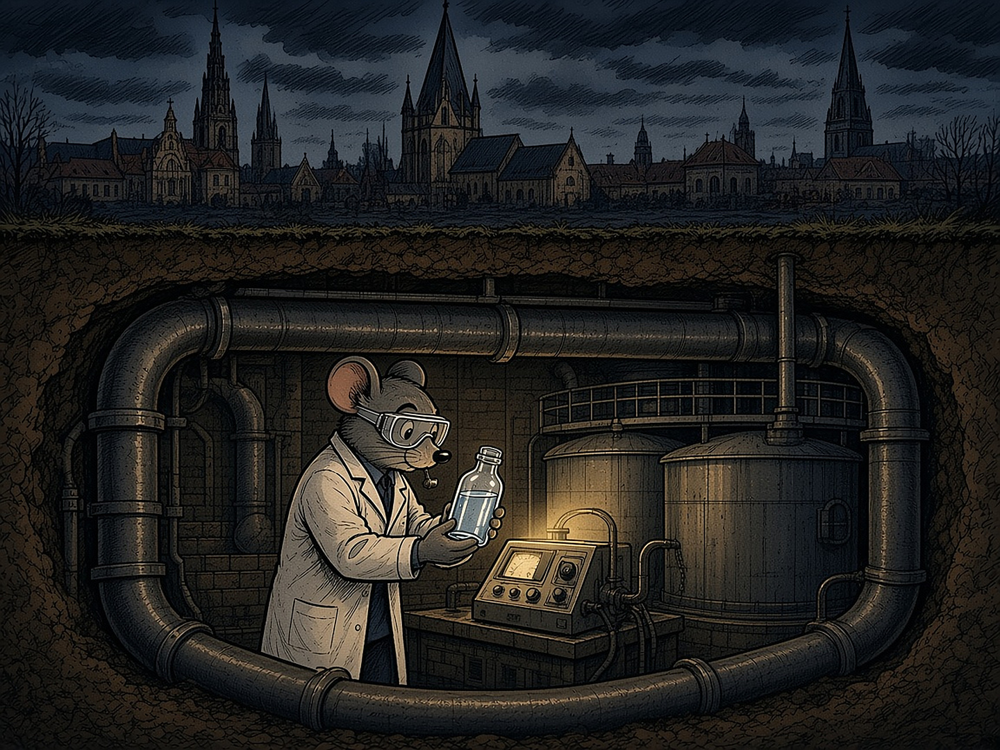

*Reovee-epidemioloogia: puhastusjaamas võetakse proov kogu linna reoveest. Tulemus näitab terve linna koguhulka, mitte üksikuid inimesi.*

### Kolm seeriat, mida ei tohi segamini ajada

Eestis on reovee kohta kolm eri andmeseeriat. **Esimene** on TAI ja EKEI sügisene mõõtmisnädal Tallinnas alates 2019. aastast (2021. aastal mõõdeti vahele). 2025. aastal lisandus Pärnu piirkond. Ühik on tarvitatud aine milligrammid 1000 elaniku kohta ööpäevas, mis on arvutatud EUDA parandusteguriga. **Teine** on EUDA/SCORE Euroopa linnade võrdlus. Eesti linnad on seal ainult aastatel 2021–2023 ja ühik on mõõdetud jääk ilma parandusteguri korrutamiseta. **Kolmas** on JDM-i seire. Aastatel 2022–2024 mõõdeti 13 linnas igas kvartalis. 2025. aasta novembris mõõdeti üks päev 18 linnas ja ühik on annused 1000 elaniku kohta. Neid seeriaid ei saa ühele joonisele panna. See ei ole bürokraatlik nüanss, vaid kogu loo alus.

### Kokaiin: suurim muutus

**Kontrollitud fakt:** TAI ja EKEI 2026. aasta aruande järgi oli Tallinna kokaiininäit 2025. aasta oktoobris 984 mg 1000 elaniku kohta ööpäevas, päevade lõikes 703–1378 mg. 2024. aastal oli see 557 mg, seega on kasv 77%. 2019. aastal oli näit 294 mg. Keskmiselt tähendab see umbes kümmet kokaiiniannust 1000 elaniku kohta päevas. Kasv ei olnud aga sirgjooneline: 2023. aastal oli näit 650 mg ja 2024. aastal langes see 557 mg-ni.

Pärnu piirkonnas mõõdeti 2025. aastal kaks nädalat. Juulis oli kokaiini keskmine 1075 mg ja oktoobris 746 mg. Ühe juulipäeva 2582 mg on kõrgeim Eestis mõõdetud kokaiini päevaväärtus. See langes kokku puhkuste aja ja suure muusikaüritusega. Ka Tallinnas oli kokaiini ja MDMA tase nädalavahetustel kõrgem kui tööpäevadel, nagu enamikus Euroopa linnades.

**Kontrollitud fakt:** kanep on endiselt levinuim aine. Tallinnas oli kanepi näit 12 337 mg (2024: 12 610). See on esimene aasta, mil kasv peatus, kuid tase on 2019. aastaga võrreldes ligikaudu 75% kõrgem. Amfetamiini oli 416 mg, mis on 18% rohkem kui aasta varem.

### Kaart, mis kipub süüdistama

JDM-i 2025. aasta novembri ühepäevane seire hõlmas 18 linna. Kanepit, amfetamiini ja kokaiini leiti kõigist linnadest. Ministeeriumi teate järgi kasvasid kõigi kolme aine näitajad võrreldes 2024. aastaga Tallinnas, Tartus, Maardus, Pärnus, Viljandis ja Võrus. Valgas vähenesid kõigi kolme aine näitajad. Kanepit leiti kõige rohkem Kohtla-Järve Ahtme linnaosas, millele järgnesid Narva ja Maardu. Kokaiini oli kõige rohkem Sillamäel (7,8 annust), seejärel Tallinnas (7,5) ja Ahtmes (6,8). Amfetamiinis eristus Ahtme (56 annust).

Siin algab koht, kus andmed muutuvad kergesti pealkirjaks ja pealkiri sildiks. Ühe kvartali ühe päeva proovi põhjal nimetati varem Rakveret meedias „kokaiinipealinnaks”. JDM-i kvartaliandmetes oli aga Rakveres 2023. aasta I kvartalis 8,1 annust ja II kvartalis 0,8 annust. See on kümnekordne kõikumine sama linna kahe mõõtmise vahel. Tallinnas jäi vahemik aastatel 2022–2024 1,9 ja 7,6 annuse vahele. Ministeerium hoiatab, et kõrge amfetamiininäit võib tähendada ka aine valamist reovette, mitte tarvitamist. TAI hinnangul võib Pärnu kõrge amfetamiinitase viidata tootmisele või turustamisele. **See on hüpotees, mitte tuvastatud fakt**, ja see ei osuta ühelegi isikule ega ettevõttele.

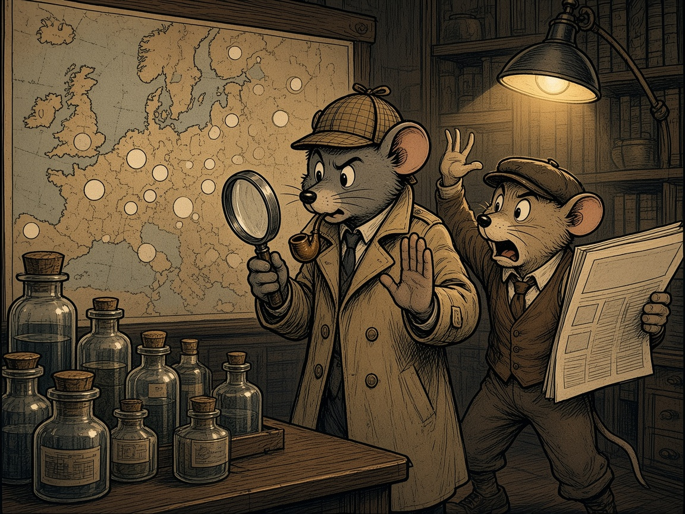

*Ühe päeva proov ei tee ühestki linnast „pealinna”. Enne pealkirja tuleb küsida, mis päeval, mis ühikus ja millega võrreldes näit mõõdeti.*

### Eesti Euroopas

Viimane võrreldav aasta EUDA tabelis on 2023. Siis oli Tallinn amfetamiinis 84 Euroopa linna seas 17. kohal ja MDMA-s 89 linna seas 18. kohal. Amfetamiini oli umbes kolm korda üle Euroopa mediaani, kuid Tallinn ei olnud Euroopa tipus. Kokaiini ja kanepi poolest oli Tallinn mediaani lähedal. 2024. ja 2025. aasta Eesti andmeid EUDA tabelis ei ole. Renee ülevaates on 2025. aasta võrdlus seetõttu märgitud **hinnanguliseks** (autori arvutus, eri mõõtmisnädal). Sama märge kehtib ka siin. EUDA andmetel kasvas Euroopa 115 linna kokaiininäit 2024. aastast 2025. aastani 22%. Kokaiini kasv on seega Euroopa üldine suund, kuid Tallinna sügisene +77% oli sellest suurem.

### Surmad, mida reovesi ei näita

Reovesi mõõdab aineid, aga surmad loeb register. **Kontrollitud fakt:** TAI 2026. aasta juuni ülevaate järgi suri 2025. aastal Eestis üledoosi 94 inimest, neist 60 meest ja 34 naist. Aastatel 1999–2025 on üledoosi surnud kokku 2162 inimest. Nitaseenidega oli seotud 8 surma (2024: 42) ja kokaiiniga 24 surma (2024: 16). 2025. aasta süstalde uuringus oli karfentanüüli sisaldavate süstalde osakaal hüppeliselt kasvanud. Nitaseene 2025. aasta reoveest määratavas koguses ei leitud. Ministeerium rõhutab aga, et „ei leitud” ei tähenda „ei tarvitata”: nitaseenid on nii kanged, et nende jäägid võivad jääda määramispiirist allapoole.

Eesti on seda teed varem käinud. 2000. aastatel põhjustas fentanüül ERR-i andmetel 85–90% narkosurmadest. Aastatel 2019–2024 oli Eesti meditsiiniajakirjanduses kirjeldatud nitaseenilaines 136 surma. EUDA andmetel oli Eesti narkosuremus 2023. aastal kuus korda Euroopa Liidu keskmisest suurem.

### Mida see meile ütleb – ja mida mitte

Reovesi ei loe inimesi. Ta ei ütle, kes tarvitab, kui sageli või kui puhas aine on. Ta ei ütle ka, kas noored tarvitavad rohkem. Ühe päeva proov võib olla juhuslik ja elanike arv on hinnang. Väikestes kogukondades, näiteks koolides, vanglates ja üritustel, on oht, et grupp muutub tuvastatavaks. Seepärast kehtivad SCORE-i eetikajuhised alates 2016. aastast. Põhja prefektuuri narkotalituse juhi Rait Pikaro sõnul piisab politseile ühest proovist aastas (ERR, 25.04.2025). Rahvatervise otsuste jaoks näitavad JDM-i kvartaliandmed aga, kui palju üksainus päev võib kõikuda. Alates 2025. aastast tehakse seda seiret ainult kord aastas.

Tarmo jaoks oli see peatükk SÜLDIKAADI loo loogiline jätk. Vaikimine ei tähenda alati, et keegi midagi peidab. Vahel tähendab see, et andmed lakkavad kogumast: Eesti puudub 2024. aastast EUDA võrdlusest ja seire harvenes. Teinekord on vaikimise vastand sama ohtlik, kui üks number muudetakse linna sildiks. Keskmine tee on kitsas, kuid selge: ütle, mida mõõdeti, millal, mis ühikus ja kui kindel see on.

### Peatüki allikad

1. Tervise Arengu Instituut ja EKEI (2026). Tallinna ja Pärnu reovee uuring uimastite jääkide suhtes 2025 (tai.ee).

2. Tervise Arengu Instituut (juuni 2026). Narkootikumide tarvitamise olukord Eestis 2025 (tai.ee).

3. Justiits- ja Digiministeerium (06.03.2026). „Reoveeuuring 18 Eesti linnas: 2025. aastal kasvas narkootikumide tarvitamine” ning statistika.justdigi.ee „Narkootikumid reovees” põhiandmed.

4. EUDA / SCORE: Wastewater analysis and drugs (uuendatud 18.03.2026) ja reoveeandmete lähtefail 2026; European Drug Report 2026, narkosurmad.

5. Abel-Ollo K. jt (2025). The nitazene epidemic in Estonia: a first report. *European Journal of Public Health* 35(6).

6. ERR, 06.12.2019 (fentanüüli ajastu) ja 25.04.2025 (seire harvendamine).

7. Renee Aluste, „Mida Eesti kanalisatsioon räägib narkootikumidest”, #peegel, oktoober 2026 (koondülevaade, andmed kogutud 10.10.2026).

> **Reegel 7.** Lisareegel: Number ei ole silt. Enne kui nimetad linna „pealinnaks”, ütle, mida mõõdeti, millal, mis ühikus ja kui kindel see on — ja pea meeles, et andmete puudumine on samuti vaikus.

---

<!-- TEINE OSA: MÕJUTAMINE JA MÄLU -->

# VII PEATÜKK — Vaikus kui enesekaitse: „Omad ei nussi” ja „Jolleri tõde”

Suured mehhanismid ei ela ainult ministeeriumide klaashoonetes, Robbeni saare müüride taga ega Vietnami kaardiruutudel. Nad elavad kõigepealt kahe inimese vahel – tänaval, töökojas, kasarmu koridoris, garaaži ukse ees või sotsiaalmeedia kommentaariumis. Sest riik ja sündikaat ei koosne millestki muust kui neist samadest lausetest, mida üks inimene ütleb teisele siis, kui ta tahab oma tegu peita.

2026. aasta oktoobri lõpus pani Tarmo oma välimärkmikku kirja kaks juhtumit, mis toimusid täpselt samal päeval ja näitasid, kuidas inim-mõjutusrelva „Seen” kaitsemehhanism töötab nii tänaval kui ka ministri kabinetis. Esimene neist ei võtnud enda alla sadu lehekülgi toimikuid ega miljoneid eurosid riigihankeid – see mahtus kolme lausesse ja ühte pärastlõunasse. Teine rullus lahti kogu Eesti silme all sotsiaalministri Facebooki seinal.

Esimeses loos seisis Renee silmitsi inimesega, kes armastas rääkida vendlusest ja lojaalsusest. Selle inimese lemmiklause – lause, mida ta kordas nagu vandevalemit – oli lihtne ja kare:

*„Omad hoiavad kokku. Omadega ei nussi.”*

See kõlas nagu aususe ja usalduse seadus. Nagu kaitsekilp, mille varjus võib igaüks kindel olla, et seljatagune on hoitud. Kuid tegelikkuses tegi seesama inimene täpselt vastupidist: ta kiusas, survestas ja nussis just Reneed ennast – vaikselt, järjekindlalt ja omade ringi varjus, eeldades, et loosung „omad hoiavad kokku” keelab ohvril suu lahti teha.

Kui Renee lõpuks piiri ette tõmbas ja vastu hakkas – kui ta keeldus vaikimast ja nimetas kiusamist kiusamiseks –, juhtus midagi, mis võtab üheainsa mikroskoopilise liigutusega kokku kogu selle raamatu anatoomia.

Kiusaja ei tunnistanud oma tegu. Ta ei vaielnud isegi faktide üle. Ta pööras lihtsalt sildi ümber ja ütles Reneele:

*„Sa oled omade nussija.”*

Psühholoogias ja totalitaarsete süsteemide uurimises on sellel võttel täpne nimi: **DARVO** (*Deny, Attack, and Reverse Victim and Offender* – eita, ründa ning vaheta ohvri ja ründaja rollid), mille sõnastas Oregoni Ülikooli psühholoogiaprofessor Jennifer Freyd (1997) institutsionaalse reetmise (*institutional betrayal*) ja väärkohtlemise kaitsemehhanismina. See toimib alati kolmes sammus:

1. **Loosung kui vaikimiskohustus:** Kõigepealt kehtestatakse grupis püha reegel – *„omad hoiavad kokku”*, *„meie üksuses musta pesu väljapoole ei viida”*, *„riigi julgeolekut ja usaldust ei õõnestata”*. Selle lause tegelik eesmärk ei ole kaitsta gruppi. Selle eesmärk on võtta ohvrilt õigus end kaitsta.
2. **Rünnak kardina varjus:** See, kes kõige valjemini nõuab lojaalsust, kasutab teiste vaikust ära, et ise reegleid rikkuda, kiusata või varastada. Ta teab, et igaüks, kes teda peatada püüab, peab astuma üle „omade” vaikimiskeelust.
3. **Rollide ümberpööramine enesekaitseks:** Niipea kui kiusatav vastu hakkab või tõe välja ütleb, kuulutatakse rikkujaks mitte see, kes tegi haiget, vaid see, kes rikkus vaikust. Kiusajast saab „ühtsuse kaitsja” ja ohvrist saab „omade nussija”, „reetur” või „valeinfo levitaja”.

Et keegi ei arvaks, nagu kuuluks see võte ainult tänavale või tagatuppa, pakkus sama päev – **27. oktoober 2026** – sellele riikliku peegelpildi.

Vandeadvokaat ja Tartu Ülikooli Euroopa õiguse kaasprofessor **Carri Ginter** oli 2026. aasta kevadel teinud päringu ja toonud avalikkuse ette tõsise põhiõiguste riive (ERR, *„Ginter: meie isikuandmed on ohus ning usaldus arstide vastu rünnaku all”*): Politsei- ja Piirivalveamet (PPA) küsis e-kirjade teel Tervise ja Heaolu Infosüsteemide Keskuselt (**TEHIK**) välja inimeste delikaatseid terviseandmeid ilma kohtu loata. Veel enam – TEHIK-u enda kirjalik vastus ja asutuse juht kinnitasid sõnaselgelt, et **kui politsei andmeid küsib, siis TEHIK päringute sisulist põhjendatust ega vajalikkust ei kontrolli**, ning sellised e-kirja teel tehtud päringud ei jäänud inimesele endale terviseportaali logissegi näha.

Kui kodanikud pöördusid sotsiaalminister **Karmen Jolleri** 22. septembri 2026 Riigikogu infotunni sõnavõtu (stenogramm `SND-45079215`) järel TEHIK-u poole, et teada saada, kas ja miks nende terviseandmeid on vaadatud, nad sisulist vastust ei saanud.

Kuidas reageeris sotsiaalminister, kui vandeadvokaat sellele pimealale osutas?

27. oktoobril 2026 postitas minister Karmen Joller oma avalikule Facebooki seinale teksti, milles süüdistas Carri Ginterit ebaõigete andmete avaldamises, väites, et muudatused tehti juba 2022. aasta lahendi järel. Ginter tuli ministri postituse alla ja esitas oma nime all rahulikult faktid: viite ERR-i artiklile, 22. septembri 2026 Riigikogu stenogrammi väljavõtte ning TEHIK-u kirjaliku kinnituse, et veel 2026. aasta kevadel käis terviseandmete väljaandmine e-kirjade peale ilma TEHIK-u poolse sisulise kontrollita. Ta küsis: *„Palun täpset viidet, mis minu postituses on vale?”*

Ministri vastus on dokumentaalne näide sellest, kuidas võim käitub siis, kui faktid ei allu narratiivile. Karmen Joller kirjutas kommentaariumis:

> *„TEHIK pole pädev kontrollima, milline info täpselt on PPA tegevuseks vajalik. Seda saab teha PPA ise või kohus. [...] Teiega ma rohkem ei vaidle ja teie järgnevad eksitavad ja tühja vaidlust tekitavad kommentaarid peidan või kustutan. Kui neid tuleb mahus, mis mulle üle jõu käib, blokeerin teid.”*

Ja mõni hetk hiljem keeras minister oma postituse all kommenteerimise lukku (*„Karmen Joller limited who can comment on this post”*).

Ministri süüdistus vandeadvokaadi pihta jäi avalikult kogu Eestile lugeda. Süüdistatava vastus koos dokumentide ja allikatega pandi keelu alla. Alles jäi ainult see, mille Ginter ristis tabavalt teemaviiteks **#jolleritõde**.

Vaata nüüd korraks tagasi kõigile eelnevatele peatükkidele. Kas märkad, et muster on millimeetri pealt sama – alates kahe inimese tülist kuni ministri Facebooki seinani ja sealt edasi suurte ajalooliste tragöödiateni?

- **Lõuna-Aafrika apartheidis** ei olnud seaduse silmis kurjategija see režiim, mis võttis miljonitelt inimestelt vabaduse ja hääle, vaid Nelson Mandela, kes keeldus vaikimast – teda nimetati „rahu ja korra lõhkujaks”, kelle sõnu ei tohtinud tsiteerida.
- **My Lai külas** ei olnud USA armee esialgses raportis süüdlaseks mitte need, kes tulistasid kraavis naisi ja lapsi, vaid kopteripiloot **Hugh Thompson Jr.**, kes maandus oma kopteriga tapjate ja külaelanike vahele ning ähvardas avada tule omaenda relvavendade pihta, kui tapmine ei lõpe. Kui Thompson sellest ette kandis, süüdistati teda Kongressi kinnistel kuulamistel selles, et ta reetis „oma poisid” ja üritas USA sõdureid sõjakohtus süüdi lavastada. Tal kulus kolmkümmend aastat (kuni 1998. aasta *Soldier's Medal*-ini), enne kui süsteem tunnistas, et tõeline lojaalsus oma üksusele on kuriteo peatamine, mitte selle varjamine.
- **Nõukogude küüditamisnimekirjades ja KGB toimikutes** ei olnud süüdi see, kes tuli öösel püssiga võõrasse tallu, vaid taluperemees, kes oma kodu kaitses – temast tehti paberil „bandiit” ja „rahvavaenlane”.
- **Kaitseliidu ja Kaitseväe koridorides (I peatükk)** ei olnud mugavusohvitseride silmis probleemiks mitte see, et luurekohale pandi oskamatu sõber või et ohuhinnanguid kästi poliitikute meeleheaks pehmendada, vaid see allohvitser või luurejuht, kes keeldus valetamast – temast tehti „konfliktne inimene, kes ei hoia omadega kokku”.
- **Riigihangete, äriregistri ja terviseandmete pimealades (III, IV ja VII peatükk)** ei küsita pärast 70 miljoni eurose suurtükimoona hanke läbikukkumist mitte seda, miks leping sõlmiti ilma KAPO taustakontrollita, vaid tellitakse 15 000 euro eest analüüs äriregistri ajaloo peitmiseks; ja kui vandeadvokaat näitab, et politsei küsib inimeste terviseandmeid e-kirjaga ilma kontrollita, kuulutab minister tema küsimused „eksitavaks ja tühja vaidlust tekitavaks” ning keerab mikrofoni kinni.

See ongi vaikuse sündikaadi kõige sügavam saladus: **kes kontrollib narratiivi, see määrab, kes on süüdi.**

Kui kiusaja ütleb sulle „omadega ei nussi” ja nimetab sind ennast „omade nussijaks” hetkel, mil sa tema kiusamisele vastu hakkad – või kui minister kuulutab su küsimuse valeks ja sulgeb samal hetkel su võimaluse vastata –, siis ei räägi nad tõest ega ühtsusest. Nad räägivad **karistamatusest**. Nende keeles tähendab „oma” või „konstruktiivne kodanik” inimest, kes laseb endaga kõike teha ja hoiab suu kinni. Niipea kui sa küsid allikat, logiväljavõtet või vastutust, oled sa oht nende maskile.

Tarmo tõmbas välimärkmikus neile kahele loole joone alla ja kirjutas servale lause, mis sai seitsmenda peatüki viimaseks reaks:

*Kui keegi nõuab sinult vaikimist „omade” nimel või kustutab su küsimuse „tõe” nimel, siis küsi alati üksainus küsimus: kas see vaikus kaitseb inimesi või kaitseb see ainult tema enda tegu?*

> **Reegel 8.** Kaheksas reegel: Kui keegi nõuab sinult vaikimist „omade” nimel või kustutab su küsimuse „tõe” nimel, küsi alati: kas see vaikus kaitseb inimesi või ainult tema enda tegu?

---

# VIII PEATÜKK — Peegel: kuidas võõras mõte sinu omaks saab

Sari, mille Renee 2026. aasta sügisel käivitas, kannab nime *#peegel*. Nimi ei ole juhuslik. Kõige tõhusam mõjutus ei tule väljastpoolt nagu käsk. See tuleb seestpoolt nagu oma mõte. Inimene vaatab peeglisse ja näeb iseennast, aga sõnad tema suus on kellegi teise omad. See peatükk räägib sellest, kuidas Venemaa psühholoogiline sõjapidamine töötab ja kuidas seda ära tunda. See põhineb kahel Renee ülevaatel (12.10.2026) ja avalikel allikatel: Kapo ja Välisluureameti aastaraamatud, kohtuotsused, RAND, EUvsDisinfo ja Prantsuse Viginum.

*Peegel: võõras mõte ei tule käsuna, vaid tundub oma mõttena. Ekraanid ja niidid on kujund, mitte kellegi konkreetse inimese kujutis.*

### Kuidas Moskva ise sellest mõtleb

Vene sõjateoorias nimetatakse seda **infovastasseisuks**. Sellel on kaks poolt: infotehniline (küber, side) ja infopsühholoogiline (inimeste teadvus, otsused ja moraal). Erinevalt läänest ei eralda see mõtteviis selgelt rahu- ja sõjaaega. Vastasseis käib pidevalt.

Vana nõukogude mõiste **refleksiivne kontroll** (V. Lefebvre, 1960ndad) tähendab, et vastasele antakse sellist infot, et ta teeb **ise ja vabatahtlikult** otsuse, mis on Moskvale kasulik. See ongi peegel: otsus tundub oma otsusena. KGB nimetas laiemat tööriistakasti **aktiivseteks meetmeteks**: desinformatsioon, võltsdokumendid, eesrindeorganisatsioonid ja mõjuagendid.

Sageli räägitakse ka „Gerassimovi doktriinist”. Selle termini lõi analüütik Mark Galeotti, kuid tunnistas 2018. aastal, et see on eksitav: kindral Gerassimovi 2013. aasta artikkel kirjeldas tema arvates lääne tegevust, mitte uut doktriini. Põhimõte, et sõda peetakse ka info, majanduse ja poliitika kaudu, kehtib sellegipoolest.

### Eesmärk ei ole veenda

RAND-i analüütikud Paul ja Matthews (2016) kirjeldasid Vene propagandat kui **valede tulejuga**: palju kanaleid, suur maht, kiirus ning tõe ja järjepidevuse eiramine. Eesmärk ei ole panna inimest midagi uskuma. Eesmärk on **uputada, väsitada ja lõhkuda usaldus**, et lõpuks tunduks, nagu ei saakski tõde teada. Kapo hinnang 2025–2026 on sama: lõhestada, hirmutada, väsitada.

### Mida on tõestatud

Siin on ainult juhtumid, mille kohta on kohtuotsus või ametlik omistamine. **Detsember 2023:** siseministri ja ajakirjaniku auto lõhkumine. Harju maakohus mõistis korraldaja 2024. aastal süüdi selles, et ta tegutses GRU ülesandel. Värbamine käis tuttavate ahela kaudu. **Jaanuar 2025:** Slava Ukraini restorani süütamine Tallinnas. Kohus tuvastas, et see oli GRU tellimustöö, ja Osula poe süütamine oli „proovitöö”. **2024–2025:** Tartu Ülikooli endine õppejõud mõisteti süüdi GRU heaks tegutsemises ning Baltnewsi kaastööline riigireetmises ja sanktsioonide rikkumises.

Kapo aastaraamat 2025–2026 (avaldatud 13.04.2026) ütleb, et alates 2025. aasta algusest on tabatud 16 Vene eriteenistuste kaastöötajat. Enamik neist olid tavalised inimesed, kellel ei olnud ligipääsu salajasele teabele. Kohtu alla on antud üle 40 inimese. Enamik värvati **Venemaa külastuse ajal**, sageli juba piiripunktis. Kapo ootab mõjutustegevuse olulist kasvu enne 2027. aasta kevadel toimuvaid Riigikogu valimisi.

**Mida ei leitud:** Renee varasemas mustandis oli kaks väidet, mis jäid kinnituseta, ja need on siit välja jäetud: väide Vabamu vastu suunatud rünnakust ja väide, et autorünnaku täideviijad värvati Telegrami kaudu.

### Raha ja maht

Venemaa 2025. aasta eelarves oli riigimeedia jaoks 139,6 miljardit rubla, sellest RT-le 33,1 miljardit (Kommersant). Prantsuse Viginum leidis 2024. aastal, et „Pravda” ehk Portal Kombati võrgustikus oli algul 193 ja aprillis juba 224 saiti. EUvsDisinfo andmebaasis oli 2024. aasta lõpuks üle 18 000 dokumenteeritud Kremli-meelse desinformatsiooni juhtumi. **Tõlgendus:** suur osa sellest sisust ei jõua kunagi päris inimesteni. Kõige suurem edu tuleb siis, kui kohalikud inimesed hakkavad sõnumit ise edasi jagama. Siis on võõras mõte saanud omaks.

### Kõige ohtlikum peegel

Kremlile sobib kütta **mõlemat poolt**. Venekeelsetele öeldakse, et eestlased vihkavad neid. Eestlastele öeldakse, et iga venelane on viies kolonn. Mõlemad sõnumid teenivad sama eesmärki. Kapo ja Välisluureamet rõhutavad, et oht tuleb konkreetsetest tegudest ja võrgustikest, mitte rahvusest. Kui sõnum ütleb, et terve rahvusrühm on reeturid, siis see ongi Moskva soovitud tulemus. Kahtlustuste levitamine ilma tõenditeta tekitab paranoiat ja koormab julgeolekuasutusi valevihjetega.

Siin kohtub see peatükk raamatu teise reegliga: nimede taga on inimesed. Ka siis, kui vastane tahab, et me näeksime ainult silte.

### Seitse küsimust enne jagamist

1. Kas see tekitab minus tugeva emotsiooni enne, kui ma tean fakte?

2. Kas mind kiirustatakse („jaga kohe, enne kui kustutatakse”)?

3. Kes on allikas ja kas keegi teine (ERR, Postimees, Delfi, Propastop) seda kinnitab?

4. Kas kogu probleem on lükatud ühe rühma kaela?

5. Kas mulle pakutakse mitu vastuolulist versiooni korraga, et jääks mulje, et tõde ei saa teada?

6. Kas päris dokumendi sisse võib olla pandud võltsing?

7. Kas sõnumi mõte on, et „kõik on korrumpeerunud ja midagi ei saa teha”?

Kui keegi pakub sulle raha „lihtsate ülesannete” eest, palub pildistada objekte või avaldab survet sugulaste kaudu, katkesta kontakt ja teata Kapole. Kuriteo korral helista 112.

### Peatüki allikad

1. Kapo aastaraamat 2025–2026 (kapo.ee); Välisluureamet, „Eesti rahvusvahelises julgeolekukeskkonnas 2026”.

2. Prokuratuur, kohus.ee ja ERR: kohtuasjad (autorünnak 2023, Slava Ukraini 2025, GRU ja riigireetmise süüdimõistmised 2024–2025).

3. K. Giles, „Handbook of Russian Information Warfare” (NDC, 2016); T. Thomas, „Russia's Reflexive Control Theory and the Military” (2004); T. Rid, „Active Measures” (2020).

4. M. Galeotti, „I'm Sorry for Creating the Gerasimov Doctrine” (Foreign Policy, 2018).

5. RAND, Paul ja Matthews, „The Russian Firehose of Falsehood Propaganda Model” (2016).

6. Viginum, „Portal Kombat” (2024); EEAS FIMI raportid; EUvsDisinfo; Kommersant (Vene riigimeedia eelarve 2025).

7. Renee ülevaated „Venemaa psühholoogiline sõjapidamine ja infomõjutus” ja „#peegel” (12.10.2026).

> **Reegel 9.** Lisareegel: Enne kui jagad, küsi, kelle mõte see on. Oht tuleb tegudest ja võrgustikest, mitte rahvusest — kes sildistab terve rahva, teeb vastase tööd.

---

# IX PEATÜKK — Unustamise masin: mida teadus mälu kustutamisest tegelikult teab

Kui eelmine peatükk küsis, kuidas võõras mõte sinu omaks saab, siis see peatükk küsib vastupidist: kas mälestust saab ära võtta? Internetis liigub lugusid salajastest „unustamise masinatest” ja programmidest, mis kustutavad sõdurite mälu. Renee pani 2026. aasta oktoobris kokku nimekirja teadlastest ja rühmadest, kes uurivad mälu nõrgendamist ja unustamist. Nimekiri tugineb ainult avalikule ja akadeemilisele uurimistööle. See peatükk on selle nimekirja lühike kokkuvõte.

### Kõige tähtsam kõigepealt

**Fakt:** inimesel saab mälu mõnikord **nõrgendada**, aga mitte täpselt **kustutada**. Hiirtel ja rottidel on teadlased kindla hirmumälu päriselt välja lülitanud. Selleks on vaja geenitehnikat ja ajusse viidud valgust või toksiini. Inimestel seda teha ei saa. Inimestel on kõige paremini tõestatud **emotsiooni vähendamine**: mälestus jääb alles, aga see ei tee enam nii haiget.

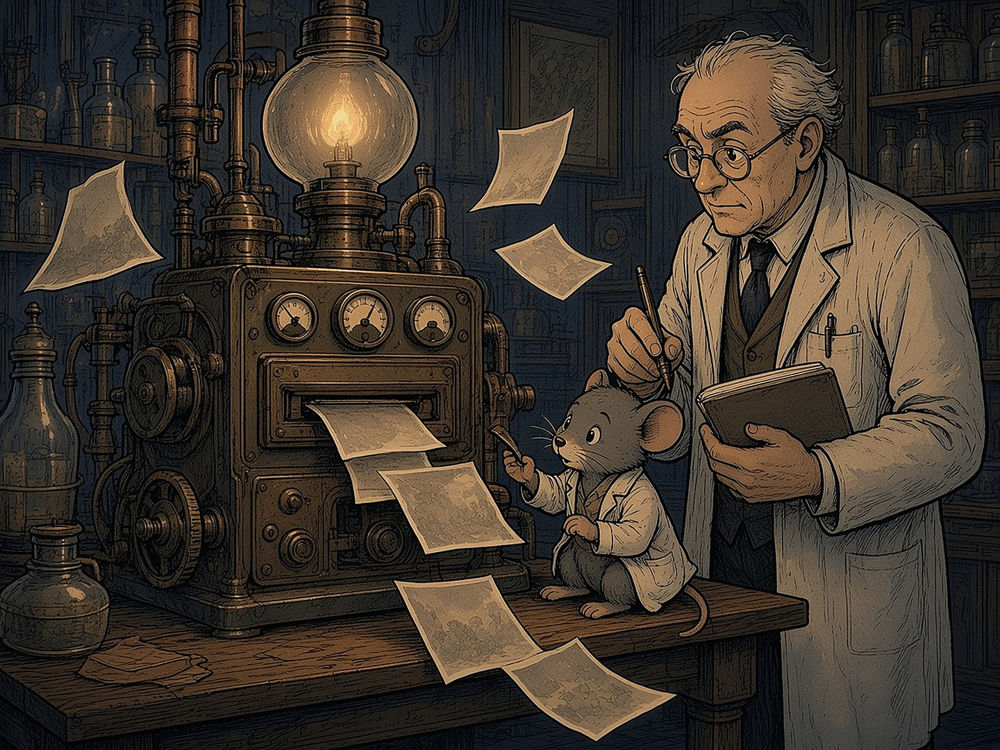

*„Unustamise masin” on kujund. Päris laborites on mälu kustutatud ainult loomadel. Inimestel saab vähendada mälestuse valu, mitte mälestust ennast.*

### Avatud aken

2000. aastal näitas Karim Nader (McGilli Ülikool) rottidel, et meenutatud hirmumälu muutub korraks ebastabiilseks ja see tuleb uuesti „salvestada”. Kui see protsess ajus blokeeriti, kadus hirmureaktsioon. Seda nimetatakse **rekonsolideerimiseks**. Sellele ideele tuginevad mitmed inimkatsed.

Merel Kindt (Amsterdami Ülikool) näitas 2009. aastal, et vererõhuravim propranolool nõrgendas laboris tekitatud hirmu, kui see anti koos meenutamisega. Hilisemad uuringud olid aga nõrgemad: päris ämblikufoobiaga patsientidel ei olnud propranolool platseebost parem. Kindt on kliiniku asutaja, see on huvide konflikt. Alain Brunet' rühm leidis 2018. aastal, et propranolool koos trauma meenutamisega vähendas PTSH sümptomeid. Prantsuse uuring 2021. aastal 66 patsiendiga seda ei kinnitanud. **Järeldus:** mõju on olemas, aga väiksem ja ebakindlam, kui alguses arvati.

Daniela Schiller avaldas 2010. aastal ajakirjas Nature tulemuse, et hirm ei tule tagasi, kui harjutus tehakse „mälu akna” ajal. Hilisem eelregistreeritud kordusuuring mõju ei leidnud.

### Tetris ja EMDR

Emily Holmes (Uppsala Ülikool) leidis, et kui pärast traumat mälestus lühidalt meelde tuletada ja siis kindlal viisil Tetrist mängida, tuleb hiljem vähem pealetükkivaid mälupilte. 2025. aasta suur korduskatse leidis ainult kohese mõju, mitte nädala pärast. Siia kuulub ka EMDR eelmisest peatükist. Ad de Jongh (ACTA, Amsterdam) uuris seda pikalt traumamälu ravina.

### DARPA ei kustutanud mälu

Vandenõulugudes nimetatakse sageli USA kaitseministeeriumi teadusagentuuri DARPA programmi RAM (*Restoring Active Memory*, umbes 2013–2018). **Fakt:** programmi eesmärk oli mälu **taastada** ajukahjustusega sõduritel, mitte kustutada. Michael Kahana rühm (Pennsylvania Ülikool) parandas 2018. aastal ajustimulatsiooniga epilepsiahaigete sõnameenutamist umbes 15%. Ühes uuringus hoopis halvendas hipokampuse stimulatsioon mälu. Wake Foresti ja USC „mäluproteesi” uuringud olid väikesed ja tulemused segased.

### Hiirte engrammid

Mälestus jätab ajju rakkude rühma, mida nimetatakse **engrammiks**. Susumu Tonegawa (MIT, suri 11. juulil 2026) rühm äratas 2012. aastal hiirel valgusega hirmumälu. 2013. aastal tekitati hiirel valemälu. Sheena Josselyn ja Paul Frankland (SickKids, Toronto) kustutasid 2009. aastal hiirel ühe kindla hirmumälu, hävitades valitud närvirakud. Tomás Ryan (Trinity College Dublin) on näidanud, et unustamine on sageli mälu **peitmine**, mitte kustutamine: „kadunud” mälu võib tagasi tulla.

### Valemälu: ohtlikum kui unustamine

Selle peatüki kõige tugevam tõend ei puuduta mälu kustutamist, vaid mälu **tekitamist**. Elizabeth Loftus (UC Irvine) näitas „kaubanduskeskuses ära eksimise” katsega, et osa inimesi hakkab uskuma lapsepõlvesündmust, mida ei olnud. Kimberley Wade (Warwick) tekitas võltsitud fotoga valemälu õhupallisõidust. 2017. aasta koondanalüüs (8 uuringut, 423 inimest) leidis, et umbes **30%** osalejatest tekkis valemälu. Henry Otgaar (Maastricht) on näidanud, et „allasurutud mälestuste” teooria ei ole teaduslikult tõestatud ja võib teraapias viia valemälestusteni.

Siin sulgub ring raamatuga. Kolmas reegel ütleb, et ära aja segamini köögilaua legende ja arhiivifakte. Mälu on köögilaud: see on soe, isiklik ja eksib kergesti. Arhiiv on külm, kuid see ei muuda end järgmisel korral jutustamisel.

### Mida nimekirjast välja jäi

Renee esialgses nimekirjas oli nimi „Bruno Bonin”. Sellenimelist mälu-uurijat ei leitud. On olemas Robert P. Bonin, kes on kirjutanud rekonsolideerimisest ja valust. Võimalik, et nimi läks segamini.

**Väide, mida tõendid ei toeta:** et kuskil on töötav masin või programm, mis kustutab inimeselt valitud mälestusi. Avalikus teadusallikas sellist asja ei ole.

### Peatüki allikad

1. Nader, Schafe, LeDoux 2000 (Nature); Kindt jt 2009 (Nature Neuroscience) ja hilisemad negatiivsed tulemused; Brunet jt 2018 (Am J Psychiatry); Roullet jt 2021.

2. Schiller jt 2010 (Nature) ja kordusuuringud (KU Leuven).

3. Holmes jt (Tetrise uuringud, 2009–2025); de Jongh, ACTA.

4. DARPA RAM programmi kirjeldus; Ezzyat, Kahana jt 2018 (Nature Communications); Hampson jt 2018.

5. Tonegawa labor (MIT) 2012–2015; Han, Josselyn, Frankland jt 2009 (Science); Ryan labor (TCD).

6. Loftus ja Pickrell 1995; Wade jt 2002; Scoboria jt 2017; Otgaar jt 2019.

7. Renee nimekiri „Kes uurib mälu nõrgendamist ja unustamist?” (oktoober 2026).

> **Reegel 10.** Lisareegel: Mälu on köögilaud, mitte arhiiv. Mälestust saab muuta lihtsamini kui kustutada — seepärast vajab iga meenutus dokumenti.

---

# X PEATÜKK — Kajakamber: kas Putin usub oma valet?

Igal hommikul avab üks mees Moskvas paberkaustad. Selles peatükis küsime lihtsa küsimuse, millele on raske vastata: **kas Putin usub oma valet?** Või õigemini: kas see, mis algas teadliku valena, võib ajapikku muutuda siiraks veendumuseks, kui kõik ümberringi kordavad sama juttu?

**Renee hinnang:** Putin usub siiralt, et Ukraina on ajutiselt „ära antud” Vene territoorium, mis tuleb tagasi võtta. Balti riike ja Poolat näeb ta teistmoodi: need on võõrad, mitte „oma”. See on Renee tunnetus, mitte tõestatud fakt. Allpool vaatame, mida ütlevad dokumendid ja analüüsid.

### Mida on kirjas

**Fakt:** 12. juulil 2021 avaldas Putin Kremli kodulehel pika essee „Venelaste ja ukrainlaste ajaloolisest ühtsusest”. Selles väidab ta, et venelased ja ukrainlased on „üks rahvas” ja et tänapäeva Ukraina on suures osas nõukogude aja looming. Seitse kuud hiljem algas täiemahuline sissetung.

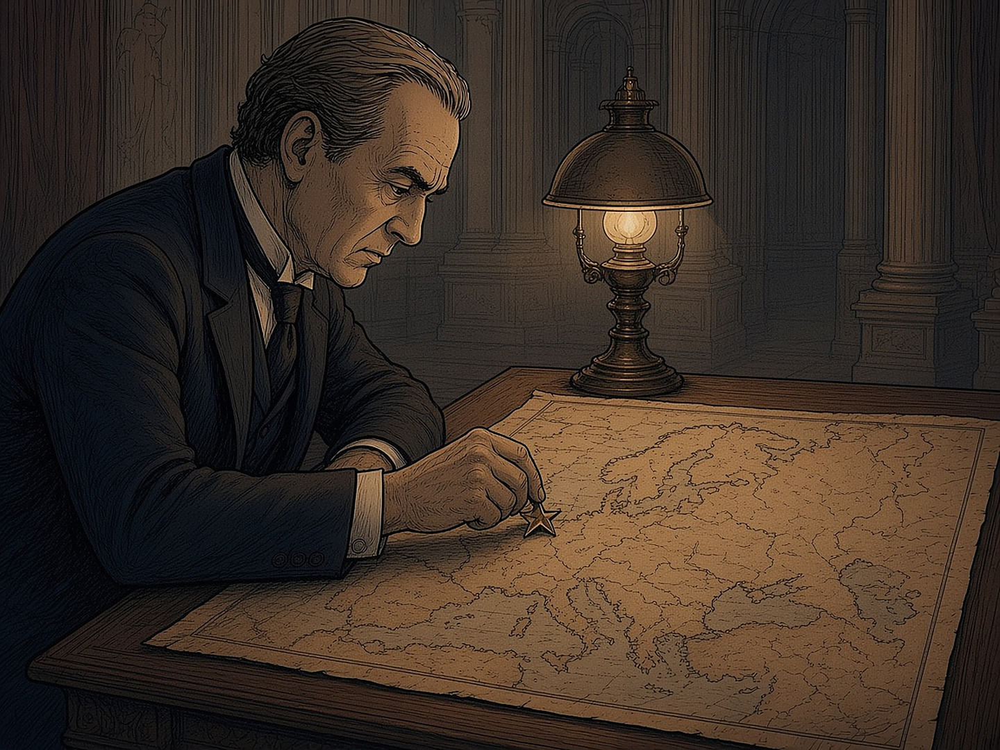

*Kaart laual ja täht ühe piirkonna peal: „see on meie oma”. Kujutis on üldine, mitte kellegi portree.*

**Fakt:** 5. detsembril 1994 allkirjastati **Budapesti memorandum**. Ukraina loobus tuumarelvadest, mis olid jäänud tema territooriumile pärast Nõukogude Liidu lagunemist. Venemaa, USA ja Suurbritannia kinnitasid, et austavad Ukraina iseseisvust, suveräänsust ja olemasolevaid piire. 31. mail 1997 allkirjastasid Venemaa ja Ukraina **sõpruse, koostöö ja partnerluse lepingu**, mis tunnustas olemasolevate piiride puutumatust. Kõik see sisaldas ka Krimmi.

**Fakt:** 2014. aasta märtsis annekteeris Venemaa Krimmi. 24. veebruaril 2022 algas täiemahuline sissetung Ukrainasse. Paberid, millele Moskva oli alla kirjutanud, ei peatanud seda. See ei tõesta, kas Putin uskus oma essee juttu. See tõestab, et allkiri ei olnud tema jaoks takistus.

### Mida ütleb teadus Putini mõtlemise kohta

Stephen Dyson ja Matthew Parent avaldasid 2017. aastal ajakirjas *Intelligence and National Security* nn **operatiivkoodi analüüsi** Putini kohta. Nad kogusid kõik, mida Putin oli 13 välispoliitilisel teemal avalikult öelnud alates esimesest päevast kohusetäitjana kuni 2016. aasta lõpuni: 1 057 709 sõna. Tulemus oli üllatavalt igav: Putini uskumused rahvusvahelise poliitika kohta olid enamasti tavapärased. Erandid olid **ülimalt agressiivne hoiak terrorismi suhtes** ja **hämmastav kinnisidee poliitilisest kontrollist**. Autorite kokkuvõte: Putin on oportunist, mitte strateeg. Ehk teisisõnu: mitte malemängija, vaid inimene, kes haarab võimaluse, kui see tekib.

### Kajakamber

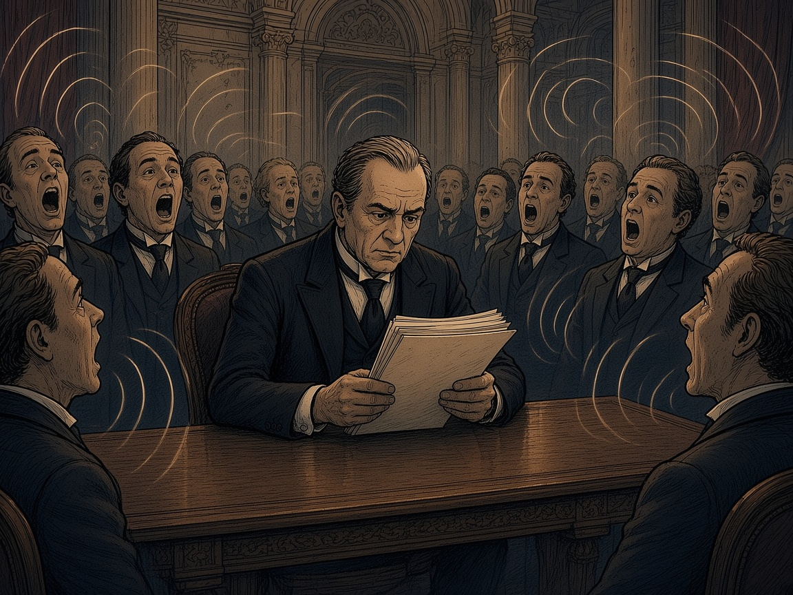

*Kajakamber: kui igaüks ümberringi noogutab, kõlab ka oma vale nagu tõde. Kujutis on üldine, mitte kellegi portree.*

Boriss Bondarev töötas Venemaa välisministeeriumis aastatel 2002–2022, viimati nõunikuna ÜRO Genfi esinduses. 2022. aasta mais astus ta sõja vastu protesteerides tagasi. Sama aasta sügisel kirjeldas ta ajakirjas *Foreign Affairs*, mis juhtub, kui valitsust moonutab aeglaselt tema enda propaganda: *„Lõpuks ei olnud selle propaganda sihtrühm mitte ainult välisriigid, vaid meie oma juhtkond.”* Diplomaadid pidid Kremlile teatama, et maailm on Venemaa suuruses veendunud. Tema sõnul ütlesid Kremli kolleegid talle korduvalt, et Putinile meeldib välisminister Sergei Lavrov, sest temaga on „mugav” töötada: ta ütleb alati jah ja räägib seda, mida president kuulda tahab. Bondarevi järeldus: pole ime, et Putin arvas, et Kiievi alistamine on lihtne.

*The Washington Post* kirjutas 13. detsembril 2025 (Mary Ilyushina), et Putini 25 valitsemisaasta jooksul on teda ümbritsevate arvamuste ring dramaatiliselt ahenenud. Kindralid ütlevad, et kõik sõja eesmärgid saavutatakse. Majandusteadlased ütlevad, et majandus peab vastu. Lehe andmetel oli enne sissetungi peetud julgeolekunõukogu istungil ainus vastuvaidleja kauaaegne abi Dmitri Kozak. Tema märkused telepilti ei jõudnud.

Kuidas info presidendini jõuab? Analüüsiportaal *Geopolitical Monitor* kirjutas 2026. aastal, et Putin **väidetavalt** ei kasuta internetti ja saab info ainult ettevalmistatud kaustade kaudu, mis liiguvad läbi presidendi administratsiooni. Kes kontrollib kaustu, kontrollib presidendi pilti maailmast. **Ausalt:** see on teiste allikate kaudu korratud väide. Endine Kremli ihukaitseteenistuse ohvitser Gleb Karakulov ütles 2023. aastal, et Putin ei kasuta internetti ega mobiiltelefoni. Kremli pressiesindaja Dmitri Peskov ütles 2018. aastal, et telefoni Putinil ei ole, aga ta võib internetti ise arvutis sirvida. Kaustad on kinnitatud, interneti täielik puudumine mitte.

### Kuidas vale muutub tõeks

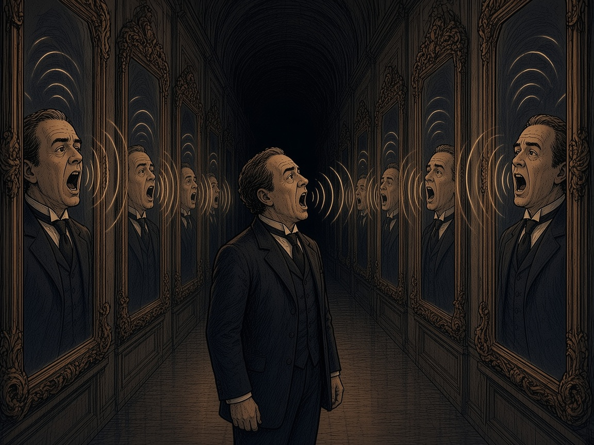

*Peeglite koridor: üks hääl, mis kordub, kuni see kõlab nagu kogu maailm.*

Hannah Arendt kirjutas 1951. aastal raamatus „Totalitarismi päritolu”: *„Totalitaarse võimu ideaalne alluv ei ole veendunud natsi ega veendunud kommunist, vaid inimene, kelle jaoks fakti ja väljamõeldise vahet ei ole enam olemas.”* Arendt kirjutas alluvast. Selle peatüki küsimus on, kas sama võib juhtuda ka valitsejaga, kelle ümber on 25 aastat ainult kinnitavad hääled.

Carnegie sihtasutuse analüütik Eugene Rumer kirjutas 2026. aasta märtsis ja aprillis, et Putin alustas sõda väära ettekäändega, et iseseisev Ukraina ohustab Venemaad. Sõda muutis Ukraina Venemaa leppimatuks vaenlaseks ja äratas Euroopa ohule. Rumeri sõnul on need täielikult enda tekitatud strateegilised vead. Tema sõnul on Putinil Ukraina suhtes pimetähn: ta ei näe, et Ukrainal on oma tahe, ja peab seda vaenuliku Euroopa etturiks. **Tõlgendus (meie sõnastus, mitte Rumeri tsitaat):** see on eneseteostuv ennustus. Kes kardab vaenlast ja ründab, see loob endale vaenlase.

**Selle peatüki järeldus (tõlgendus):** algus oli tõenäoliselt küüniline, sest essee, memorandumi rikkumine ja „rahuvalvajad” on poliitilised tööriistad. Kuid kajakamber, kus 25 aastat keegi ei julge vastu vaielda, võib osa valest muuta valetaja jaoks tõeks. Bondarev kirjeldas sama protsessi seestpoolt. Täpselt ei tea seda keegi peale Putini enda ja tema ei räägi.

### Ellujäämise matemaatika

Siin on Renee mõte, mis ei vaja allikat, vaid ainult loogikat. Üksikinimese jaoks on ratsionaalne ellu jääda: mitte surra võõra ideoloogia eest, hoida oma peret ja kodu. Riik nõuab aga ohvrit: mine, võitle, sure. Need kaks loogikat lähevad vastuollu. Kõige teravamalt näeb seda selle järgi, kes läheb rindele ja kes mitte. **Fakt:** otsuse teinud juht ise rindele ei lähe. Ohvri toovad teised.

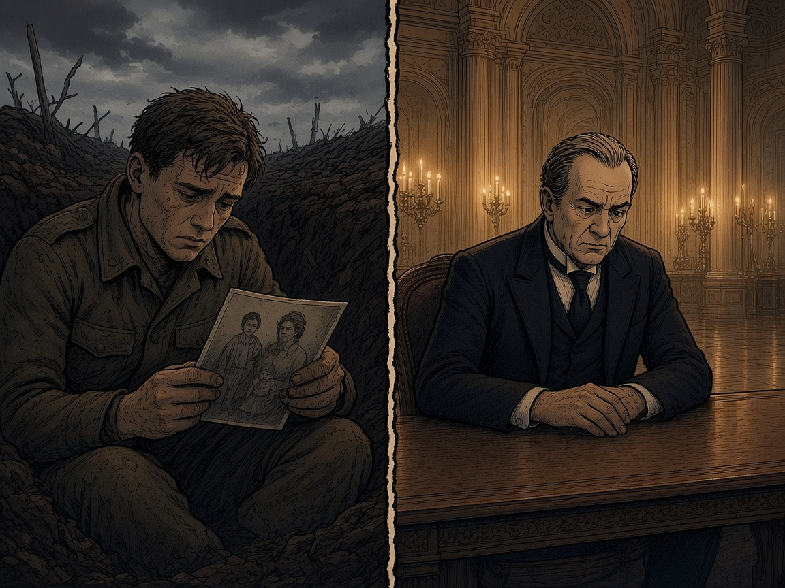

*Ellujäämine ja ohver: sõdur kaevikus pere fotoga, juht kaugel soojas lossis.*

### Kuidas see sinuni jõuab

Tüüpiline näide: X-is levis postitus, kus madala kvaliteediga video esitas Putinit kui ainsat, kes maailmas rahu eest seisab. Autori nime me siin ei nimeta, sest asi ei ole ühes inimeses. Asi on kanalis: lühike video, tugev emotsioon, lihtne kangelane ja lihtne süüdlane. Peatüki VIII seitse küsimust kehtivad siin täies ulatuses. Kajakamber ei ole ainult Kremlis. Iga uudisvoog, kus kõik on sinuga nõus, on väike kajakamber.

### Vastus: operatsioon „Peegel”

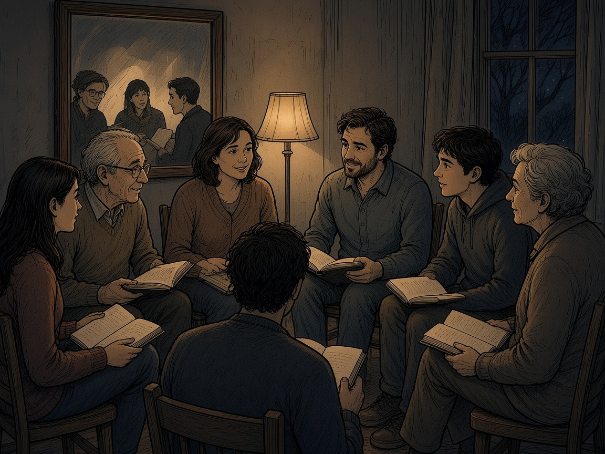

*Peegel kajakambri vastu: väike ring inimesi, raamatud, aknal puu. Siin vaieldakse ja kuulatakse.*

Kajakambri vastand ei ole teine kajakamber. See on peegel: koht, kus näed iseennast ja kuuled ka seda, mida kuulda ei taha. Renee on kirja pannud **operatsiooni „Peegel”** viiepunktilise lahingukäsu (OPORD) vormis. Selle põhimõte on: *„Ära usu mind. Kaitse oma uskumusi. Tee uuringud.”*

1. **Olukord.** Tulemused, mitte süüdistused. Statistikaameti andmetel oli Eesti summaarne sündimuskordaja 2025. aastal **1,16** (2024. aastal 1,18), taastootmiseks oleks vaja umbes 2,1. Üksikvanemaga pered on suuremas vaesusriskis kui kahe vanemaga pered. Usaldus valitsuse vastu on madal. Noortel on raske kodu soetada.

2. **Põhiülesanne.** Taastada Eesti rahva inimlikkus iga kodaniku isikliku paranemisteekonna kaudu.

3. **Täitmine.** Põhialused on uni, toit, keha, suhted, lapsed ja juhtimine. Trauma puhul on aluseks traumateadlikkus (Bessel van der Kolk, „Keha peab arvet”; selle raamatu kohta tehtud kriitika on kirjas peatükis XVI). Laste puhul Montessori lähenemine: laps ei ole projekt, vaid isiksus. Juhtimise puhul *Extreme Ownership* (Jocko Willink): sa ei saa juhtida teisi, kui sa ei suuda juhtida iseennast. Nimekirjas on ka Steigeri „Inimesekeskne juhtimine”.

4. **Teenindus ja logistika.** Taskukaardid, SOP-id, raamatuklubid (vt peatükk XVII) ja avalik leht **operatsioon-peegel.vercel.app**.

5. **Juhtimine ja side.** Ülesande täitjad on kodanikud. Igaüks on oma üksuse juht.

**Mõõdikud (KPI-d):** sündimuskordaja, üksikvanemate vaesusrisk ja usaldus. Need on numbrid, mida saab iga aasta Statistikaametist üle kontrollida. Kui need ei liigu, ei tööta ka operatsioon, olgu sõnad kui ilusad tahes.

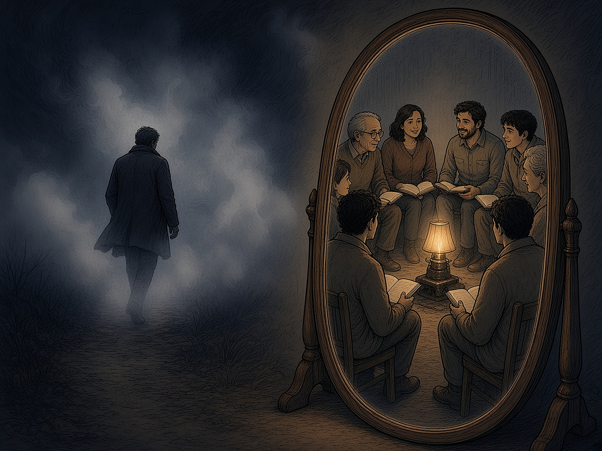

*Peegli teekond: pimedusest välja peegli poole, kus ootab ring inimesi, raamatuklubi ja Kaitseliidu kaaslased.*

Siin sulguvad kolm peatükki. Peatükk VIII näitas, kuidas võõras mõte muutub sinu omaks. Peatükk XVII näitas, et keskkond kujundab mõtteid. See peatükk näitab, mis juhtub, kui keskkond on ainult kaja. Kremli jaoks on liiga hilja. Meie jaoks mitte.

### Peatüki allikad

1. V. Putin, „Об историческом единстве русских и украинцев” (kremlin.ru, 12.07.2021).

2. Budapesti memorandum (05.12.1994, ÜRO dokumendid); Venemaa–Ukraina sõpruse, koostöö ja partnerluse leping (31.05.1997).

3. S. B. Dyson ja M. J. Parent, „The operational code approach to profiling political leaders: understanding Vladimir Putin”, *Intelligence and National Security* (2017), doi 10.1080/02684527.2017.1313523.

4. B. Bondarev, „The Sources of Russian Misconduct”, *Foreign Affairs* (2022); RFE/RL ja AP (mai 2022).

5. M. Ilyushina, „With an army of yes-men, how Putin's world turned into an echo chamber”, *The Washington Post* (13.12.2025).

6. „Is Elite Information War Hollowing Out the Russian State?”, *Geopolitical Monitor* (2026); Newsweek / Dossier Center, G. Karakulov (2023); D. Peskov, Rossija 24 (2018).

7. E. Rumer, „Belligerent and Beleaguered: Russia After the War with Ukraine” (Carnegie, 19.03.2026) ja „Russia Will Be More Dangerous After the War with Ukraine” (Carnegie Emissary, 06.04.2026).

8. H. Arendt, „The Origins of Totalitarianism” (1951).

9. Statistikaamet, „Sünnid” ja rahvastiku uudis (2026): summaarne sündimuskordaja 2025.

10. Renee Aluste, „OPERATSIOON PEEGEL — OPORD (paranemis-teekond)” (Google Drive, 2026) ja operatsioon-peegel.vercel.app. Renee hinnangud on märgitud hinnanguna.

> **Reegel 11.** Lisareegel: Kui kõik ümberringi on sinuga alati nõus, ei ole sa juht, vaid kaja. Hoia enda ümber inimesi, kes julgevad öelda „ei”, ja kontrolli kaustu, mida sulle tuuakse.

---

# XI PEATÜKK — Katkenud liin: Utö, MAYDAY ja päästeoperatsioon (28.09.1994)

Saarel, mis on Soome saarestiku viimane asustatud punkt enne avamerd, ei ole tuul kunagi päris vaikne. Renee jõudis Utöle samal põhjusel, miks Tarmo oli aastaid kogunud toimikuid: et näha oma silmaga kohta, mille kohta teised olid ainult rääkinud. Ta ei tulnud sinna turistina. Ta tuli kuulama.

Utö majakas, mille valge torn kõrgub üle graniidi ja madalate punaste majade, on kõige vanem säilinud majakas Soomes. Torni trepid on kitsad ja kumerad, iga keerd viib natuke kõrgemale ja natuke kaugemale kõigest, mis jääb alla. Ülevalt paistab ainult vesi – lõunas ja edelas, sinnapoole, kuhu 28. septembri 1994 öösel jäi parvlaev *Estonia*.

Renee oli kuulnud, et just siin, selles tornis, võeti vastu *Estonia* MAYDAY. Lugu kõlas nagu suur ja lihtne tõde: üks saar, üks torn, üks raadio ja üks hääl pimedas. Seistes klaasi taga, kus valgusvihk kunagi pöörles, otsustas ta selle loo lõpuni kontrollida. Mitte selleks, et seda maha teha, vaid selleks, et teada, milline osa sellest kannab.

### Mida dokumendid tegelikult ütlevad

Eesti, Soome ja Rootsi ühise uurimiskomisjoni (JAIC) 1997. aasta lõpparuande päästetööde peatükk (soomekeelne väljaanne on 2024. aastal uuesti avaldatud Soome Ohutusjuurdluse Ameti veebis) annab sellele ööle kellaajad. Aruanne hoiatab ise, et eri päevikutest ja tunnistustest pärit ajad võivad mõne minuti võrra erineda.

Esimese hädakutse võttis vastu reisiparvlaev **Mariella**, umbes kell 01.22, ja vastas sellele. *Mariella* oli *Estoniale* kõige lähemal, temast kirdes. *Silja Symphony* pardal pandi raadioside peale salvestama magnetofon. Teise hädakutse kell 01.24 võttis aruande tabeli 7.2 järgi vastu **14 raadiojaama**. Nende seas on laevad *Silja Europa*, *Silja Symphony* ja *Finnjet*, Turu mereõnnetuste päästekeskus (MRCC Turku), Turu ja Maarianhamina alamkeskused, Turku Radio, Kökari merevalvejaam – ja **Utö kindlus** (*Utön linnake*), mille kohta on allikana märgitud raadioametnik ja raadiopäevik.

Raadioside juhtjaamaks sai *Silja Europa*, millel oli *Estoniaga* otseühendus. Kell 01.29 andis *Estonia* *Silja Europale* oma asukoha. See oli viimane raadioside. Aruanne märgib ka, et Helsinki Radio ja MRCC Turu kasutasid VHF-kanalil 16 samu tugijaamu Utös, Järsös ja Hangos, ning Turu alamkeskus kasutas samuti Utö tugijaama.

Seega on Renee loo tuum tõsi, kuid see vajab täpsustust. **Utö oli tõepoolest üks paikadest, kus MAYDAY kinni püüti.** See ei olnud aga ainus koht ega ka esimene. Esimesena kuulis hääli *Mariella* ning samal minutil kuulis teist kutset veel kolmteist jaama. Aruanne nimetab vastuvõtjana Utö *kindlust* ja raadioametnikku. Allikad, mida ma läbi vaatasin, ei kinnita, et raadio asus just majakatornis. Võimalik, et kohapealne pärimus seob need kaks kohta kokku. Võimalik, et tugijaama antenn või seade paiknes tornis. Dokumendist ma seda aga ei leidnud, nii et jätan selle avatuks.

### Katkenud liin

Ülejäänu on aruandes kirjas kõledas ametlikus keeles, kuid see keel räägib omaette loo. *Mariella* teatas õnnetusest Helsinki Radiole kell 01.42. Kell 01.45 nõudis MRCC Turu kanalil 16, et Helsinki Radio saadaks välja *Mayday Relay* ehk hädasõnumi teise laeva nimel. Kell 01.50 saatis Helsinki Radio selle asemel kiirteate (*Pan-Pan*). Tegu on madalama astme teatega.

Rootsi päästekeskusele teatas Maarianhamina alamkeskus kell 01.52. Tallinna päästekeskus (MRCC Tallinn) sai teate Helsingist alles kell 02.55, peaaegu poolteist tundi pärast viimast raadiosidet. Aruande järgi käivitas MRCC Tallinn oma häirestuse kell 03.00. Kell 03.02 vastas ta Turule, et pardal oli 679 reisijat ja 188 meeskonnaliiget. Kell 03.58 andis Tallinn häire rannavalve laevale EVA-207, kuid ilm takistas laeval välja sõitmast.

See on see, mida Tarmo oma toimikutes nimetas *katkenud liiniks*. Katkenud liin ei tähenda vandenõud. See tähendab ahelat, kus iga lüli teeb midagi, kuid sõnum liigub aeglasemalt kui vesi. Suuronnettomuuks kuulutas MRCC Turu olukorra kell 02.30. Esimene laev, *Mariella*, jõudis kohale kell 02.12.

### Kopterid pimeduses

Turu valmiskopter **OH-HVG**, Soome piirivalve Super Puma, sai häire kell 01.35, startis kell 02.30 ja jõudis esimese kopterina õnnetuspaigale kell 03.05. Pimedas otsis meeskond prožektoriga vees olevaid inimesi. Esimese Rootsi kopterina jõudis kohale Q 97, õhujõudude Super Puma Visbyst, kell 03.50. Talle järgnesid Rootsi õhujõudude Super Pumad ning mereväe Boeing-Kawasaki kopterid Bergast ja Sävest. Soome piirivalve saatis lisaks Agusta Bell 412 kopterid OH-HVD ja OH-HVH. Soome õhujõudude Mi-8 kopterid said häire Uttis.

Kell 04.15 pakkus Taani merepäästeteenistus kopteriabi. Taani õhujõudude Sea King kopterid **U 280** ja **U 277** Aalborgist jõudsid kohale kell 08.15. Hilja pärastlõunal saabus ka Venemaa tsiviilkasutuses olnud Mi-8 RA 22511.

Aruande koondarv on ühemõtteline: õnnetuspäeval osales päästetöödel ja hukkunute otsingutel **26 kopterit, neist kaheksa Soomest, neliteist Rootsist, üks Eestist, kaks Taanist ja üks Venemaalt**. Lisaks tegi viis kopterit transpordilende. Kopterid päästsid 104 ja laevad 34 inimest. Kokku oli pardal 989 inimest. Ellu jäi 137 ja hukkus 852 inimest.

Siin tuleb Renee loos teha teine parandus. **Norra kopterid JAIC-i aruande kopterite tabelis ei esine.** Seal on Soome, Rootsi, Taani, Eesti ja Venemaa masinad. Norra osaluse kohta ma kontrollitavat allikat ei leidnud. Kui kellelgi on Norra kopteri või meeskonna dokument, kuulub see lisamisele. Seni jääb see väide kinnitamata.

### Eesti kopter ja „remondis olnud” masinad

Eestist osales üks kopter: **ES-XAC, Mi-2**, mis kuulus Tallinna eraettevõttele AeroCo. Häire andis talle kell 07.30 riiklik päästeamet. Kopter tegi otsingulennu mööda Eesti põhjarannikut. Sama ettevõtte teine Mi-2, ES-XAB, jätkas järgmistel päevadel. Lisaks tegi Eesti riigi lennuk L-410 (ES-PLW) otsingulende Eesti rannikul.

Renee on kuulnud, et Eesti kopterid olid tol ajal remondis. Avalikest allikatest, mida ma läbi vaatasin, ma sellele kinnitust ei leidnud ega ka ümberlükkamist. Aruanne kirjeldab, kuidas Eesti merepääste oli 1994. aastal alles üles ehitamisel. Eesti ei olnud enne õnnetust ratifitseerinud rahvusvahelist merepääste konventsiooni. Rootsi oli alates 1991. aastast koolitanud Eesti merepäästjaid. Remondijutt jääb seega **suuliseks pärimuseks**, mida tasub kontrollida tolleaegse piirivalve lennuüksuse dokumentidest või toonastelt lenduritelt.

### Saar, kuhu toodi elavad

Utö roll ei lõppenud raadiosõnumiga. Aruande järgi oli kindlusesaar kõige välimine saar enne õnnetuspaika. Sellest sai **kõige tähtsam päästetute kogumispaik**. Kuna kõiki päästetuid ei saanud laevadele viia, andis MRCC Turu korralduse lennutada neid vajaduse korral Utöle, et lühendada lennuaega ja vähendada alajahtumise ohtu. Kopterid tõid saarele 24 päästetut, kes viidi sealt edasi haiglaravile. Esialgu hoolitses nende eest kindluse personal õdede juhendamisel. Arsti juhitud meditsiinirühm saadeti Maarianhaminast kell 06.20, sest kopterit polnud vaba, ja rühm jõudis kohale umbes kell 06.50. Kell 06.30 sai saarel kopterikütus otsa ja kopterid suunati tankima Nauvosse ja Hankosse. Päeva jooksul toodi Utöle ka hukkunuid.

Kui Renee seisis tornis, vaatas ta seega mitte ainult kohta, kus kuuldi häält. Ta vaatas kohta, kuhu toodi tagasi need, kes ellu jäid. Graniidil, mille vahel praegu kasvab kanarbik, ootasid läbimärjad ja külmunud inimesed kopteri müra keskel järgmist lendu.

### Vrakk ja katmata jäänud haud

Vrakk lebab Soome majandusvööndis rahvusvahelistel vetel umbes 80 meetri sügavusel. Uppumise järel jäi see merepõhja peaaegu kummuli, tüürpoordi küljega pehmesse savisse. Vöörivisiir leiti vrakist eraldi, umbes poolteist kilomeetrit lääne poolt. Rootsi, Soome ja Eesti sõlmisid 1995. aastal lepingu, mis kuulutas vraki hauarahuks.

*Vrakk merepõhjas, illustratsioon on stiliseeritud. Tegelikkuses lebab vrakk umbes 80 m sügavusel peaaegu kummuli ja tüürpoordi küljega savis. 1994. aastal oli kreen umbes 108° ja kurss 091°, 2021–2023 mõõdeti kreeniks umbes 134°. Vöörivisiir leiti vrakist eraldi, umbes 1,5 km lääne poolt.*

Vahetult pärast õnnetust tegi Rockwater A/S (koos Smit Takiga) Rootsi Meresõiduameti tellimusel vraki seisukorra uuringu, ajavahemikus 21.11–08.12.1994. Rockwater vraki **ei katnud**. Rootsi valitsus otsustas 15. detsembril 1994, et vrakk kaetakse. Leping sõlmiti 11. jaanuaril 1996 konsortsiumiga Nordic Marine Contractors, kelle laevad olid Van Oordi kivipuistelaev *Tertnes* ja süvendaja *Volvox Iberia*. Plaani järgi pidi vraki vööri ja ahtri katma kahekordse betoonplokkmatiga ning ümbrus pidi saama liiva- ja kivitäite.

Tööd algasid 19. aprillil 1996. Ümber vraki paigaldati 26 geotekstiilmatti, need stabiliseeriti kruusaga ja peale puistati liiva. Hukkunute lähedaste survel otsustas Rootsi valitsus 19. juunil 1996 katmise lõpetada. Ajakirjanduse andmetel põhjendas transpordiminister Ines Uusmann seda sellega, et õnnetuse põhjus ei olnud veel lõplikult selge. 21. juulil avastati vrakist lõuna pool liivatäites suured deformatsioonid. Töövõtja lõpetas tööd 27. juulil 1996. Selleks ajaks oli puistatud umbes 380 000 m³ liiva. **Betoonmatte vrakile ei paigaldatud.** Vrakk ise jäi katmata, kuid selle ümbrus on sellest ajast saadik inimtekkeline täide. Just sellele viitab ka BMTIG, kui ta küsib, kas hilisematel sonaripiltidel nähtav kõva kiht on aluskivim või 1996. aasta täide.

*1996. aasta katmistööd. Rootsi valitsus otsustas 15.12.1994 vraki katta. Tööd algasid 19.04.1996 ja valitsus otsustas 19.06.1996 katmise lõpetada. Töövõtja lõpetas tööd 27.07.1996. Ümber vraki paigaldati geotekstiil, kruusakiht ja umbes 380 000 m³ liiva. Plaanitud betoonmatid vrakile ei jõudnud.*

### Mida 2025. aasta aruanne muutis

Kolmkümmend üks aastat pärast õnnetust muutis ametlik lõpparuanne kahes kohas pilti, mida JAIC 1997. aastal joonistas. Need muudatused on olulised ka Utö loo jaoks, sest need nihutavad kellaaegu, millest raadiosõnumid sõltusid.

Esiteks hindas aruanne, et visiiri eraldumine ja vee sissevool algasid umbes 10–15 minutit varem, kui JAIC oli arvanud, vahetult pärast kella ühte öösel. Aruande ajajoone järgi tungis vesi autotekilt mitteveekindlate tuletõkkeuste kaudu trepikodadesse ja alla 1. tekile. Kreen ületas 90 kraadi umbes kell 01.35 ja laev uppus ahter ees umbes kell 01.50. See tähendab, et kui MAYDAY kell 01.22 ja 01.24 eetrisse läks, oli laev juba umbes kakskümmend minutit hädas olnud.

Teiseks jõudsid Eesti ja Rootsi uurijad järeldusele, et *Estonia* **ei olnud merekõlblik**. Vöörilukud olid sertifitseerimata ja põrkevahesein oli valel kohal, mistõttu poleks laev tohtinud sõita kaldast nii kaugel. JAIC seda 1997. aastal nii ei sõnastanud. Ka BMTIG nõustub konstruktsiooniliste puuduste kriitikaga. Vaidlus on kitsam, kui avalikkus sageli arvab: mõlemad pooled tunnistavad, et laev oli haavatav. Lahkhelid puudutavad tüürpoordi vigastust.

Tarmo märkmikus on see lõik alla joonitud. Tema jaoks oli see vaikimismustri kõige selgem näide: tõde ei tulnud välja ühe suure paljastusega. See tuli välja aeglaselt, aruandest aruandesse, ja iga parandus tõi kaasa küsimuse, miks seda kohe ei nähtud.

### Teine liin: allveelaeva hüpotees

Utö tornist vaadates on lihtne mõelda, et meri peidab kõike. Just seepärast tuleb järgmine osa lugeda teistmoodi kui eelmised. Eelmised lõigud tuginevad uurimiskomisjoni kellaaegadele ja tabelitele. See osa kirjeldab **hüpoteesi**, mida ametlik uurimine **ei kinnitanud**. Tarmo kirjutas selle oma kaardil eraldi kihile ja tegi kihi serva kirjaga „väide, mitte fakt”.

Hüpotees ütleb, et *Estonia* põrkas hukuööl kokku suure veealuse või pinnal liikuva objektiga, võimalik et allveelaevaga, ning et see kokkupõrge tekitas vraki tüürpoordi suure vigastuse. Hüpoteesi kõige põhjalikum avalik tehniline esitus on Rootsis tegutseva sõltumatu rühma **Baltic Marine Technical Investigation Group (BMTIG)** kümneosaline raportisari R1–R10. See avaldati Stockholmis 10. detsembril 2025, kuus päeva enne Eesti, Soome ja Rootsi ohutusjuurdlusasutuste ametlikku lõpparuannet.

### Mis on vaidluse all

Vaidluse keskmes ei ole vöörivisiir. Sellest on mõlemad pooled ühel meelel: visiir eraldus ja vesi tungis autotekile. 2020. aastal leidsid filmitegijad vraki tüürpoordist ava, mida 1990. aastatel ei olnud filmitud. Hiljem mõõdeti selle vigastusala pikkuseks umbes 22–25 meetrit ja kõrguseks umbes neli meetrit. Küsimus on lihtne: **kas see vigastus tekkis enne uppumist või pärast seda?**

**Ametliku lõpparuande (OJK, SHK ja OTKES, 16.12.2025) seisukoht:** vigastus tekkis siis, kui vrakk vajus ja rullus merepõhjas vastu gneisist aluskivimi paljandit. Vigastus oli 1990. aastatel savi sees peidus. Nähtavale tuli see alles pärast seda, kui vrakk nihkus nõlval ja selle kreen suurenes ligikaudu 108 kraadilt 134 kraadini. Tallinna Tehnikaülikooli arvutimudelid (2023 ja 2025) näitavad, et vrakk võib omaenda raskuse all aluskivimile vajudes sellise vigastuse saada. Eesti Kohtuekspertiisi Instituudi 2023. aasta ekspertiisiakt 23U-AR0075 uuris vigastuse servast lõigatud teraseproovi. Proovil oli plastne venimine, kuid kokkupõrkest metallobjektiga, võõrmetallist või lõhkeainest jälgi ei leitud. Lisaks märgib aruanne, et vähemalt viis tunnistajat nägid väljasirutatud stabilisaatorilaba, kuid vrakil on mõlemad labad sisse tõmmatud ja terved. Ametlike uurijate hinnangul räägib see külgkokkupõrke vastu.

**BMTIG vastuargumendid:** rühm arvutab raportis R3, et tüürpoordi vigastusala tekitamiseks oleks vaja umbes 140–180 megadžauli plastse deformatsiooni energiat. Raportis R5 kritiseerib rühm TalTechi mudelit. BMTIG hinnangul jääb mudeli rullumisenergia alla ühe megadžauli, olles seega umbes 250–300 korda väiksem. Rootsi rühm viitab ka Rockwateri 1994. aasta detsembri puursüdamikele, mille järgi oli vigastusala juures paks pehme savikiht, mitte kaljupaljand. BMTIG-i järeldus on, et vajaliku energia oleks andnud kokkupõrge objektiga, mille efektiivne mass on mõni tuhat tonni ja kiirus umbes 11–14 sõlme. Rühma Bayesi analüüs murdepindade kohta eelistab kiiret löögimurdu. Stabilisaatorite kohta viitab BMTIG kolmanda mehaaniku ütlusele, et labad tõmbusid kiiruse langedes automaatselt sisse.

**Ajakirjanduslik lisa, mitte tõend:** ajakirjanik Lars Borgnäs avaldas 15. detsembril 2025 ajakirjas *Fokus* loo dokumendist. Selle dokumendi oli 1996. aastal saanud Rootsi Meresõiduameti ametnik ning selles väideti muu hulgas kokkupõrget allveelaevaga. Lõpparuande koostanud SHK kinnitas 2025. aasta memos, et ameti arhiivist sellist dokumenti ei leitud. Dokumendi sisu ei ole seega avalikult kontrollitav.

Kumb pool on õigem? Selle peatüki allikad seda ei otsusta. Ametlik uurimine tugineb laboriekspertiisidele ja merepõhja uuringutele. BMTIG tugineb energiabilansile ja kriitikale ametlike mudelite aadressil. Tarmo märkis oma kaardile ainult selle, mida saab kontrollida: **ametlik järeldus on põhjakontakt, allveelaeva kokkupõrget ei ole ükski uurimisasutus kinnitanud ja Rootsi rühma arvutused on avalikud ning kontrollitavad.** Kes tahab vaidlust lõpetada, peab need arvutused ümber lükkama või kinnitama, mitte vaikimisi kõrvale jätma.

***HÜPOTEES – mitte tõestatud fakt.** Kunstniku kujutlus BMTIG-i (2025) esitatud versioonist, mille järgi põrkas *Estonia* kokku allveelaeva või muu suure objektiga. Ametlik lõpparuanne (OJK/SHK/OTKES, 16.12.2025) seda ei kinnita: selle järgi tekkis tüürpoordi vigastus merepõhjas pärast uppumist.*

### Kas Utö ja allveelaev on seotud?

Siin on kiusatus suur. Utö oli kindlussaar, raadioside sõlm ja päästetöö kogumispaik. Allveelaeva lugu räägib sõjaväest. Sellegipoolest **ei ole avalikes allikates, mida ma läbi vaatasin, mitte ühtegi dokumenti, mis seoks Utö kindlust või selle raadioliiklust allveelaeva hüpoteesiga.** Utö raadioametnik kuulis sama MAYDAY-d, mida kuulis veel kolmteist jaama. Uurimiskomisjoni tabelis on tema kellaaeg ja allikas, mitte rohkem.

Seepärast on kahe liini vaheline seos selles peatükis üksnes **küsimuste seos**, mitte väide. Esimene küsimus on, kas Utö kindluse ja teiste rannikujaamade 1994. aasta raadio- ja vaatluspäevikud on täies mahus avalikud ja kas neis on midagi peale hädaliikluse. Teine küsimus on, kas tolleaegsed mereseirevahendid, nii Soome, Rootsi kui ka teiste riikide omad, registreerisid õnnetuspiirkonnas muud liiklust. Kumbki küsimus ei ole süüdistus. Need on päringud, mille vastus võiks hüpoteesi kas nõrgendada või tugevdada.

### Mis jäi uurimata – ja mis on lihtsalt teadmata

See raamat on algusest peale eristanud kahte asja: seda, mida dokument ütleb, ja seda, mida inimesed räägivad. Ka selles peatükis peab see piir olema nähtav.

**Kontrollitud fakt:** MAYDAY kuulsid kell 01.24 neliteist jaama, nende seas Utö kindlus. Esimesena kuulis kutset *Mariella* umbes kell 01.22. Päästetöid juhtis MRCC Turu. Kohal olid Soome, Rootsi, Taani, Eesti ja Venemaa kopterid. Utöst sai päästetute peamine kogumispaik.

**Kontrollitud fakt:** ametlikus ahelas oli viivitusi. Helsinki Radio saatis *Mayday Relay* asemel *Pan-Pan* teate. Tallinn sai teate kell 02.55. Eesti laev ei pääsenud ilma tõttu välja.

**Kinnitamata väide:** raadio, mis kutse vastu võttis, asus majakatornis. Aruanne nimetab kindlust ja raadioametnikku, mitte torni.

**Kinnitamata väide:** Norra õhujõud osalesid päästetöödel. Aruande kopterite tabelis neid ei ole.

**Kinnitamata väide:** Eesti kopterid olid remondis. See on suuline pärimus, mida dokumentides ei leidnud.

**Ametlik järeldus (2025):** tüürpoordi vigastus tekkis merepõhjas pärast uppumist. Ekspertiisid kokkupõrke ega lõhkeaine jälgi ei leidnud.

**Hüpotees, mida ametlikult ei kinnitatud:** vigastuse põhjus oli kokkupõrge allveelaevaga või muu suure objektiga. Selle peamine tehniline alus on BMTIG-i energiaarvutus.

**Tõestamata seos:** Utö ja allveelaeva hüpotees. Dokumenti, mis neid seoks, ei leitud.

**Avatud küsimus, mitte järeldus:** miks liikus teade Tallinna nii aeglaselt ja miks valiti *Mayday Relay* asemel madalam teade? Aruanne kirjeldab, *mis* juhtus. Kas see oli korralduslik nõrkus, kogenematus või midagi muud, seda ei saa selle peatüki allikate põhjal öelda. V peatükis kirjeldatud vaidlused vrakki üle ei ole selle küsimusega tõestatult seotud ja Tarmo hoidis need oma kaardil eraldi kihis.

Tarmo kirjutas oma välimärkmikku lause, mis sobib selle peatüki lõppu: *vaikus ei ole alati kellegi valik – vahel on see lihtsalt liin, mida keegi õigel ajal ei parandanud.* Vaikimismustri tunneb ära alles siis, kui küsitakse, miks liini pärast kunagi ei parandatud, ja kui vastus nõutakse dokumendiga.

Renee laskus mööda kitsast treppi alla. Allpool oli jälle tuul, graniit ja meri, mis ei mäleta midagi. Mäletavad paberid, ja ainult siis, kui keegi neid loeb.

### Kaks katkenud liini

Tallinnas, Paksu Margareeta kahurtorni kõrval Suure Rannavärava bastionil, seisab mälestusmärk, mis **kannab sama nime kui see peatükk**: „Katkenud liin”. Selle autorid on Villu Jaanisoo ja Jorma Mukala. Mälestusmärk avati 27. septembril 1996, kaks aastat pärast huku. Graniitaluselt algav kandiline metallsammas kaardub üle tee ja katkeb keskelt. Graniidile on raiutud õnnetuse kuupäev ja hukkunute nimed. Autorite sõnul sümboliseerib see katkenud teekonda Tallinnast Stockholmi. Reisisadam, kust *Estonia* viimasele reisile läks, on sealt mõne minuti tee kaugusel.

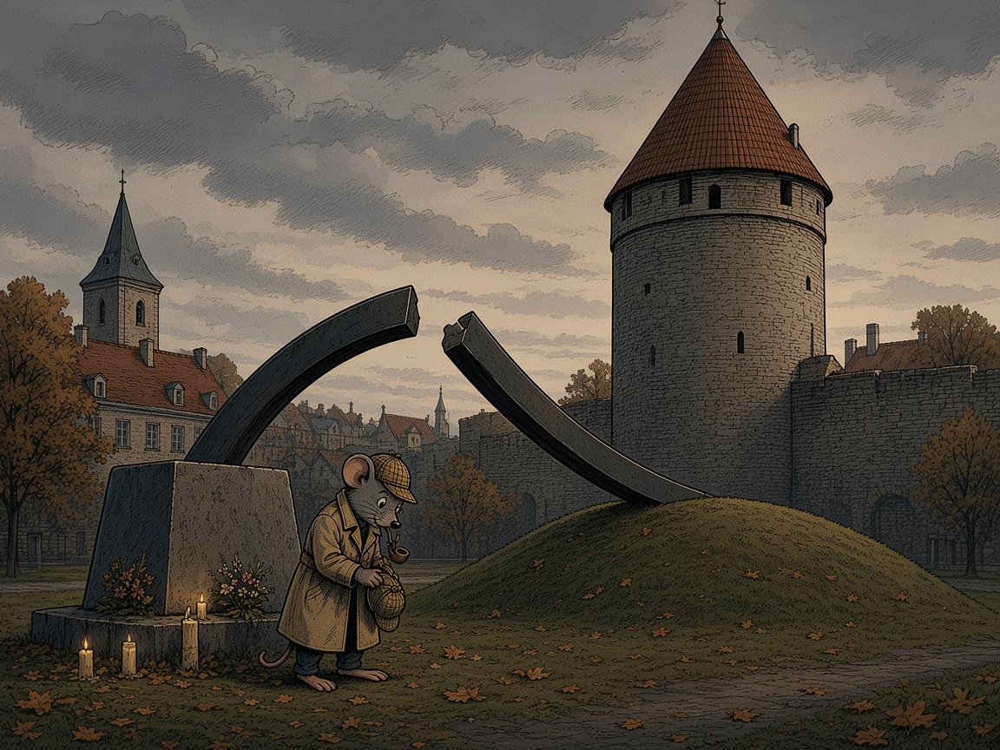

*Mälestusmärk „Katkenud liin” Paksu Margareeta juures Tallinnas (Villu Jaanisoo ja Jorma Mukala, avatud 27.09.1996). Kujutatud on keskelt katkev metallsammas graniitalusel, millele on raiutud hukkunute nimed.*

Renee seisis ühel päeval Utö tornis, kus kuuldi viimaseid sõnu, ja teisel päeval kivisamba juures, kus need sõnad on raiutud nimedeks. Kahe paiga vahel on meri ja kolmkümmend kaks aastat paberit. Peatüki nimi on laenatud monumendilt teadlikult: liin katkes merel, raadios ja aruannetes, kuid nimekiri graniidil ei katke.

### Peatüki allikad

1. Eesti, Soome ja Rootsi ühise uurimiskomisjoni (JAIC) lõpparuanne, 1997. Peatükk 7 „Pelastustoimet”, tabelid 7.2, 7.5, 7.7 ja 7.9 (soomekeelne väljaanne, Turvallisuustutkintakeskus, turvallisuustutkinta.fi, 2024).

2. Riksarkivet, Estoniasamlingen: hädaraadioside salvestus („Mayday-anropet”), sok.riksarkivet.se/estonia.

3. Wikipedia: „MS Estonia” (ingliskeelne), mida kasutasin hukkunute ja pääsenute arvu kontrollimiseks.

4. Eesti Ohutusjuurdluse Keskus, Rootsi SHK ja Soome OTKES: M/S Estonia esialgse hindamise lõpparuanne, 16.12.2025. Sellele lisanduvad TalTechi analüüsid (2023 ja 2025) ning EKEI ekspertiisiakt 23U-AR0075 (2023).

5. Baltic Marine Technical Investigation Group (BMTIG): raportisari R1–R10 ja koondkokkuvõte, Stockholm, 10.12.2025 (estoniainvestigation.com).

6. Lars Borgnäs, ajakiri *Fokus*, 15.12.2025, ja SHK memo S-200/20 (20.08.2025), mõlemad viidatud eelmise allika võrdlusanalüüsi kaudu. Allikat ei ole iseseisvalt kontrollitud.

7. SHK/OJK/OTKES lõpparuanne 2025, lisa O 2.6 ja O 2.10 (Rockwateri uuring 1994, katmistööd 19.04–27.07.1996); SGI aruanne „Fartyget M/S Estonia” (2021/2023); taz/dpa 1996.

8. Tallinna linnaruumikunsti kaart: „Katkenud liin”; et.wikipedia „Katkenud liin”; Visit Tallinn.

> **Reegel 12.** Lisareegel: Hea lugu ei vaja ilustamist. Kontrolli, kes tegelikult kuulis, kes tegelikult tuli ja mis jäi ütlemata. Kinnitamata väide jääb väiteks seni, kuni dokument selle kinnitab.

---

# XII PEATÜKK — Saar, kust puugid tulid: Plum Island, borrelioos ja uurimine, mis on alles pooleli

Selles raamatus on juba üks saar. Utö on Soome saarestiku välisserval, kus 1994. aasta septembriöö kriisis oli koht majakal ja raadiojaamal. Teine saar asub teisel pool ookeani, New Yorgi osariigis Long Islandi idatipu lähedal. Selle nimi on **Plum Island**. Ka seal on majakas. Ja ka selle saare ümber on aastakümneid räägitud lugu, mida pole keegi tõestanud.

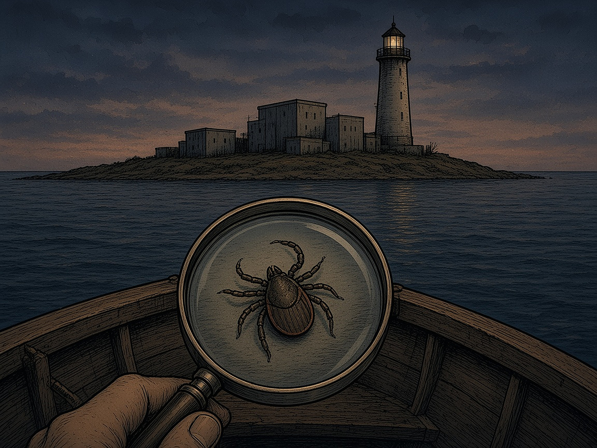

*Plum Island: madal saar, laborihooned ja majakas. Puugi ja saare seos on VÄIDE, mida tõendid ei toeta.*

### Mis saarel tegelikult oli

**LEID:** Plum Islandil asus USA loomahaiguste uurimiskeskus (*Plum Island Animal Disease Center*). DHS-i andmetel uuriti seal loomade haigusi, näiteks suu- ja sõrataudi ning Aafrika seakatku. DHS-i sõnul ei uuritud seal inimeste puugihaigusi ega borrelioosi. Teadustöö saarel lõppes septembris 2025 ja diagnostika oktoobris 2026. Saaste puhastamine kestab DHS-i järgi 2031.–2034. aastani. Töö kolib Kansasesse uude laborisse (NBAF), mis 2026. aasta augusti seisuga veel täies mahus ei töötanud.

### Väide

**VÄIDE:** et borrelioos ehk Lyme'i tõbi pärineb külma sõja aegsest relvaprogrammist ja pääses Plum Islandilt välja. Seda on levitanud raamatud ja poliitikud. Kris Newby raamat „Bitten” (2019) tugineb borrelioosi bakteri avastaja Willy Burgdorferi intervjuudele. Raamatu arvustaja hinnangul ja autori enda tunnistusel kindlat tõendit lekke kohta ei ole. Väidet on korranud ka Robert F. Kennedy Jr ja Tucker Carlson.

### Mida teadlased vastavad

**LEID:** borrelioosi bakter on palju vanem kui labor. Seda on leitud vanadest puukidest ja 5300 aasta vanusest muumiast. Esimene USA haigusjuht diagnoositi 1969. aastal Wisconsinis, kaugel Plum Islandist. Puugiteadlane Sam Telford (Tuftsi ülikool) kirjutas Washington Postis, et bakteri geenid ei näita levikut ühest laborist. PolitiFact hindas Tucker Carlsoni väite 2024. aastal täiesti valeks („Pants on Fire”).

### Mida Kongress tegelikult otsustas

See on koht, kus fakt ja väide kõige kergemini segamini lähevad. **LEID:** 2019. aastal kiitis USA Esindajatekoda heaks kongresmen Chris Smithi paranduse, mille järgi pidi Pentagoni peainspektor uurima, kas aastatel 1950–1975 katsetati puuke relvana. See parandus võeti lõplikust seadusest välja. 2025. aasta detsembris lisati 2026. aasta kaitse-eelarve seadusse (NDAA, §1068) uus ülesanne: riigikontroll GAO peab uurima, kas USA sõjavägi katsetas aastatel 1945–1972 puuke bioloogilise relvana. Aruanne peab valmima umbes 2027. aasta keskel. **Tulemust veel ei ole.**

Uurimise tellimine ei ole tõend. See tähendab ainult, et küsimus on ametlikult esitatud. Vastus võib olla ükskõik milline. Seni jääb relvaväide **VÄITEKS**.

### Miks see lugu ei sure

Kohalik teadlane nimetas borrelioosi lugu CT Posti artiklis müüdiks, mis sündis külma sõja aegsest salastatusest. **Tõlgendus:** kui riik hoiab saart aastakümneid suletuna ega räägi, mida seal tehakse, täidab vaikuse inimeste kujutlusvõime. Kümnes reegel ütleb, et saladus, mida kõik teavad, on kokkulepe vaikida. Plum Island näitab ka teist poolt: vaikus sünnitab lugusid, mis elavad kauem kui saladus ise.

### Kaks saart

Utö ja Plum Island ei ole omavahel seotud. Neid ei ühenda ükski dokument ega sündmus. Raamatus on nad kõrvuti ühel põhjusel. Mõlemal saarel juhtus midagi, mille ümber tekkis rohkem küsimusi kui vastuseid. Utö peatükis jäid lahtiseks mõned küsimused Estonia kohta. Plum Islandi peatükis jääb lahtiseks GAO aruanne. Mõlema puhul kehtib sama reegel: kinnitamata väide jääb väiteks seni, kuni dokument selle kinnitab. Ja dokument, mis väidet ei kinnita, on samuti vastus.

Täna on Plum Islandi tulevik lahtine. Suffolki maakond ja 130 organisatsioonist koosnev koalitsioon tahavad saare looduskaitse alla võtta. Föderaalvalitsus võib saare 2027. aasta alguses üleliigseks kuulutada. Majakas jääb alles. See ei tea midagi puukidest.

### Peatüki allikad

1. DHS, Plum Island Animal Disease Center (dhs.gov).

2. Stars and Stripes (23.01.2026); E&E News / POLITICO (16.12.2025 ja 11.12.2024): NDAA 2026 §1068 ja GAO ülesanne.

3. Newsday (12.04.2025 ja 15.07.2026); CT Post (08.04.2025 ja 24.07.2026); The East Hampton Star (23.07.2026); The Suffolk Times (02.09.2025); Kansas Reflector (18.08.2026).

4. PolitiFact (16.05.2024); The Washington Post (S. Telford, 11.08.2019; 17.07.2019); CNN (17.07.2019); Roll Call (15.07.2019); Portland Press Herald (17.09.2021).

5. Outside (29.05.2019), arvustus K. Newby raamatule „Bitten”.

6. Renee ülevaade „Plum Island ja puugid: uudised USA meedias” (07.10.2026).

> **Reegel 13.** Lisareegel: Uurimise tellimine ei ole tõend. Vaikus sünnitab lugusid — vasta neile dokumentidega, mitte uute lugudega.

---

# XIII PEATÜKK — Nähtamatud reisijad: parasiidid, mikroobid ja inimese käitumine

Selles raamatus on palju nähtamatuid tegijaid: varifirmad, nominaalhoidjad ja trollikontod. See peatükk räägib kõige väiksematest. Mõned organismid elavad inimese sees ja mõned neist mõjutavad tõesti aju. Internetis tehakse sellest suuri järeldusi, näiteks et „parasiit juhib poolt planeeti”. Renee kirjutas 2026. aasta oktoobris raporti, kus iga väide sai märke. Need märked on siingi:

**TÕESTATUD** — põhjus ja tagajärg on selgelt näidatud. **SEOS** — kaks asja esinevad sageli koos, kuid üks ei pruugi põhjustada teist. **VÄIDE** — keegi ütleb nii, kuid tõendeid on vähe, need on vastuolulised või puuduvad.

### Rott, kes ei karda kassi

**TÕESTATUD (loomadel):** üherakuline parasiit *Toxoplasma gondii* saab paljuneda ainult kassi sooles. Oxfordi uuringus (Berdoy jt 2000) väldivad terved rotid kassi uriini lõhna, nakatunud rotid aga mitte. Osa neist eelistas isegi kassi lõhnaga kohta. Nii jõuab parasiit kergemini kassi kõhtu. Teadlased peavad seda „peremehe manipuleerimise” klassikaliseks näiteks.

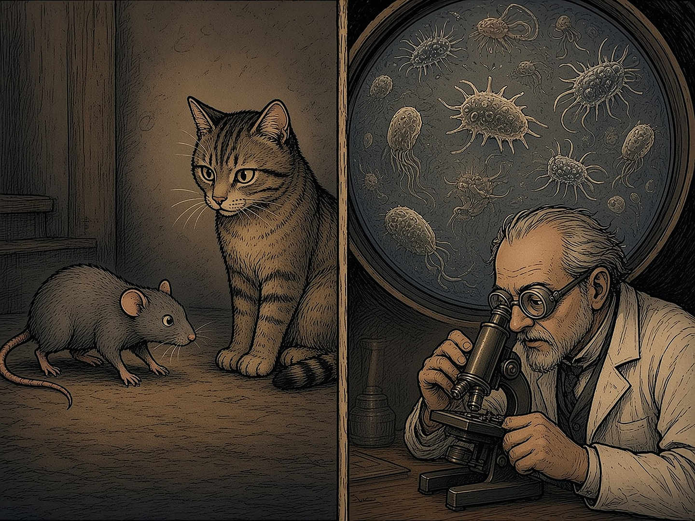

*Rott, kes ei karda kassi: toksoplasma mõju rottide käitumisele on tõestatud. Inimeste kohta on leitud ainult seoseid.*

### Iga teine eestlane

**TÕESTATUD:** 2016. aasta uuringus oli toksoplasma antikehad **55,8%** Eesti täiskasvanutest (n = 999). Maailmas on see umbes 26%, Euroopas umbes 30%. Väide „üle poole planeedist on nakatunud” ei pea paika. Eestis on aga tõesti umbes iga teine inimene parasiidiga kokku puutunud. Tartus oli levik üle kahe korra suurem kui Uppsalas. Enamikul nakatunutel ei ole mingeid sümptomeid.

### Mida see inimesega teeb

**SEOS:** 50 uuringu meta-analüüsis (Sutterland jt 2015) oli toksoplasma antikehadega inimeste seas skisofreeniat sagedamini: šansisuhe 1,81, pärast avaldamisnihke parandust 1,43. Liiklusõnnetuste kohta leiti 11 uuringu põhjal šansisuhe 1,69. Ettevõtlusüliõpilaste uuringus olid nakatunud sagedamini äri erialal. **Need on seosed, mitte põhjused.** Taga võivad olla elutingimused, toitumine, loomadega kokkupuude või vaesus. Ka uurijad ise rõhutavad seda.

**Vastutõend:** Uus-Meremaa Dunedini kohordi uuring (Sugden jt 2016, 837 inimest) ei leidnud seost skisofreenia, depressiooni, kuritegevuse, impulsiivsuse ega IQ-ga. Tšehhi Jaroslav Flegri isiksuseuuringud olid väikese valimiga ja testisid palju omadusi korraga.

**VÄIDE:** et toksoplasma muudab dopamiini kaudu inimese iseloomu. Parasiidil on geenid, mis toodavad dopamiini eelainet L-DOPA-t, kuid hiireuuringus ei muutnud ühe geeni eemaldamine looma dopamiini ega käitumist. Mehhanism on lahtine.

### Need, mis päriselt aju kahjustavad

**TÕESTATUD:** mõned organismid mõjutavad aju kindlasti. **Puukentsefaliidi viirus**: Eestis oli 138 juhtu 2024. aastal ja 143 juhtu 2025. aastal, mis on üks Euroopa kõrgemaid näitajaid. Läti uuringus oli peaaegu pooltel haiglapatsientidest püsivad tagajärjed, näiteks keskendumisraskus ja väsimus. **Borrelia** (Lyme'i tõbi): Eestis 3843 juhtu 2024. aastal ja 3276 juhtu 2025. aastal. Neuroborrelioos võib põhjustada närvipõletikku ja näonärvi halvatust. **Sea paeluss** ajus põhjustab WHO järgi kuni 30% epilepsiast piirkondades, kus see levib. Eestis kinnitatud juhte uuringus ei olnud. Siia kuuluvad ka marutaud, neurosüüfilis ja ajumalaaria.

Puugid on selles loetelus kõige eestimaisemad. Nendega algab järgmine peatükk.

### Hallitus, lestad ja seened

**SEOS:** niiske ja hallitanud kodu on seotud halvema vaimse tervisega, umbes 1,3–1,4 korda suurema depressiooni šansiga. Põhjuslikkust ei ole tõestatud. **VÄIDE, mis ei leidnud kinnitust:** „90–97% Eesti majadest on musta hallitusega”. Eesti uuringus oli 97% hoopis kaebus umbse õhu üle. Hallituse üle kaebas 43%. Kogu Eestis elab niiskes või lekkivas kodus 10,5% inimestest.

**TÕESTATUD:** ripsmelestad (*Demodex*) elavad peaaegu kõigil täiskasvanutel. Need on lestad, mitte ussid, ja käitumist nad ei mõjuta. **VÄIDE (müüt):** et „zombiseen” *Cordyceps* võib nakatada inimest. See on sarja- ja mängulugu, mitte bioloogia.

### Luure ja relvad

**Mida ei leitud:** ühtegi dokumenteeritud uuringut ega programmi, kus toksoplasmat oleks kasutatud inimeste käitumise mõjutamiseks või relvana. Sõjandusega seotud uuringud käsitlevad sõdurite tervist, näiteks Tšehhi sõjaväeautojuhte. Kui keegi räägib „luureoperatsioonist”, tuleb küsida allikat.

### Miks see on raamatus

Nähtamatu reisija on hea kujund kõige selle kohta, mida see raamat uurib. Mõju võib olla päris ka siis, kui seda ei näe. Aga seose ja põhjuse vahel on sama suur vahe kui kahtluse ja süüdistuse vahel.

### Peatüki allikad

1. Lassen jt 2016 (Eesti seroepidemioloogia); Birgisdóttir jt 2006; Molan jt 2019.

2. Berdoy, Webster, Macdonald 2000 (Proc R Soc B).

3. Torrey jt 2007; Sutterland jt 2015 ja 2019; Burgdorf jt 2019; Flegr jt 2002; Johnson jt 2018; Sugden jt 2016 (Dunedin).

4. Terviseamet, nakkushaiguste statistika 2024–2025; WHO (tsüstitserkoos, malaaria); Läti puukentsefaliidi uuring.

5. Eesti siseõhu ja paneelmajade uuringud; Statistikaamet (niiske eluase 10,5%).

6. Renee raport „Parasiidid, mikroobid, hallitus ja inimese käitumine” (07.10.2026).

> **Reegel 14.** Lisareegel: Seos ei ole põhjus. Märgi iga väite juurde, kas see on tõestatud, seos või väide — sama vahe on kahtlusel ja süüdistusel.

---

<!-- KOLMAS OSA: INIMENE JA KESKKOND -->

# XIV PEATÜKK — Mees, kes tuli koju sõjast, mis algas kuurist

Kuid „Sündikaat 7” ei ole raamat ainult paberitest, hangetest ja varifirmadest. See on raamat sellest, mis juhtub inimesega siis, kui süsteem näeb temas ainult mutrit või sildiga rida. Tarmo teadis erioperaatori, üksuse juhi ja inim-mõjutusrelva „Seen” sõdurina, et ükski võrgustik ega ükski sõjavägi ei püsi koos paberil – see püsib koos või laguneb laiali täpselt sellest hetkest, kuidas juht vaatab otsa oma kõige katkisemale sõdurile.

Tema nimi on selles peatükis Margus Vene *(märkus: loo avaldamiseks trükis on vaja asjaosalise kirjalikku nõusolekut; selle puudumisel käsitletakse nime koondkujuna)*.

Ta oli üheksateistkümneaastane, kui ta leidis oma ema kodukuurist pootuna. Tema isa ei suutnud kuuri minna. Isa saatis üheksateistkümneaastase poja oma ema nööri otsast alla lõikama.

Poiss lõikas. Ta pani ema põrandale ja hakkas elustama. Südamemassaaži käigus murdusid ema roided – iga meedik teab, et elustamisel juhtub seda sageli. Kuid kui kohale tulid uurijad, hakati üheksateistkümneaastast poissi süüdistama omaenda ema mõrvas.

Ta jäi sellesse kuuri lukku. Kahekümneks aastaks.

Umbes 2002. aastast asus ta teenima Eesti Kaitseväes. Temast sai EOD-spetsialist – demineerija, pommimees, see, kes kõnnib üksinda sinna, kust kõik teised tagasi jooksevad. Ta käis viiel välismissioonil, nende hulgas Afganistanis. Ühel operatsioonil tabas ta vastase 740–750 meetri kauguselt. Ta ei tundnud selle üle kunagi uhkust. Ta ei rääkinud sellest baaris.

Ta lihtsalt jõi. Rängalt, aasta-aastalt, kogu teenistuse vältel. Süsteemi ja määrustiku silmis oli ta „probleemne kaitseväelane, kellel on alkoholiga pahandusi” – järjekordne rida distsiplinaararuandes, keda sai karistada, survestada või maha kanda. Keegi ei küsinud, miks mees, kes ei karda Afganistanis lõhkekeha, ei suuda kodus kaine peaga magama jääda.

Kuni ühel päeval üks kapten ei hakanud karjuma ega käskkirja kirjutama, vaid kuulas. Ja mees rääkis – esimest korda elus – sellest kuurist, oma emast, murtud roietest ja süüdistusest.

Sel päeval muutusid korraga kaks inimest. Kapten sai aru, et tema ees ei seisa mitte distsipliinirikkumine, vaid üheksateistkümneaastane poiss, kes polnud kahekümne aasta jooksul kordagi kuurist välja saanud. Ja sõdur sai aru, et teda on esimest korda nähtud inimesena.

Selles loos on koos kogu „Sündikaat 7” vastumürk. Nii nagu My Lai peatükis saab naisest ja lapsest „punkt ekraanil” sel hetkel, kui temalt võetakse nimi ja lugu, saab sõdurist või kodanikust taas inimene sel hetkel, kui keegi tema loo päriselt ära kuulab. Trauma ei ole kurjus; trauma on kehasse lukustunud valu, mida saab vabastada teaduspõhise abiga – olgu selleks EMDR-teraapia (*Eye Movement Desensitization and Reprocessing*, mida Maailma Terviseorganisatsioon ja kliinilised ravijuhendid soovitavad posttraumaatilise stressi ravis) või juht, kes tunneb inimest nime taga.

> **Reegel 15.** Kuues reegel: Enne kui kirjutad käskkirja või kannad inimese maha, kuula ära tema lugu. Trauma ei ole kurjus, vaid lukustunud valu, mis vajab inimlikku ja teaduspõhist abi.

---

# XV PEATÜKK — Peegel ja õlessanded: kuidas vaikus murdub

Mida teha riigis, kus usaldus valitsuse vastu on langenud kolmekümne protsendini, kus sündimuskordaja on kukkunud ajaloolisse põhja (1,16 last naise kohta, −30% võrreldes kümnendi keskmisega) ning kus iga teine ametnik vaatab koosolekul laua alla, et mitte öelda välja ebamugavat tõde?

Kogupakett, mille Tarmo koos oma meeskonnaga kokku pani ja mis kannab nime **Operatsioon „Peegel”**, **„Õlessanded allüksustele”** ning inim-mõjutusrelva **„Seen”** vastumürk, vastab sellele ühe lausega: *muutuse algatab see, kes märkab, et midagi on valesti – aga ta alustab iseendast, mitte teiste ründamisest.*

Erioperaatori ja üksuse juhina selgitas Tarmo oma meestele „Seene” olemust lihtsalt: metsas ei kasva ükski seen üksinda – nähtav viljakeha on vaid murdosa maa-alusest mükoriisavõrgustikust, mis vahetab toitaineid ja signaale kilomeetrite ulatuses. Kui korruptsioon, hirm ja vaikimiskokkulepe on ehitanud endale maa-aluse niidistiku läbi OÜ-de, MTÜ-de ja ametkondlike toiduahelate, siis ei piisa ühe seene maha lõikamisest. Vastumürk peab olema täpselt sama elujõuline, alt-üles kasvav ausate inimeste, *Warrior Kid*'i distsipliiniga kodanike, vabatahtlike kaitseliitlaste ja kontrollitud tõendite niidistik.

Selle asemel, et oodata käsku ministeeriumist või otsida salajast vaenlast iga põõsa tagant, pakub kogupakett välja kolm praktilist kaitseliini, mis toovad sõdurioskuste kursuse (SOK) ja erioperatsioonide meeskonna (MSK) parima juhtimiskultuuri tagasi tsiviilühiskonda:

1. **Debrief ehk tegevusjärgne aus peegel (`Annex A`):**
   Erioperatsioonide meeskonnas ja Maakaitse käsiraamatus kehtib reegel: pärast iga ülesannet istub meeskond maha ja küsib viis küsimust: *1) Mis läks hästi? 2) Mis läks valesti? 3) Mis oli MINU otsuse viga? 4) Mida teeme teisiti? 5) Kuidas see mõjutas inimesi?*
   Võti on kolmandas punktis: **juht tunnistab oma viga esimesena** (*Extreme Ownership*). Kui malevapealik, vallavanem, kantsler või pereisa ütleb esimesena „see oli minu viga”, kaob ruumist hirm. Ja kui kaob hirm, kaob ka Seitsmenda võim.

2. **Õlessanded allüksustele ja demomehe standard (`Üksus Aluste_kool`):**
   Sõjakooli vana deviis *Verbo contra gladium* – „Sõnaga mõõga vastu” – tähendab, et ühiskonda ei parandata loosungite ega rusikatega, vaid eeskujuga. Iga inimene, kes on läbinud sõdurioskuste kursuse või võtnud omaks inimesekeskse juhtimise, on oma kogukonnas *demomees*, kes kontrollib end iga päev viie küsimusega:
   - **Austa:** Kas ma suhtlesin täna nii, et teine inimene tundis end väärtustatuna?
   - **Kuula:** Kas ma kuulasin täna päriselt – mitte ainult vastamiseks oodates?
   - **Usalda:** Kas ma andsin täna kellelegi võimaluse olla aus ilma hukkamõistuta?
   - **Ole mõjutatud:** Kas ma lasksin täna kellelgi mu arvamust muuta fakti või kogemusega?
   - **Hooli:** Kas ma tegin täna ühe konkreetse teo, mis näitas, et teine inimene läheb mulle korda?

3. **Valgus pimealadele – jälgi raha ja hoia registrid avatuna:**
   Ükski varjuvõrgustik ei karda kurje kommentaare. Ta kardab ainult kontrollitud fakte, kuupäevaga registriväljavõtteid ja ametlikke järelepärimisi. Kui näed riigihankes ühe pakkujaga lepingut, seotud osapoolte tehingut või sanktsioonidest kõrvale jäänud jälgimistehnoloogia firmat, ära laima inimest tänaval – võta äriregistri toimik, kontrolli majandusaasta aruande lisasid ja saada digiallkirjastatud, allikaviidetega teade Riigikontrollile, Prokuratuurile ja Kaitsepolitseiametile.

Vaikus püsib ainult seni, kuni kõik lepivad kokku, et nad ei vaata.

> **Reegel 16.** Seitsmes reegel: Muutuse algatab see, kes vaatab esimesena peeglisse ja küsib pärast iga ülesannet: „Mis oli MINU otsuse viga?”

---

# XVI PEATÜKK — Silmad puude vahel: EMDR, tõendid ja üks isiklik lugu

Pärast raamatut, mis leidis oma lugeja, jõudis Tarmo laual järg küsimuseni, mida ei saa lahendada ühegi registri ega arhiiviga. Kuidas paraneb inimene, kelle sees on vana haav? Selle peatüki keskmes on üks ravimeetod ja üks isiklik lugu. Lugu on Renee oma ja ta on andnud loa seda siin kasutada. Perekonna üksikasju siin ei ole ja ei tule. Need kuuluvad inimestele, kes ei ole selle raamatu tegelased.

### Renee lugu

Renee on rääkinud, et tema lapsepõlves oli kogemus, mis jäi kehasse kauemaks, kui ta oleks tahtnud. Aastaid hiljem käis ta EMDR-teraapias. Ta ei kirjelda seda imena. Ta kirjeldab seda tööna: terapeudi kabinet, ettevalmistus, mälestuse juurde naasmine ja silmad, mis liiguvad küljelt küljele.

Teraapiast jäi talle alles harjumus. Kui ärevus või viha tõuseb, läheb ta võimaluse korral metsa või aknale ja vaatab puid. Ta laseb pilgul liikuda ühelt tüvelt teisele, vasakult paremale ja tagasi, kuni hingamine rahuneb. **See on Renee kogemus, mitte raviskeem.** Allpool on kirjas, mida teadus selle kohta ütleb ja mida mitte.

Nüüd on sellest saanud igapäevane tööriist. Renee ise ütleb nii: *„Kasutan seda nüüd igapäevaselt. Kui tuleb mingi häiriv mõte, lasen silmalihased pingesse ja silmad teevad iseenesest hästi kiiresti paremale-vasakule. Tunnen, kuidas mõte lahustub.”* Kõrvalt vaadates võib see meenutada inimest, kes jälgib väga kiiret tennisemängu. Tegelikult saadab ta lihtsalt ühe mõtte koju.

**See on isiklik praktika, mitte ravisoovitus.** Teadusel on selle kohta lihtne seletus. Hollandi psühholoogid Marcel van den Hout ja Iris Engelhard kirjeldavad **töömälu koormuse teooriat**: töömälu on nagu väike laud, kuhu mahub korraga vähe asju. Kui sinna panna häiriv pilt ja kiired silmaliigutused, jääb pildile vähem ruumi ja see tundub vähem ere. Nad kirjutasid sellest 2012. aastal artiklis „How does EMDR work?” (*Journal of Experimental Psychopathology*). Numbreid on ka: Lee ja Cuijpersi 2013. aasta meta-analüüs koondas 26 uuringut ja 849 osalejat. Laborikatsetes oli silmaliigutuste lisamõju d = 0,74 ja mälupildi eredusele koguni d = 0,91. Kliinilistes uuringutes oli see väiksem, d = 0,41. Aga labor mõõdab lühiajalist muutust, mitte paranemist. Silmad on hea abiline, mitte terapeut. Kui mõte on seotud traumaga või tuleb ikka ja jälle tagasi, mine spetsialisti juurde.

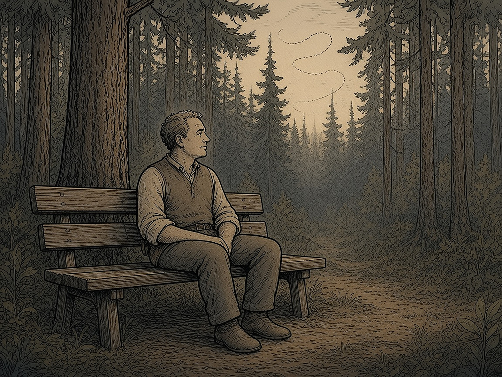

*Puude vaatamine: pilk liigub ühelt tüvelt teisele, kuni hingamine rahuneb. Renee isiklik harjumus pärast teraapiat, mitte raviprotokoll.*

### Mis on EMDR

EMDR on lühend ingliskeelsest nimest *Eye Movement Desensitization and Reprocessing*, eesti keeles silmaliigutustega desensitiseerimine ja ümbertöötlemine. Meetodi töötas välja USA psühholoog Francine Shapiro 1987. aastal. Inimene meenutab häirivat sündmust ja jälgib samal ajal silmadega terapeudi kätt või valgust. Silmaliigutuste asemel võib kasutada ka helisid või koputusi. Eesmärk ei ole mälestust kustutada. Mälestus jääb alles, kuid see ei tekita enam sama tugevat hirmu ega valu.

EMDR on terviklik ravi, millel on kaheksa etappi. Esimesed etapid on inimese loo kuulamine ja ettevalmistus. Briti ravijuhise NICE järgi on täiskasvanul tavaliselt vaja **8–12 seanssi**, keerulise trauma korral rohkem.

*EMDR-seanss: terapeut liigutab kätt ja klient jälgib seda silmadega. Ravi teeb väljaõppe ja järelevalvega spetsialist.*

### Mida ütlevad juhised

**Fakt:** EMDR on sees kõigis suuremates traumajärgse stressihäire (PTSH) ravijuhistes. **WHO** soovitas 2013. aastal kaaluda EMDR-i võrdselt trauma-keskse kognitiiv-käitumisteraapiaga (TF-KKT). WHO 2023. aasta mhGAP juhis annab lastele ja noortele tugeva soovituse, täiskasvanutele tingimusliku. **NICE** (2018) soovitab EMDR-i täiskasvanutele, kui sündmusest on möödas üle kolme kuu. Lastele on NICE esimene valik TF-KKT. **ISTSS** (2019) soovitab EMDR-i tugevalt nii lastele kui ka täiskasvanutele. **APA** uuendas oma juhist 2025. aastal ja paigutas EMDR-i teise valiku raviks (tingimuslik soovitus). Esimesel kohal on seal kognitiivne töötlemisteraapia (CPT), pikaajaline eksponeerimine (PE) ja TF-KKT.

### Mida ütlevad meta-analüüsid

**Fakt:** Cochrane'i ülevaade (Bisson jt 2013) leidis, et EMDR vähendab täiskasvanute kroonilise PTSH sümptomeid rohkem kui ootenimekiri, kuid tõendite kvaliteet on väga madal. Lewis jt (2020) võrdlesid 114 katset ja 8171 täiskasvanut. EMDR oli ootenimekirjast selgelt parem. TF-KKT-st see parem ega halvem ei olnud. Cuijpers jt (2020) leidsid samuti suure efekti, kuid ainult 4 PTSH-uuringut 27-st oli madala nihkeriskiga ja oli märke avaldamisnihkest. Lastel ja noortel (Sutton jt 2025, 8 katset, 794 last) vähendas EMDR sümptomeid ootenimekirjaga võrreldes, kuid ka need uuringud olid mõõduka või kõrge nihkeriskiga.

**Tõlgendus:** EMDR toimib PTSH puhul paremini kui ravi puudumine ja umbes sama hästi kui TF-KKT. Väide, et see on teistest teraapiatest **parem**, ei pea kvaliteetsete uuringute põhjal vastu.

### Kas silmad on üldse olulised?

See on EMDR-i kõige vaieldavam küsimus. Davidson ja Parker (2001) ei leidnud silmaliigutuste lisaefekti. Lee ja Cuijpers (2013) leidsid väikese kuni keskmise lisaefekti, laboris suurema. Kriitikud kasutavad „lilla mütsi” võrdlust: kui foobiaga inimene kannab ravi ajal lillat mütsi ja paraneb, ei tähenda see, et aitas müts. Psühholoog Richard McNally on öelnud: *„Mis on EMDR-is tõhus, ei ole uus, ja mis on uus, ei ole tõhus.”* Mõlemad pooled nõustuvad aga, et EMDR kui tervik vähendab PTSH sümptomeid.

Siit tuleb Renee puude-harjumuse kohta aus vastus. **Uuringud ei näita, et iseseisev silmade liigutamine ravib traumat.** Rahustavad harjutused, näiteks turvalise paiga kujutlemine või rahulik vaatlemine, on madala riskiga ja võivad aidata hetkes maha rahuneda. Traumamälestuste iseseisev töötlemine ilma terapeudita ei ole soovitatav. EMDR-i rahvusvaheline ühing EMDRIA ei toeta „tee-ise” EMDR-i. Shapiro ise hoiatas, et puuduliku ettevalmistusega töötlemine võib olla ohtlik.

### Kellele see ei sobi

Ettevaatust on vaja tugeva dissotsiatsiooni, aktiivse psühhoosi, suitsiidimõtete ja olukorra korral, kus oht kestab veel, näiteks kui inimene elab edasi vägivallaga. NICE rõhutab, et ravi alguses tuleb kõigepealt tagada inimese turvalisus. EMDR on **ravi** inimesele, kellel on traumasümptomid. See ei ole sõeluuring ega ennetus tervetele.

### Eesti olukord

EMDR Eesti Ühing asutati 23. märtsil 2023. 2026. aasta septembri lõpu seisuga oli ühingu nimekirjas 54 inimest, neist 33 baasõppe läbinut ja 16 laste ja noorte EMDR-i õppega. Confidos maksis korduv seanss 190 eurot (100 minutit). Kuriteo või vägivalla ohvri psühhoteraapia eest saab tasuda Sotsiaalkindlustusamet.

**Väide, mida tõendid ei toeta:** et EMDR-i vaigistatakse teadlikult. Kasutamist piiravad terapeutide vähesus, koolituse hind ja nõuded ning põhjendatud teaduslik skepsis. Need on igavamad põhjused kui vandenõu, kuid need on tõesed.

### Miks see peatükk on siin

Raamatu kuues reegel ütleb, et trauma ei ole kurjus, vaid lukustunud valu. Renee lugu näitab, et luku saab avada, aga mitte jõuga ega üksi. Mets aknal võib aidata hingata. Haava ravib väljaõppinud inimene.

### Peatüki allikad

1. WHO (2013) juhis stressiga seotud seisundite kohta (NCBI NBK159721) ja WHO mhGAP (2023).

2. NICE NG116 (2018); ISTSS ravijuhised (2019); APA PTSH juhise uuendus (2025).

3. Bisson jt 2013 (Cochrane); Lewis jt 2020 (Eur J Psychotraumatol); Cuijpers jt 2020 (Cogn Behav Ther); Sutton jt 2025 (doi 10.1002/cpp.70186).

4. van den Hout ja Engelhard 2012, „How does EMDR work?” (Journal of Experimental Psychopathology); Davidson ja Parker 2001; Lee ja Cuijpers 2013; Rosen ja Davison 2003; McNally 1999.

5. EMDRIA seisukoht „tee-ise” EMDR-i kohta; Waterman ja Cooper 2020 (BJPsych Open).

6. EMDR Eesti Ühing (emdr.ee); Confido hinnakiri; Sotsiaalkindlustusamet. Andmed Renee raportitest „EMDR-teraapia koolides” (27.09.2026) ja „EMDR-teraapia: tõendid” (10.10.2026).

7. Renee Aluste suuline meenutus oma teraapiast ja igapäevasest praktikast (01.11.2026). See on märgitud meenutusena.

> **Reegel 17.** Lisareegel: Haav ei parane vaikides ega jõuga. Kasuta meetodit, mille kohta on tõendid, ja inimest, kellel on väljaõpe — ning ära müü oma kogemust teistele raviskeemina.

---

# XVII PEATÜKK — Vastuta keskkonna eest: miks inimese süüdistamine ei tööta

Renee ütles selle peatüki mõtte ühe hingetõmbega välja ja Tarmo kirjutas selle üles: *„Inimese süüdistamine ja tema eest vastutama panemine on haige lähenemine. Käitumine tuleb suures osas keskkonnast. Vastutada tuleb keskkonna kujundamise eest.”* Inimene näeb objekte ja sümboleid. Need käivitavad mõtteahela ja tunde. Kes kujundab keskkonda, see mõjutab, mida inimene mõtleb ja tunneb.

Renee teab, kust see mõte tuleb: Kaitseväest. Allohvitseri töö ei ole ainult käsklused ja kontroll. Suur osa sellest on **keskkonna kujundamine**: sümbolid, traditsioonid, rivistused, lipp, vanne, mälestuspäevad ja isamaaline kasvatus. Need ei ole dekoratsioon. Need on see pinnas, kus inimesekeskne juhtimine saab kasvada. Kui pinnast ei hoita, ei aita ka parim raamat.

Renee meenutuse järgi ütles kolonelleitnant Meelis Mandre, Kaitseliidu Harju maleva pealik, talle 2026. aasta suvel, et 2014.–2015. aastal üritati Steigeri „Inimesekeskset juhtimist” Kaitseväes uuesti rakendada, kuid see vajus maha, sest ei osatud rakendada. **See on Renee meenutus tema öeldust, mitte koloneli ametlik seisukoht.** Rakendamiskatse kohta avalikku dokumenti me ei leidnud. (Harju maleva kodulehe järgi juhib Mandre malevat 2024. aasta oktoobrist ja tema auaste on kolonelleitnant.) Renee järeldus on tema arvamus: raamat jäi rakendamata, sest keskkonna kujundamise osa jäeti tegemata, ja selle hinda maksab ühiskond tänaseni. Raamat, mis 1997. aastal Eestile kingiti, on nagu hea retsept, mis jäi sahtlisse. Selles peatükis vaatame, miks keskkond on oluline ja kuidas retsept sahtlist välja võtta.

See on tugev väide. Selles peatükis on see pandud teaduse ette nagu sõdur rivi ette: mis peab vastu, mis mitte ja kus on piir. Ausalt öeldes: väide „inimene ei ole kunagi süüdi” teadusega ei kattu. Väide „keskkond kallutab käitumist rohkem, kui me tunnistada tahame, ja selle kujundaja kannab suurt vastutust” kattub väga hästi.

### Ahv, kes vaatas pähklit

1990. aastate alguses mõõtis Giacomo Rizzolatti rühm Parma ülikoolis makaakide ajukoore piirkonnas F5 üksikute närvirakkude tööd. Nad märkasid, et osa rakke aktiveerus nii siis, kui ahv ise haaras pähklit, kui ka siis, kui ahv **nägi**, kuidas seda teeb uurija. Tulemused avaldati 1992. ja 1996. aastal. Need rakud said nimeks **peegelneuronid**. Ajakirjandus kuulutas peagi, et need seletavad empaatiat, keelt, kultuuri ja võib-olla ka seda, miks me haigutame koos.

**Kriitika:** neuroteadlane Gregory Hickok kirjutas 2014. aastal raamatu „The Myth of Mirror Neurons”. Tema sõnul on peegelneuronid päris, kuid nende tähtsust on liialdatud: tegevuse nägemine aktiveerib motoorikat, kuid see ei tähenda, et me mõistame teist inimest ainult nende rakkude kaudu. Inimestel on üksikute rakkude mõõtmisi väga vähe, enamik tõendeid on ajukuvamisest. **Mis jääb alles:** see, mida me näeme, käivitab ajus meie oma tegevuse ja tunde süsteeme. Keskkond ei ole ainult taust. Ta räägib ajuga otse.

### Sõnad, mis panid inimesed aeglasemalt kõndima. Või mitte

1996. aastal avaldasid John Bargh, Mark Chen ja Lara Burrows kuulsa katse: tudengid, kes koostasid lauseid vanadusega seotud sõnadest („Florida”, „hall”, „kortsus”), kõndisid pärast katset koridoris aeglasemalt. Seda nimetati **eelhäälestuseks** (*priming*). 2012. aastal kordas Stéphane Doyen rühm katset, mõõtes aega infrapunaväravatega. Mõju ei tekkinud. See tekkis ainult siis, kui katse läbiviijad **ootasid**, et inimesed hakkavad aeglaselt kõndima.

See on osa suuremast loost. 2015. aastal kordas Open Science Collaboration 100 psühholoogiauuringut. Statistiliselt olulise tulemuse sai uuesti umbes 36%. Paljud „märkamatu vihje muudab käitumist” leiud kukkusid läbi, näiteks rahapildi mõju isekusele. **Mis püsis:** tavaline semantiline eelhäälestus. Kui oled just näinud sõna „arst”, tunned sõna „õde” kiiremini ära. Vihjed mõjutavad mõtlemist päriselt, aga sageli väiksemalt ja kitsamalt, kui populaarsed raamatud lubasid.

### Kurt Lewini valem

1936. aastal kirjutas psühholoog Kurt Lewin üles valemi **B = f(P, E)**: käitumine (*behavior*) on isiku (*person*) ja keskkonna (*environment*) funktsioon. Tähele tasub panna, et valemis on mõlemad tähed. Kumbagi ei saa välja jätta.

Kõige kuulsamad situatsionismi katsed on Stanley Milgram ja Philip Zimbardo. Milgrami 1963. aasta katses andis 26 inimest 40-st ehk 65% käsu peale näiliselt 450-voldise elektrilöögi. Hilisemates variantides langes kuulekus tugevalt, kui katse läbiviija polnud ruumis või kui teine osaleja keeldus. Keskkond muutis tulemust. Zimbardo Stanfordi vanglakatse 1971. aastal katkestati kuuendal päeval. Thibault Le Texier näitas 2018–2019 arhiividokumentide põhjal, et „valvureid” juhendati karmilt käituma. Seega ei saa seda katset pidada puhtaks tõendiks, et olukord teeb inimesest iseenesest koletise. Alex Haslam ja Stephen Reicher tõlgendavad Milgrami katset nii, et inimesed ei kuuletunud pimesi, vaid samastusid teadusliku eesmärgiga. Ka see on keskkond, aga mitte nupp, mis lülitab südametunnistuse välja.

### Groningeni ümbrikud

2008. aastal avaldasid Kees Keizer, Siegwart Lindenberg ja Linda Steg ajakirjas *Science* katsete seeria Groningenist. Ühes katses jäeti postkasti suust välja paistma ümbrik, mille aknast paistis 5-eurone rahatäht. Kui postkast oli puhas, võttis ümbriku 13% möödujatest. Kui postkast oli grafitiga kaetud, võttis selle 27%. Teises katses pandi jalgratastele reklaamlehed. Puhta seinaga kohas viskas lehe maha 33%, grafitiga seina juures 69%.

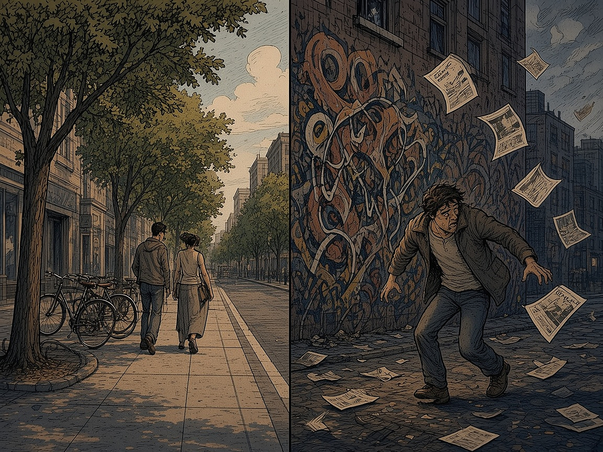

*Sama tänav, sama inimene, erinev keskkond. Groningeni katsetes kahekordistas korratus normirikkumist (Keizer jt 2008).*

**Mida see tõestab:** nähtav korratus annab märku, et siin reegleid ei järgita, ja inimesed järgivad seda märki. **Mida see ei tõesta:** et iga inimene teeb grafitiseina ees pahandust. Ka grafitiga kohas jättis 73% ümbriku puutumata.

### Valikuarhitektuur

Richard Thaler ja Cass Sunstein kirjutasid 2008. aastal raamatu „Nudge” (Thaler sai 2017. aastal Nobeli majandusauhinna). Nende mõte: keegi kujundab alati keskkonda, kus valik tehakse. Kohvikus on alati mingi toit silmade kõrgusel. Kõige kuulsam näide on vaikevalik. Eric Johnson ja Daniel Goldstein näitasid 2003. aastal, et riikides, kus inimene on vaikimisi elundidoonor ja peab ise loobuma, oli nõusolekuid peaaegu kõigil (Austrias 99,98%). Naaberriigis Saksamaal, kus tuli ise nõusolek anda, oli neid 12%. Väike täpsustus, et mitte ise nudge'i ohvriks langeda: need on registri nõusolekud, mitte tegelikud doonorluse näitajad. Tegelikud doonorite arvud on riikide vahel palju lähemal, sest otsustavad ka pere, meditsiin ja haiglate võimekus.

**Ausalt:** 2022. aasta suur meta-analüüs (Mertens jt, PNAS) koondas üle 200 uuringu ja üle 2,1 miljoni osaleja ning leidis tõukamistele keskmise mõju d = 0,43. Autorid märkisid ise avaldamisnihet: tugeva nihke korral langes mõju d = 0,08-ni. Maier jt (2022) parandasid nihet teise meetodiga ja said d = 0,04 ehk üldise mõju kohta tõendeid ei jäänud. Mõju oli siiski väga erinev: mõni tõuge töötab, paljud mitte. Vaikevalikud mõjuvad tugevalt. Paljud teised väikesed nipid mõjuvad vähem, kui reklaamiti.

### Puu aknal

1984. aastal avaldas Roger Ulrich ajakirjas *Science* uuringu Pennsylvania haiglast. Ta võrdles sapipõie operatsiooni järel 23 patsiendipaari, kes olid samasugused, kuid ühe palatiaken avanes puudele ja teise oma pruunile telliskiviseinale. Puid vaadanud patsiendid lahkusid haiglast keskmiselt 7,96 päevaga, teised 8,70 päevaga. Nad vajasid vähem tugevaid valuvaigisteid ja õdede märkmetes oli nende kohta vähem negatiivseid kommentaare.

*Ulrichi haiglaakna uuring (1984): puud aknal, lühem haiglaravi. Keskkond ei ravi, kuid aitab.*

Siin kohtub see peatükk Renee puudega peatükist XVI. Mets aknal ei ole ravi. Kuid see on keskkond, mis teeb rahunemise lihtsamaks. Seda saab kujundada: haigla, kool, kasarm, kontor.

### Juht kujundab keskkonda

Rudolf Steiger kirjutas „Inimesekeskses juhtimises” (eesti keeles 1997), et juhtimine on inimese pärast. Selle peatüki keeles: juht ei vastuta alluva iga mõtte eest. Ta ei saagi. Juht vastutab selle eest, millised on reeglid, kas korratus jäetakse ripakile, mida tasustatakse, millised on vaikevalikud ja kas aknast paistab puu või telliskivisein.

### Lahendus: raamatuklubi

Kui raamat jäi rakendamata, on lahendus lihtne ja odav: loe seda koos. Ka selle mõtte on keegi juba enne meid välja mõelnud.

Napoleon Hilli raamatu „Think and Grow Rich” (1937) alguses on lehekülg pealkirjaga „The Most Profitable Way to Use This Book” (kõige kasulikum viis seda raamatut kasutada). Renee hoiab selle lehe skaneeringut oma Drive'is. Hill kirjutab seal, et ta analüüsis sadu edukaid inimesi ja kõik nad vahetasid mõtteid nn **konverentsidel**: kui oli probleem, istuti maha ja räägiti vabalt, kuni ühistest ideedest sündis plaan. Lugejal soovitab ta kasutada **Master Mindi põhimõtet** ja moodustada õppeklubi. Selles on nii palju inimesi, kui soovitakse, kuid nad peavad olema sõbralikud ja harmoonilised. Klubi koguneb korrapäraselt, näiteks kord nädalas. Igal kohtumisel loetakse üks peatükk ja arutatakse seda vabalt. Igaüks teeb märkmeid ja kirjutab üles **KÕIK OMA IDEED**, mida arutelu tekitas. Igaüks loeb peatüki läbi mitu päeva enne kohtumist. Klubis loeb ette see, kes loeb hästi ja oskab ridade vahele värvi ja tunnet panna. Hilli lubadus: lugeja saab teadmisi mitte ainult raamatust, vaid ka **igalt teiselt kohalolijalt**.

Master Mindi määratleb Hill raamatu kümnendas peatükis nii: *„teadmiste ja jõupingutuste koordineerimine harmoonia vaimus kahe või enama inimese vahel kindla eesmärgi saavutamiseks.”* Ausalt öeldes: Hilli enda elulugu ja väiteid tema kohtumistest kuulsate inimestega on hiljem kahtluse alla seatud. Rikkuse valemi lubadus on reklaam. Klubi formaat ise on aga lihtne ja töötab ka ilma lubaduseta.

Huvitaval kombel soovitab sama Steiger ise. „Inimesekeskse juhtimise” sissejuhatuses kirjeldab ta menetlust, mis on tema seminaridel ennast õigustanud: **a)** peatüki individuaalne lugemine või ettekandmine, kus rasvases kirjas sissejuhatust käsitletakse teesina; **b)** individuaalne või grupitöö küsimusega „mis on teesi X või Y konkreetne tähendus minule (ettevõtjale, personalijuhile, sõjaväeülemale)?”; **c)** käitumisviiside läbimängimine ja arutelu. Steiger lisab, et raamat on oma eesmärgi täitnud, kui sellest saab igapäevase juhtimise kaaslane, alati ehk mitte mugav, aga virgutav.

Renee Drive'is on raamat juba ette valmistatud: kaustas „00_Inimesekeskne_juhtimine” on avakõne ja 20 peatükki eraldi failidena, alates „Inimesekeskne juhtimine kui põhimõte” kuni „Usalduse keskne tähtsus”. See on 21 kohtumist ehk umbes viis kuud, kui kogunetakse kord nädalas.

### Raamatuklubi formaat: 60 minutit, kord nädalas

1. **Enne kohtumist (kodus):** loe peatükk läbi mitu päeva varem. Kirjuta üles üks tees (rasvases kirjas sissejuhatus) ja üks oma idee.

2. **Avamine (5 min):** sama koht, sama aeg, sama algus. See on keskkond: väike traditsioon, mis ütleb, et nüüd algab.

3. **Ettelugemine (10 min):** üks hea lugeja loeb peatüki tuuma ette, „värvi ja tundega”.

4. **Mida see tähendab MULLE? (20 min):** iga osaleja ütleb, mida tees tähendab tema rollis: lapsevanem, juht, õpetaja, sõdur. Ei vaielda, kuulatakse.

5. **Läbimängimine (15 min):** kaks inimest mängivad läbi ühe päris olukorra peatüki järgi, näiteks raske vestluse alluvaga.

6. **Märkmed ja üks samm (10 min):** igaüks kirjutab üles kõik oma ideed ja ühe asja, mida ta järgmisel nädalal oma keskkonnas muudab. Järgmisel kohtumisel küsitakse, kuidas läks.

Reeglid: 4–8 inimest, harmoonia enne võitmist, telefon taskus, mitte keegi ei ole „õpetaja”. Kui klubi tahab, kutsub ta kord kuus külla kellegi, kes juhib päriselt inimesi.

### Kus on piir

Renee lause „inimest ei saa tema tegude eest vastutama panna” on raamatus kirjas tema arvamusena. Teadus annab sellele osaliselt õiguse: kui keegi süüdistab üksikut sõdurit, õpilast või töötajat ega vaata keskkonda, kus see juhtus, tegeleb ta sümptomiga. Täielikult teadus seda õigeks ei pea. Lewini valemis on ka P. Groningenis jättis enamik ümbrikut puutumata. Milgrami katses keeldus kolmandik.

**Selle peatüki sõnastus:** vastutus nihkub suures osas **keskkonna kujundajale**: juhile, ametnikule, linnaplaneerijale, platvormile. Isikliku valiku ruum jääb alles. See ruum on väiksem, kui karistajad arvavad, ja suurem, kui vabandajad loodavad.

### Peatüki allikad

1. di Pellegrino, Fadiga, Fogassi, Gallese, Rizzolatti 1992 (Experimental Brain Research); Gallese, Fadiga, Fogassi, Rizzolatti 1996 (Brain); G. Hickok, „The Myth of Mirror Neurons” (W. W. Norton, 2014).

2. Bargh, Chen, Burrows 1996 (J Pers Soc Psychol); Doyen, Klein, Pichon, Cleeremans 2012 (PLoS ONE); Open Science Collaboration 2015 (Science).

3. K. Lewin, „Principles of Topological Psychology” (1936).

4. S. Milgram 1963 (J Abnorm Soc Psychol); T. Le Texier, „Debunking the Stanford Prison Experiment” (American Psychologist, 2019); Haslam ja Reicher 2012 (PLoS Biology).

5. Keizer, Lindenberg, Steg 2008, „The Spreading of Disorder” (Science).

6. R. Thaler ja C. Sunstein, „Nudge” (2008); Johnson ja Goldstein 2003, „Do Defaults Save Lives?” (Science); Mertens jt 2022 (PNAS); Maier jt 2022 (PNAS).

7. R. Ulrich 1984, „View through a window may influence recovery from surgery” (Science).

8. R. Steiger, „Inimesekeskne juhtimine” (Fontes, 1997), autori sissejuhatavad märkused („Raamatuga töötamise kohta”).

9. N. Hill, „Think and Grow Rich” (1937): „The Most Profitable Way to Use This Book” ja 10. peatükk „Power of the Master Mind”.

10. Renee Aluste Google Drive: „raamatuklubi_juhised.pdf” ja kaust „00_Inimesekeskne_juhtimine” (avakõne ja peatükid 01–20).

11. Renee Aluste suulised mõtted ja meenutus kolonelleitnant Meelis Mandre öeldust (01.11.2026), märgitud arvamuse ja meenutusena; Kaitseliidu Harju malev, „Malevast” (harju.kaitseliit.ee).

> **Reegel 18.** Lisareegel: Ära küsi ainult, kes on süüdi. Küsi, milline keskkond selle teo lihtsaks tegi, ja kujunda see ümber. Isikliku valiku ruum jääb, kuid vastutus nihkub selle juurde, kes keskkonda kujundab.

---

# XVIII PEATÜKK — Süda nooltes: „Inimesekeskne juhtimine” (1997) ja raamat, mis leidis lugeja

Kõige raskematel aastatel ei otsi inimene raamatuid. Ta otsib põrandat, millele astuda. Renee meenutuse järgi oli tal käes just selline aeg. Kodus olid pinged, abielu lagunes ja tööl käis kõik allamäge. Ühel päeval tühjendas ta töökohal oma kappi ja viskas peaaegu kõik minema. Alles jäid kolm raamatut: kollaste kaantega „Jaoülema käsiraamat” (1993), lilla kaanega „Rakenduspedagoogika” (1994) ja kolmas, mille kaas oli teistsugune.

Kolmandal raamatul ei olnud mundrit, relva ega lippu. Kaane keskel seisis inimfiguur, rinnas süda, ja ümberringi olid tugevad nooled, mis suundusid tema poole. Pealkiri oli „Inimesekeskne juhtimine”. Renee meenutab, et ta ei teadnud, miks ta seda hoidis. Ta ei lugenud seda. Pool aastat hiljem tuli töölt lahkuda ja asjad kokku pakkida, ning need kolm raamatut tulid kaasa. Kolmas elas tema juures umbes kuu aega avamata. Iga kord, kui pilk sellele langes, tundis ta tema sõnul midagi kutse sarnast.

*Kunstniku tõlgendus 1997. aasta kaane mõttest, mitte kaane koopia. Keskel on süda kui inimlikkuse rõhutaja ja selle ümber välised mõjujõud. Kujundaja sõnul olid süda ja nooled teadlikult tasakaalus.*

### Mida raamatukogu kataloog ütleb

Esmalt dokumendid. Rahvusraamatukogu e-kataloogi ESTER kirje järgi ilmus Rudolf Steigeri „Inimesekeskne juhtimine: juhiseid tsiviil- ja sõjaväejuhtidele” 1997. aastal Fontese kirjastuselt. Raamat trükiti Tartus Greifi trükikojas, sellel on 142 lehekülge ja ISBN 9985-9012-7-4. Tõlkija on Piret Liivamägi ja algupärand on saksakeelne *Menschenorientierte Führung*. **Juba 1997. aasta väljaandes** on kaks eessõna. Neist esimese kirjutas kindralmajor Johannes Kert, kes oli tollal Kaitseväe juhataja (ametis 1996–2000). Teise kirjutas Kaspar Villiger, kes oli tollal Šveitsi Konföderatsiooni liidunõukogu liige ja aastatel 1989–1995 Šveitsi kaitseminister. 2011. aastal andsid Kaitseväe Ühendatud Õppeasutused Tartus välja kordustrüki, milles on samad eessõnad.

See parandab üht levinud mälupilti, mis oli ka Renee enda uurimuses: Kerti ja Villigeri eessõnad ei lisandunud 2011. aastal. Need olid raamatus algusest peale. Sõjaväeline side ei tulnud seega hiljem. Raamat oli Eesti Kaitseväe projekt juba sünnihetkel, kuigi see ilmus äriraamatute kirjastuses ja äriraamatu kaane all.

### Kes oli Rudolf Steiger

ETH Zürichi järelehüüde (veebruar 2026) ja Šveitsi teatmeallikate järgi sündis Rudolf Steiger 1946. aastal Zürichis ja suri 24. jaanuaril 2026. Ta õppis Zürichi ülikoolis üldajalugu ja pedagoogikat ning kaitses doktorikraadi 1973. aastal. Ta oli Šveitsi armee instruktsiooniohvitser ja hiljem sõjaväepedagoogika õppejõud. 1985. aastal andis liidunõukogu talle ETH Zürichis inimjuhtimise ja kommunikatsiooni professori tiitli. Aastatel 1993–2000 oli ta Zürichi sõjalise juhtimiskooli asedirektor ning aastatel 2001–2005 juhtis ta brigaadikindrali auastmes ETH juures asuvat Sõjaväeakadeemiat. ETH järelehüüde järgi kuulub *Menschenorientierte Führung* tänapäeval Šveitsi armee reglemendi hulka. Raamat on ilmunud üle kahekümne trüki, viimane neist 2023. aastal.

Renee nimetab raamatut „Eesti enda piibliks”. See on tema hinnang ja tema sõna. Faktina saab öelda nii palju: raamat oli Šveitsis armee- ja tsiviiljuhtide käsiraamat ning Eesti Kaitseväe juht soovitas selle 1997. aastal oma ohvitseridele ja ühiskonnale.

### Kas see oli kingitus? Raha jälg

Renee mäletab, et raamat „annetati Eestile 1997”. Kontrollisin seda nii palju, kui avalikud allikad ja raamat ise võimaldavad. **Ainus dokumenteeritud vihje on Kerti saatesõnas.** Selle järgi on Eesti Kaitseväel hea sõber prof. Rudolf Steiger, kes on kirjutanud raamatu „ja teinud soodustused selle avaldamiseks”. See tähendab tõenäoliselt, et autor loobus täielikult või osaliselt autoritasust või tõlkeõiguste hinnast. Täpset sisu, summat ega lepingut ma ei leidnud.

**Kinnitamata on**, et raamat oleks olnud Šveitsi riigi ametlik kingitus või et selle trükki oleks rahastanud Šveitsi saatkond või mõni fond. ESTER-i kirjes ega raamatu tiitellehe pöördel sponsorit ei nimetata. Tiitellehe pöördel on märgitud ainult tõlke autoriõigus (OÜ Fontes Kirjastus 1997), trükikoda (Greif) ja kaanekujundus (Aldus, Tallinn). Raha jälg lõpeb seega lausega „soodustused avaldamiseks”. Edasi viiksid Fontese ja tollase Kaitseväe Peastaabi arhiiv ning Šveitsi saatkonna 1996.–1997. aasta koostööprojektide nimekiri. Need on päringud, mitte järeldused.

### Kujundaja, kes raamatut ei lugenud

Renee kirjutas raamatu kaanekujundajale. Nimetame teda siin vaid eesnimega: Kristjan. Kristjan vastas lühidalt ja ausalt. Tellimus tuli Fontese kirjastuselt ajal, mil ta oli lõpetamas Eesti Kunstiakadeemia graafikaosakonda. Kaastudengid tegelesid vabakunstiga, tema oli leidnud enda jaoks praktilisema suuna, raamatukujunduse. Arvutitöö õppisid nad tema sõnul ise kõrvalt juurde. Kaane mõte oli sirgjooneline: pealkiri räägib inimesest, nii et keskel on inimfiguur ja selle keskel süda, mis tasakaalustab väliseid mõjureid tähistavaid jõulisi nooli. Sõjaväelisest aspektist ei olnud tema sõnul juttu, sest Fontes andis välja peamiselt äriringkondadele mõeldud juhtimisraamatuid. Ja lõpuks: raamatut ennast ta ilmselt ajapuudusel ei lugenudki. Hiljem juhina oleks ta tema sõnul neist teadmistest kasu saanud.

See on üks raamatu ilusamaid paradokse. Kõige inimlikuma juhtimisraamatu kaane kujundas noor kunstnik, kes ei teadnud, et kujundab sõjaväejuhtide käsiraamatut. Just seetõttu jäi kaas sõjaväeliseks muutumata ja jäi inimlikuks. Märkus täpsuse huvides: tiitellehe pöördel on kaane tegijana nimetatud stuudio Aldus. Kristjani enda kirjeldus ja see kirje ei ole vastuolus, sest kujundaja võis töötada stuudio kaudu.

### Telk, pann ja avatud raamat

Raamat avanes Renee meenutuse järgi ootamatus kohas: enesearengufestivalil „Ühenduses”, Pühali Hea Elu Keskuses Kohila vallas. Ta ei olnud seal festivalikülastajana. Tal polnud piletit ja ta oli pigem lapsehoidja. Tal oli oma väike telk ja oma pliit ning ta praadis peekonit. Ta oli just tulemas välja raskest lapsepõlvetraumast, mida ta töötles EMDR-teraapiaga (silmaliigutustega desensitiseerimine ja ümbertöötlemine). See on tunnustatud traumateraapia meetod, mille käigus pilk liigub rütmiliselt küljelt küljele. Festivalil oli tal palju aega ja süles oli seitsmekuune tütar. Ühel päeval avas ta raamatu.

*Telk metsa servas, pann pliidil ja avatud raamat. Illustratsioon Renee meenutuse järgi, pildil kujutatud detailid on stiliseeritud.*

Tema sõnul hakkasid lugedes elu tükid paika loksuma: vanad mälestused, juhtimise, sõjaväe ja isiklik kogemus. Raamat ei olnud raske. See oli kompaktne ja käepärane, nagu kasutusjuhend. Steigeri peatükid kannavad pealkirju „Iseennast ja kaastöötajaid tundma õppida”, „Palki enda silmas”, „Midagi mõista ei tähenda alati nõus olla”, „Lojaalsus – ka ülevalt alla” ja „Usalduse keskne tähtsus”. Need ei käsi, need küsivad. Üks Villigeri mõte, mida Steiger tsiteerib, kõlab nii: kes vigu tunnistab, selle suust usutakse ka häid uudiseid.

### Ahel, mis seob inimesi

Renee loos on ka inimeste ahel. Osa sellest on avalik fakt, osa tema meenutus. **Avalik fakt:** Toomas Väli oli Vahipataljoni ülem aastatel 2009–2011 ja Kaitseliidu Tallinna maleva pealik aastatel 2016–2018 (Kaitseväe ja Postimehe teated, Vikipeedia). **Renee meenutus:** Väli oli tema esimene pataljoniülem ja inimsõbralik juht. Kui Renee 2017. aastal regulaarväest Kaitseliitu liikus, suunas Väli ta Harju malevasse. Seal andis Eero Kinnunen talle missiooni luua ja läbi viia sõdurioskuste kursus. **Samuti Renee meenutus, mida ei ole kontrollitud:** Väli olevat hiljutises vestluses rääkinud, et teda ennast värbas kunagi kaitseväkke Johannes Kert. Kert suri 2021. aastal.

Kui see meenutus peab paika, sulgub ring. Mees, kes kirjutas 1997. aastal eessõna inimesekesksest juhtimisest, värbas noore sõduri. Too sõdur sai hiljem pataljoniülemaks, kelle inimsõbralikkust Renee mäletab. Kolmkümmend aastat hiljem jõudis sama raamat Renee telki. Tarmo märkis selle oma kaardile katkendjoonega, sest see on lugu, mitte tõend. Ilus lugu on aga ka see, mida on kõige kergem kontrollida: tasub küsida.

### Miks vana tekst kehtib

Renee vastas Kristjanile ühe lausega: sest inimene ei muutu. Tehnoloogia ja organisatsioonid muutuvad, kuid inimene, kes vajab kuulamist, mõistmist, ausat dialoogi ja juhti, kes oma vigu tunnistab, on sama nagu 1997. aastal. Kert kirjutas oma saatesõnas, et Nõukogude okupatsioonist tulnud väikeriigis ei ole totalitaarse suurriigi juhtimisstiil ülekantav. Riigil tuleb olla lojaalne oma inimestele, et nad oleksid vajadusel entusiastlikud kaitsjad. See lause on SÜLDIKAADI kogu loo vastumürk. Vaikimise sündikaat elab hirmust. Inimesekeskne juhtimine elab usaldusest.

### Peatüki allikad

1. ESTER: Steiger, R. „Inimesekeskne juhtimine: juhiseid tsiviil- ja sõjaväejuhtidele”, Fontese kirjastus, 1997 (püsilink record=b1057375), ning Kaitseväe Ühendatud Õppeasutuste kordustrükk, Tartu, 2011.

2. Raamatu 1997. aasta väljaanne: tiitellehe pööre ning Johannes Kerdi saatesõna ja Kaspar Villigeri eessõna.

3. ETH Zürich, järelehüüe „Prof. Dr. Rudolf Steiger” (2026); de.wikipedia „Rudolf Steiger (Militärpädagoge)”.

4. et.wikipedia „Johannes Kert”; mil.ee (15.08.2011) ja Postimees: Vahipataljoni ülemavahetus; et.wikipedia „Toomas Väli (sõjaväelane)”.

5. Pühali Hea Elu Keskus (puhali.ee) ja festivali „Ühenduses” veebileht.

6. Renee Aluste kirjavahetus kaanekujundaja Kristjaniga (2026) ja Renee suulised meenutused. Need on märgitud meenutusteks.

> **Reegel 19.** Lisareegel: Inimesekeskne juhtimine ei ole abivahend edu saavutamiseks — seda on vaja inimese pärast. Kes oma vigu tunnistab, selle suust usutakse ka häid uudiseid.

---

<!-- NELJAS OSA: LAHENDUS JA TEEKOND -->

# XIX PEATÜKK — The Path: mees peab minema välja

See peatükk algab nagu halb anekdoot. Kõrge testosterooniga mees astub tuppa, kus diivanil istub viis madala testosterooniga poissi. Kardinad on ees, põrandal on pitsakarbid, telefonide ekraanid helendavad. Mees tõmbab kardinad eest. Keegi kissitab silmi ja keegi küsib: „Kes sa oled?” Üks poiss tõuseb püsti.

Naljakas on see, et selle anekdoodi taga on päris teadus. Veel naljakam on see, et teadus ütleb midagi muud, kui anekdoot arvab.

### Fakt: testosteroon langeb

Thomas Travison ja kolleegid avaldasid 2007. aastal ajakirjas *Journal of Clinical Endocrinology & Metabolism* Massachusettsi vananevate meeste uuringu (MMAS) tulemused. Uuringus osales 1532 Bostoni piirkonna meest vanuses 45–79 ja neilt koguti 2769 mõõtmist aastatel 1987–2004. Samavanuste meeste testosteroon langes aasta-aastalt umbes **1,2% aastas**. Kui arvestada tervist ja eluviisi, sealhulgas suitsetamist ja ülekaalu, jäi langust ikka umbes 1% aastas. Ehk 2003. aasta 65-aastasel mehel oli testosterooni vähem kui 1988. aasta 65-aastasel.

Soum Lokeshwar ja kolleegid vaatasid 2021. aastal (*European Urology Focus*) USA riikliku terviseuuringu NHANES andmeid 4045 noore mehe kohta vanuses 15–39. Keskmine üldtestosteroon langes **605 ng/dl-lt (1999–2000) 451 ng/dl-ni (2015–2016)**. Kehamassiindeksi kasv selgitab osa langusest, kuid langus oli olemas ka normaalkaalus meestel: 665-lt 529-le. **Ausalt:** mõõtmismeetodid muutusid vahepeal ja autorid ise nimetavad seda piiranguks. Need on USA andmed. Eesti kohta sarnast aegrida me ei leidnud.

### Fakt: testosteroon reageerib keskkonnale

Siin muutub anekdoot huvitavaks. Allan Mazur ja Alan Booth kirjutasid 1998. aastal ajakirjas *Behavioral and Brain Sciences* ülevaate „Testosteroon ja domineerimine meestel”. Nende peamine järeldus on, et testosteroon ei ole ainult geenides kirjas. See tõuseb ja langeb vastavalt sellele, mis toimub. Võistluse eel see tõuseb. Pärast võitu jääb see kõrgeks, pärast kaotust langeb. Sama juhtub isegi siis, kui mees ainult vaatab, kuidas tema meeskond võidab. John Archer kirjeldas 2006. aastal nn väljakutse hüpoteesi: hormoon reageerib sotsiaalsele väljakutsele ja staatusele.

Ja nüüd üks fakt, mis anekdoodi pea peale pöörab. Lee Gettler ja kolleegid jälgisid 2011. aastal (*PNAS*) Filipiinidel 624 meest. Need mehed, kellest said isad ja kes hoolitsesid laste eest, kaotasid testosterooni rohkem kui mehed, kellest isa ei saanud. Bioloogia ise ütleb, et pühendunud mehe hormoonid kohanevad. **Järeldus:** testosteroon ei ole võluvõti ega mehelikkuse mõõdupuu. Ta on termomeeter, mis näitab keskkonda. Kui keskkond on diivan ja ekraan, siis termomeeter seda ka näitab.

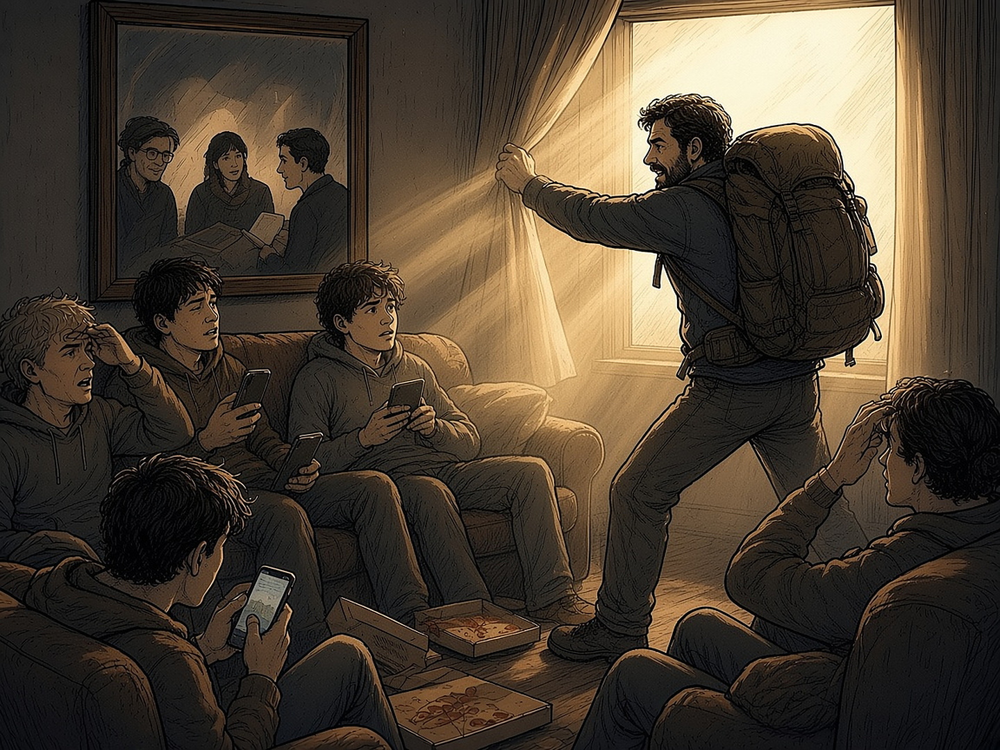

*Faktiline paroodia: mees seljakotiga tõmbab kardinad eest. Valgus ei paranda kedagi, aga sellest saab alguse küsimus „mis väljas on?”.*

### Fakt: mehed on üksi

Ameerika elu-uuringute keskus (Survey Center on American Life) küsitles 2021. aasta mais 2019 täiskasvanut. **15% meestest** vastas, et neil ei ole ühtegi lähedast sõprust. 1990. aastal oli selliseid mehi 3%. Lähedaste sõprade arv vähenes enim just meeste seas.

Kas see on ainult kurb või ka ohtlik? Julianne Holt-Lunstad koondas 2010. aastal (*PLoS Medicine*) **148 uuringut 308 849 osalejaga**. Tugevamate suhetega inimestel oli uuritud perioodil umbes **50% suurem tõenäosus ellu jääda**. Selle mõju suurus on võrreldav suitsetamisest loobumisega ja suurem kui ülekaalul või liikumisvaegusel.

Harvardi täiskasvanute arengu uuring algas 1938. aastal 724 noormehega: 268 Harvardi tudengit ja 456 Bostoni vaesemate linnaosade poissi. Uuringut on juhtinud mitu põlvkonda teadlasi, praegu Robert Waldinger. Tema kokkuvõte pärast üle 80 aasta: rohkem kui raha või kuulsus hoiavad inimest õnneliku ja tervena head suhted.

Robin Dunbar arvutas 1990. aastatel, et inimene suudab hoida umbes **150** stabiilset suhet. Need jagunevad kihtideks: umbes 5 väga lähedast, 15 head sõpra, 50 sõpra ja 150 tuttavat. Need viis kohta täituvad mehe elus tihti pelgalt naise, ema ja juhuslike inimestega. Ülejäänud kohad jäävad tühjaks, kui ise neid täitma ei lähe.

### Seega: mees peab minema välja

Siin ühenduvad varasemad peatükid. Peatükk XVII ütles, et keskkond kujundab inimest. Peatükk X näitas, mis juhtub, kui ümberringi on ainult kaja. See peatükk ütleb lihtsalt: **mees vajab enda ümber teisi mehi** ja keegi ei too neid talle koju kätte. Uus keskkond tuleb ise üles otsida.

### Teekond ümber maailma

Kujutle seda kui reisi ümber maailma, kus igal etapil on oma sadam.

1. **Lahkumine.** Diivanilt püsti tõusmine. See on kõige raskem etapp, sest midagi ei juhtu veel. Lihtsalt uks läheb lahti.

2. **Esimene sadam: võõrad mehed.** Koht, kus keegi ei tea su minevikku. Sinult küsitakse ainult, kas sa suudad kaasa tulla.

3. **Torm.** Esimene kord, kui jõud saab otsa, kui vihma sajab ja kott on raske. Siin selgub, kas nõrkus jääb varju või tuleb päevavalgele.

4. **Meeskond.** Teised aitavad püsti. Edaspidi aitad sina neid.

5. **Kaardiruum.** Raamatuklubi, kus loetakse, vaieldakse ja kontrollitakse (vt peatükk XVII: Hilli Master Mind, Steigeri inimesekeskne juhtimine).

6. **Kojutulek.** Mees tuleb tagasi oma pere ja töö juurde teistsugusena. Mitte kõvemana, vaid kindlamana.

### Kaitseliit: keskkond, kus nõrkus ei jää varju

Miks just Kaitseliit? Sest see on üks väheseid kohti Eestis, kus eri vanuses ja eri taustaga mehed ja naised teevad vabatahtlikult koos füüsiliselt rasket tööd ühise eesmärgi nimel. Metsas pole tähtis, kui palju sa teenid või mitu jälgijat sul on. Tähtis on, kas sa suudad kaasa tulla ja kas sa aitad teist. Nõrkus ei jää seal varju. See tuleb välja ja seda treenitakse.

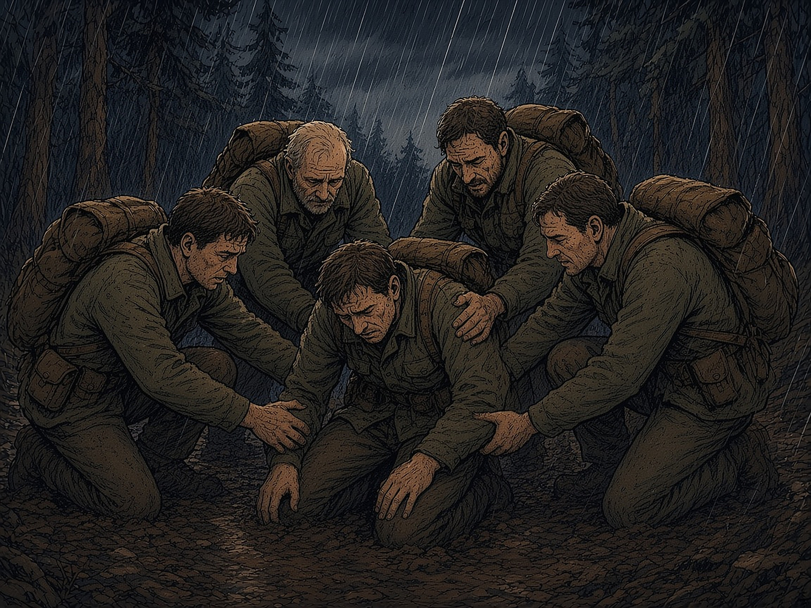

*Torm: üks põlvitab mudas, teised tõstavad ta püsti. Sellest saab alguse meeskond.*

**Renee lugu (isiklik kogemus, mitte ametlik seisukoht):** Renee läbis Kaitseliidu Harju malevas sõdurioskuste kursuse. Tema sõnul ei olnud kõige olulisem relv ega rännak, vaid inimesed. Seal olid mehed, kes märkasid, kui keegi jäi maha. Seal olid mehed, kes ütlesid otse, mitte selja taga. Seal oli keskkond, kus enda eest vastutamine oli normaalne, mitte erand. Tema kogemus kattub sellega, mida ülal kirjeldatud uuringud näitavad: kui keskkond muutub, muutub ka inimene.

### Mis see EI ole

**Ausalt.** Kaitseliit ei ole teraapia ega asenda arsti ega psühholoogi. Testosteroon ei ole võluvõti ja hormoonide tarvitamine omal käel on ohtlik. Anekdoodi „kõrge T mees muudab poisid” teadus tegelikult ümber ei lükka, aga keerab selle teistpidi. Asja ei muuda mehe hormoonid, vaid see, et keegi tõi tuppa uue keskkonna. Ja poisid ei ole „nõrgad”. Nad on keskkonnas, mis ei nõua neilt midagi.

### Praktiline tee (60 päeva)

1. Esimesel nädalal vali üks koht, kus on teised mehed: Kaitseliit, spordiklubi, vabatahtlik päästeüksus või raamatuklubi.

2. 2.–4. nädal: käi kohal. Ära kohe midagi muuda, lihtsalt ilmu kohale.

3. 5.–8. nädal: võta üks kohustus, näiteks vastutus varustuse, toidu või järgmise kohtumise eest.

4. Iga nädal: kirjuta üles kolm nime, kellega rääkisid ausalt. Dunbari viis kohta täituvad nii.

### Peatüki allikad

1. T. G. Travison jt, „A Population-Level Decline in Serum Testosterone Levels in American Men”, *J Clin Endocrinol Metab* 92(1):196–202 (2007).

2. S. D. Lokeshwar jt, „Decline in Serum Testosterone Levels Among Adolescent and Young Adult Men in the USA”, *Eur Urol Focus* 7(4):886–889 (2021).

3. A. Mazur ja A. Booth, „Testosterone and dominance in men”, *Behavioral and Brain Sciences* 21:353–397 (1998).

4. J. Archer, „Testosterone and human aggression: an evaluation of the challenge hypothesis”, *Neurosci Biobehav Rev* 30:319–345 (2006).

5. L. T. Gettler jt, „Longitudinal evidence that fatherhood decreases testosterone in human males”, *PNAS* 108(39):16194–16199 (2011).

6. D. A. Cox, „The State of American Friendship: Change, Challenges, and Loss”, Survey Center on American Life (juuni 2021).

7. J. Holt-Lunstad, T. B. Smith, J. B. Layton, „Social Relationships and Mortality Risk: A Meta-analytic Review”, *PLoS Medicine* 7(7):e1000316 (2010).

8. R. Waldinger ja M. Schulz, „The Good Life” (2023); Harvard Study of Adult Development (alates 1938).

9. R. I. M. Dunbar, „Neocortex size as a constraint on group size in primates”, *J Hum Evol* 22:469–493 (1992); „How Many Friends Does One Person Need?” (2010).

10. Renee Aluste, isiklik kogemus Kaitseliidu Harju maleva sõdurioskuste kursusel (meenutus, mitte ametlik seisukoht).

> **Reegel 20.** Lisareegel: Sa ei leia oma meest diivanilt. Mine välja, leia mehed, kelle kõrval sa kasvad, ja ole ise see mees, kelle kõrval kasvab keegi teine.

---

# XX PEATÜKK — Tõendi piir: mida kogupaketi uus läbivaatus muudab

Vaikuse vastu ei aita see, kui täidame lüngad omaenda kindlusega. Raamatu varasemad peatükid küsivad, kes hoiab kaarti ja kes kustutab logiraamatu. Kogupaketi 4. novembri 2026 tõendiregister toob selle küsimuse tagasi uurija enda lauale: milline paber üldse tohib kaardile jõuda? See peatükk võtab kokku registri ja koondstaatuse järeldused, mitte uut kriminaaluurimist.

### Dokument, väide ja oletus ei ole sama asi

Register eristab ametlikku dokumenti, avaldaja kirjeldust, oletust ja kasutut materjali. Allkirjastatud pöördumine tõendab teksti ja allkirja olemasolu; see ei muuda pöördumise iga väidet tuvastatud faktiks. Kohtuavalduse kavand ei ole kohtuotsus. Käskkiri võib kinnitada väljaõppe korraldamist, kuid ei tõenda midagi kõrvalise inimese varjatud kavatsuste kohta.

Kaitseliidu kohta jääb piir samaks nagu kogupaketi varasemas auditis: läbivaadatud materjalides ei ole liikmepõhist tõendit KGB võrgustikust ega varustuse vargusest. Puuduvat tõendit ei saa asendada ametikoha, tutvuse või ilukirjandusliku sarnasusega. See piir kehtib ka siis, kui raamatu juhtimiskriitika on terav.

### Mida saab avalikus loos kasutada

Tõendiregister nimetab Peegli kolmanda kaitseliini jaoks kasutatavaks töödokumendi „Nähtamatud niidid” ja kaitsehangete avaandmete analüüsi. Esimese juures on kirjas Tõe reegel: päris nimi ainult allikaga. Teise juures on piirang, mis peab jääma nähtavaks ka raamatus: statistiline lipp ei ole rikkumise tõend. Need materjalid annavad kontrollimise meetodi, mitte valmis süüdlaste nimekirja.

Toetuse kasutamist käsitlev 29. oktoobri digiallkirjastatud pöördumine sobib registri järgi metoodika näiteks: avalikust andmest tekib küsimus ja küsimus suunatakse pädevale asutusele. Õiguslik hinnang toetuse abikõlblikkusele jääb avaldaja hinnanguks, kuni kontroll annab vastuse. Register ei sisalda seda vastust. Selles peatükis ei nimetata seetõttu ühtegi inimest süüdlaseks ega esitata pöördumist süüdimõistmisena.

### Mida raamatusse ei tooda

Koondstaatus ja tõendiregister eraldavad Peegli avalikust materjalist isiklikud perekonna-, tervise- ja õigusasjad. Need ei ole vabalt kasutatav taustavärv ega tõend avaliku mõjuvõrgustiku kohta. Selle täienduse jaoks ei võeta neist üle isikuandmeid, terviseandmeid ega kolmandaid isikuid puudutavaid kontrollimata süüdistusi.

Registris on viis helifaili märgitud läbi kuulamata ja transkribeerimata materjaliks. Nende sisu on teadmata. Vales keeles automaattekst, mis ei anna arusaadavat sisu, ei saa olla tsitaadi alus. Neist ei teki siia ühtegi uut ütlust, nime ega sündmust.

### Plaan ei ole veel tulemus

Peegli koondstaatus seob kogupaketi kolme kaitseliiniga: inimene ja kodu, kogukond ja juhtimine ning selge pea inforuumis. Koduvisiidi ohutuskontroll, nõusolek, tagasilugemine ja väike teostatav samm kuuluvad esimesse. Juhi aus debrief kuulub teise. Allika, kuupäeva ja piiranguga väide kuulub kolmandasse.

Samas dokumendis on piloodi käivitamine ja ajakava muutmine otsust ootavate sammude hulgas. Valmis juhend ei tähenda, et piloot on toimunud, ja kavandatud mõõdik ei ole saavutatud tulemus. Neid ei kirjutata selles raamatus ümber õnnestumislooks.

Vaikuse murdmine ei tähenda kõigi kahtluste avaldamist. See tähendab, et ka oma loo nõrgale kohale jäetakse valgus peale. Kui vastust veel ei ole, kirjutataksegi: vastust veel ei ole.

### Peatüki allikad ja piirangud

1. „OPORD „Peegel“ – tõendite register”, 04.11.2026, fail Peegel_toendite_register_2026-11-04.md: kategooriad, põhilised leiud ja lüngad. Tegemist on varasema läbivaatuse registriga, mitte selles uuenduses uuesti avatud algdokumentide kogumiga.

2. „OPORD „Peegel“ / #ajuvabadus — Koondstaatus ja Tegevuskava”, fail OPORD_Peegel_Koondstaatus_2026-10-27.md, sealhulgas 04.11.2026 tõendite täiendus: kolm kaitseliini ja kinnitust ootavad sammud.

3. Raamatu varasem kogupaketi auditi kokkuvõte: 20_Koodnimi_salastatud_info.md. PRD ja hankeanalüüsi kohta kasutatakse siin üksnes registris kirjeldatud järeldusi; helifailide sisu ega uut menetlustulemust ei väideta.

---

# XXI PEATÜKK — Ära süüdista Venemaad: kuidas valmis pealkiri töötab

Peatükk VIII näitas, kuidas võõras mõte muutub sinu omaks. Peatükk X näitas, mis juhtub, kui kõik ümberringi kordavad sama juttu. See peatükk võtab ühe lühikese postituse ja küsib, mida teeb valmis pealkiri. Asi ei ole ühes mehes ega ühes konto nimes. Asi on kanalis: lühike klipp, tugev emotsioon, lihtne süüdlane ja lause, mis pöörab ajajoone peapeale. Allpool on kirjas, mida postitus lubab, mida klipis öeldakse, ja mis sellest peab avalike allikate järgi paika.

### Mida postitus ütleb

**Fakt:** 7. novembril 2026 kell 23.42 UTC (Tallinna aja järgi 8. novembril kell 01.42) postitas X-i konto @ivan_8848 teksti: „Scott Ritter: Don't blame Russia for Ukraine War. Russia did everything possible to prevent this war.” Postituse aadress on https://x.com/ivan_8848/status/2119213870577254615. Selle peatüki esimese kontrollimise ajal, 13. novembril 2026, oli postitusel 125 404 kuvamist, 7 808 meeldimist, 2 927 edasipostitust, 400 vastust, 173 tsitaati ja 1 795 järjehoidjat. Külge lisatud video kestis 5 minutit ja 39 sekundit ning sellel oli 290 132 vaatamist. Need arvud kehtivad tolle kontrollimise hetkel; need võivad hiljem muutuda.

**Fakt:** Postituse külge lisatud video tehniline identifikaator vastab 27. jaanuarile 2025. See toetab oletust, et 2026. aasta novembris üles pandud materjal on vanema klipi kordus, mitte sellel päeval filmitud uus salvestis.

### Mida klipis öeldakse

Alljärgnev kokkuvõte põhineb video läbivaatamisel, millel on bulgaariakeelsed subtiitrid. Kanalil on näha logo „MK”; tegu on Scott Ritteri kaugintervjuuga ühel Bulgaaria kanalil. Selles peatükis pannakse Ritteri suu sisse ainult need väited, mis on selle vaatamise põhjal kirja pandud. Subtiitrite kaudu edasi antud sõnastus võib täpsest ingliskeelsest lausest veidi erineda.

Põhiväide, nagu see vaatamises kokku võeti, on selline: alates 1990. aastatest on Ameerika Ühendriigid püüdnud Venemaad strateegiliselt hävitada; Venemaa proovis kõiki diplomaatilisi teid; „Venemaa on selles kõiges süütu.”

### Väited, millel on faktipõhi, aga mis on moonutatud

**Fakt (mida klipis öeldi):** Ritter rääkis, et Antony Blinken on tunnistanud relvade saatmist Ukrainasse alates 2021. aasta septembrist.

**Fakt (mida allikad ütlevad):** 4. jaanuaril 2025 avaldatud intervjuus (New York Times; USA välisministeeriumi transkriptsioon) ütles Blinken, et oht oli näha ja seetõttu saadi Ukrainasse „vaikselt” (*quietly*) palju relvi alates septembrist ja uuesti detsembris, näiteks Stingerid ja Javelinid, et Ukraina saaks end kaitsta. 1. septembril 2021 kuulutasid president Biden ja president Zelenskõi avalikult välja uue 60 miljoni dollari suuruse julgeolekuabi paketi, sh täiendavad Javelini-süsteemid. „Vaikselt” ei tähenda, et septembri paketti ei oleks avalikult teatatud. Blinken ise raamistas saadetised ettevalmistusena, sest Venemaa agressiooni ohtu nähti ette. 2021. aasta kevadel oli Venemaa juba vägesid Ukraina piiri äärde koondanud.

**Fakt (mida klipis öeldi):** Ritter tugines Angela Merkeli ja François Hollande’i hilisematele sõnadele Minski kokkulepete kohta.

**Fakt (mida allikad ütlevad):** Merkel ütles 2022. aasta detsembris nädalalehele *Die Zeit*, et 2014. aasta Minski kokkulepe oli katse anda Ukrainale aega ja et Ukraina kasutas seda aega, et tugevamaks saada. Hollande nõustus *Kyiv Independentile* antud intervjuus, et Merkelil on selles punktis õigus ja et Minsk andis Ukraina armeele võimaluse paremini väljaõpetada ja relvastuda. **Tõlgendus:** kumbki ei öelnud, et eesmärk oli rünnata Donbassi või „likvideerida Vene elanikkond”. See laiendus on vaatamise järgi Ritteri oma, mitte Merkeli ega Hollande’i tsitaat.

**Fakt:** 17. detsembri 2021 lepinguprojektid on olemas. Venemaa välisministeerium avaldas samal päeval kaks mustandit. NATO-le esitatud mustandi artikkel 4 ütleb, et Venemaa ja need NATO liikmed, kes olid alliansis 27. maiks 1997, ei paiguta Euroopas teiste riikide territooriumile lisajõude üle selle, mis oli seal 27. mail 1997. Eesti sai NATO liikmeks 2004. aastal; selle sätte praktiline mõju oleks olnud NATO jõudude väljaviimine või paigutamise keeld riikides, mis liitusid pärast 1997. aastat, sealhulgas Eestis. Artikkel 6 nõudis NATO edasise laienemise, sh Ukraina ühinemise lõpetamist. Ameerika Ühendriigid ja NATO andsid 26. jaanuaril 2022 kirjalikud vastused. Avalike ütluste järgi lükati tuumnõudmised tagasi, sealhulgas keeld otsustada Ukraina liikmesuse üle, kuid pakuti kõnelusi relvastuskontrolli, läbipaistvuse ja riskide vähendamise üle.

**Fakt (mida klipis öeldi):** Ritter viitas 1994. aasta memole ja nimetas autorit vaatamise järgi „härra Maryks”.

**Fakt:** Avalikult tuntud 1994. aasta USA Moskva saatkonna eriarvamuse telegramm kuulub diplomaat E. Wayne Merryle. National Security Archive avaldas teksti täies mahus 18. detsembril 2024. Pealkiri on „Whose Russia Is It Anyway? Toward a Policy of Benign Respect”. Merry kritiseeris Ameerika „šokiteraapia” majanduspoliitikat Venemaal ja hoiatas, et see võib rikkuda suhteid. See on ühe ametniku kriitiline arvamus, mitte tõend CIA plaanist Venemaa strateegiliselt hävitada. Identifitseerimine tugineb nime sarnasusele ja aastale; subtiitrite kaudu kuuldud „Mary” võib olla Merry nime moonutus. Selles peatükis ei väideta, et Ritter tsiteeris just seda dokumenti sõna-sõnalt.

**Fakt (mida klipis öeldi):** Ritter rääkis 20 CIA baasist.

**Fakt:** *The New York Times* kirjutas 25. veebruaril 2024 loos „The Spy War”, et CIA toel on Ukrainas rajatud luurevõrgustik, milles on 12 salajast asukohta Venemaa piiri lähedal. Arvu 20 kohta selles loos kinnitust ei ole. 20 jääb kinnitamata.

### Väited, mis ei pea paika või on tõendamata

**Fakt (mida klipis öeldi):** Ritter rääkis, et 2022. aasta märtsis kirjutati rahuleping alla.

**Fakt:** 29. märtsil 2022 arutati Istanbulis ühisavalduse ehk kommunikee mustandit, mitte allkirjastatud lepingut. Kõnelused ja lepingutekstide vahetamine kestsid aprillis ja osade allikate järgi ka maini. Allkirjastatud rahulepingut ei ole. Teated tsiviilisikute tapmistest Buchas said avalikkusele teatavaks 2022. aasta aprilli alguses. Kui suur oli lääne mõju kõneluste katkemisele, on vaidlusalune küsimus; see ei muuda mustandit allkirjastatud lepinguks.

**Fakt (mida klipis öeldi):** Ritter esitas sissetungi nii, nagu selle ainus eesmärk olnuks tuua Ukraina läbirääkimiste laua taha.

**Tõlgendus:** Seda ei toeta sissetungi dokumenteeritud käik: rünnak Kiievi suunal, dessant Hostomeli lennuväljale sissetungi esimestel päevadel ja kuriteod okupeeritud aladel. Kes püüab pealinna kiiresti ära võtta, ei käitu nagu see, kes tahab ainult läbirääkimisi.

**Fakt (mida klipis öeldi):** Ritter rääkis, et president Biden lubas 2021. aasta Genfi kohtumisel viia Minski kokkulepped täide Putini tingimustel.

Selle peatüki kontrollimise ajal ei leitud sellele lubadusele avalikku allikat. Väide jääb kinnitamata.

**Fakt (mida klipis öeldi):** Ritter rääkis, et ukrainlased mõnitasid venelasi 2022. aasta jaanuaris–veebruaris.

Seda väidet ei olnud võimalik siin kinnitada. See jääb tõendamata.

### Ajajoon, millega pealkiri ja põhiväide kokku põrkavad

Pealkiri ütleb kaks asja korraga: ära süüdista Venemaad, ja Venemaa tegi kõik võimaliku, et seda sõda ära hoida. Klipi põhiväide ütleb kolmanda: Venemaa on selles kõiges süütu. Allpool on ainult see, mis on avalikult dokumenteeritud. Need faktid on kontrolljoon, mille vastu pealkirja ja põhiväidet saab panna.

**Fakt:** 2014. aasta märtsis annekteeris Venemaa Krimmi. ÜRO Peaassamblee võttis 27. märtsil 2014 vastu resolutsiooni 68/262 „Ukraina territoriaalsest terviklikkusest”. Hääled olid 100 poolt, 11 vastu ja 58 erapooletut. Resolutsioon kinnitas Ukraina territoriaalset terviklikkust rahvusvaheliselt tunnustatud piirides ja kutsus riike Krimmi staatuse muutust mitte tunnustama.

**Fakt:** 2014. aastal toetas Venemaa relvastatud separatiste Donbassis. Üks dokumenteeritud näide ei ole kuulujutt, vaid kohtu ja uurimise materjal. 17. juulil 2014 tulistati Ida-Ukrainas alla lennuk MH17. Haagi ringkonnakohus mõistis 2022. aastal eluks ajaks vangi kolm nn Donetski rahvavabariigi sõjalist juhti. Kohus tuvastas, et rakett pärines Venemaa Föderatsioonist. Hollandi prokuratuuri ja ühisuurimisrühma (JIT) 8. veebruari 2023 kokkuvõtte järgi tuvastas kohus ka, et Venemaa osales lahingutegevuses ja omas 2014. aasta juulis selle rühmituse üle üldist kontrolli. JIT kirjutas, et on tugevaid viiteid, et raskema õhutõrjesüsteemi andmise otsus tehti Venemaa juhtkonna tasandil, kuid see ei küündinud uute süüdistuste künniseni. See piir tuleb jätta nähtavaks.

**Fakt:** 24. veebruaril 2022 alustas Venemaa täiemahulist sissetungi Ukrainasse. ÜRO Peaassamblee võttis 2. märtsil 2022 vastu resolutsiooni ES-11/1 „Agressioon Ukraina vastu”. Hääled olid 141 poolt, 5 vastu ja 35 erapooletut; 12 liiget ei hääletanud. Resolutsioon mõistis agressiooni hukka ja nõudis vägede väljaviimist.

**Fakt:** 17. märtsil 2023 andis Rahvusvaheline Kriminaalkohus välja vahistamismääruse Vladimir Putini suhtes. Kohtu teatel on alust arvata, et ta kannab vastutust sõjakuritegude eest, mis puudutavad Ukraina laste õigusvastast küüditamist ja ümberasustamist okupeeritud aladelt Venemaale. Määrus ei ole süüdimõistev kohtuotsus. See on vahistamismäärus, mille aluseks kohus ise nimetab „põhjendatud alust arvata”.

**Tõlgendus:** „Venemaa tegi kõik võimaliku, et seda sõda ära hoida” ja „Venemaa on selles kõiges süütu” ei pea vastu sellele ajajoonele. Valikuline jutustus jätab kõrvale Krimmi annekteerimise, 2022. aasta täiemahulise sissetungi ja ÜRO hukkamõistu. Kes annekteerib naabri maa, relvastab relvarühmitusi ja alustab kaheksa aastat hiljem täiemahulist sissetungi, ei ole sõja ärahoidja. See on pealkirja ja põhiväite kokkupõrge avaliku ajajoonega.

### Mees pealkirjas

**Fakt:** Scott Ritter on endine Ameerika Ühendriikide merejalaväe luureohvitser ja ÜRO relvastuse erivoliniku (UNSCOM) relvainspektor Iraagis aastatel 1991–1998. Seda tausta kinnitavad muu hulgas tema enda avalikud elulookirjeldused ja 1998. aasta Yale’i–ÜRO suulise ajaloo intervjuu.

**Fakt:** 7. augustil 2024 otsis FBI läbi Ritteri kodu Delmaris, New Yorgi osariigis. Reuters kirjutas 22. augustil 2024, et otsiti läbi kahe Ameerika kodaniku kodud, kellel olid sidemed Vene riigimeediaga; üks neist oli Ritter. Kohalikele telekanalitele ütles Ritter, et määrus puudutas muret välisagentide registreerimise seaduse (FARA) võimaliku rikkumise pärast, ja eitas rikkumist. FBI kinnitas toona õiguskaitsetegevust seoses käimasoleva föderaalse uurimisega. Selles peatükis ei väideta, et Ritter on süüdi mõistetud või et ta on välisagent. Läbiotsimine on toimunud toiming, mitte kohtuotsus.

### Kuidas sõnum liigub

Konto @ivan_8848 oli 13. novembril 2026 vaadates loodud 16. augustil 2016 ja sellel oli 209 451 jälgijat. Kuvatav nimi oli „Ignorance, the root and stem of all evil”. Samal päeval vaadatud 25 värskemast postitusest kordusid sõnumid, mis süüdistavad lääne ja Ukraina juhtkonda, naeruvääristavad Euroopa Liidu juhte, nimetavad Ukraina presidenti alandavalt ja kordavad, et Venemaa sõda ei tahtnud. Sama Ritteri pealkirja klippi jagati ja tsiteeriti korduvalt. Voos oli ka üksikuid teisi teemasid. See on vaatlus ühe päeva jagu postitusi, mitte õiguslik hinnang ega süüdistus, et konto on välisagent või kuritegelik propagandaorganisatsioon.

Peatükk VIII kirjeldas RAND-i analüütikute Paul ja Matthewsi (2016) mõistet **valede tulejoa**: palju kanaleid, suur maht, kiirus. Eesmärk ei ole alati panna inimest ühte lauset uskuma. Eesmärk võib olla uputada, väsitada ja lõhkuda usaldus. Siin töötab sama mehhanism lühemal kujul. Valmis pealkiri teeb töö enne videot: süü on juba ümber pööratud, vaatajal jääb ainult noogutada. Kui klipp ise avada, kordub sama muster valikuliselt: mõnel väitel on faktipõhi, aga järeldus on keeratud paigast; mõni väide ei pea paika või jääb tõendamata; Krimmi, sissetungi ja ÜRO hukkamõistu ei ole jutustuses näha. Peatüki VIII seitse küsimust kehtivad siin täies ulatuses. Esimene neist on täpselt selle postituse kohta: kas see tekitab minus tugeva emotsiooni enne, kui ma tean fakte?

Kajakamber ei ole ainult Kremlis. Iga uudisvoog, kus sama lause tuleb tagasi uue kuupäevaga ja vana klipiga, on väike kajakamber. Peegel ei ole teine kajakamber. Peegel on kontrolljoon: kuupäev, dokument, häälte arv, ja aus vahe selle vahel, mis klipis öeldakse ja mis on allikatega kontrollitud.

### Peatüki allikad

1. X-i postitus @ivan_8848, 07.11.2026, 23:42 UTC: https://x.com/ivan_8848/status/2119213870577254615. Tekst, kuupäev, mõõdikud, video kestus ja vaatamiste arv ning video identifikaatori aeg (27.01.2025) on kontrollitud X-i avaliku vaate järgi 13.11.2026. Klipi sisu kokkuvõte põhineb video läbivaatamisel bulgaariakeelsete subtiitritega.

2. ÜRO Peaassamblee resolutsioon 68/262 „Territorial integrity of Ukraine” (27.03.2014), hääled 100–11–58. ÜRO pressiteade GA/11493; ÜRO digitaalarhiiv A/RES/68/262. https://press.un.org/en/2014/ga11493.doc.htm

3. Hollandi prokuratuur / JIT, „JIT MH17: strong indications that Russian president decided on supplying Buk” (08.02.2023). https://www.prosecutionservice.nl/latest/news/2023/02/08/jit-mh17-strong-indications-that-russian-president-decided-on-supplying-buk

4. ÜRO Peaassamblee resolutsioon ES-11/1 „Aggression against Ukraine” (02.03.2022), hääled 141–5–35, 12 ei hääletanud. ÜRO hädaistungite tabel ja digitaalarhiiv. https://www.un.org/depts/dhl/resguide/remergency_table_en.html

5. Rahvusvaheline Kriminaalkohus, pressiteade 17.03.2023: vahistamismäärused Vladimir Putini ja Maria Lvova-Belova suhtes. https://www.icc-cpi.int/news/situation-ukraine-icc-judges-issue-arrest-warrants-against-vladimir-vladimirovich-putin-and

6. Scott Ritteri taust: Yale–ÜRO suulise ajaloo intervjuu (27.10.1998); Ritteri avalik elulookirjeldus.

7. FBI läbiotsimine, 07.08.2024: Reuters, „FBI searched homes of two Americans with ties to Russian state media” (22.08.2024), https://www.reuters.com/world/us/fbi-searched-homes-two-americans-with-ties-russian-state-media-2024-08-22/; WRGB / CBS 6 Albany ja Spectrum News kohalikud raportid samast päevast.

8. Antony Blinken, intervjuu Lulu Garcia-Navarrole, *The New York Times* „The Interview”, avaldatud 04.01.2025; USA välisministeeriumi transkriptsioon. https://2021-2025.state.gov/secretary-antony-j-blinken-with-lulu-garcia-navarro-of-nyts-the-interview-podcast/

9. President Bideni ja president Zelenskõi ühisavaldus USA–Ukraina strateegilise partnerluse kohta, 01.09.2021, sh 60 miljoni dollari suurune julgeolekuabi pakett. https://www.president.gov.ua/en/news/spilna-zayava-shodo-strategichnogo-partnerstva-ukrayini-ta-s-70485 ; AP, 01.09.2021.

10. Angela Merkel, intervjuu nädalalehele *Die Zeit* (nr 51/2022, 07.12.2022). https://www.zeit.de/2022/51/angela-merkel-russland-fluechtlingskrise-bundeskanzler ; François Hollande, intervjuu väljaandele *Kyiv Independent*, kajastatud 30.12.2022.

11. Venemaa välisministeerium, „Agreement on measures to ensure the security of The Russian Federation and member States of the North Atlantic Treaty Organization” (mustand, 17.12.2021), artiklid 4 ja 6. https://mid.ru/en/foreign_policy/rso/1790803/

12. NATO, „NATO conveys written proposals to Russia” (26.01.2022). https://www.nato.int/en/news-and-events/articles/news/2022/01/26/nato-conveys-written-proposals-to-russia ; Antony Blinken, pressiülevaade 26.01.2022. https://2021-2025.state.gov/secretary-antony-j-blinken-at-a-press-availability-13/

13. E. Wayne Merry, „Whose Russia Is It Anyway? Toward a Policy of Benign Respect” (eriarvamuse telegramm, märts 1994); National Security Archive, 18.12.2024. https://nsarchive.gwu.edu/briefing-book/nato-75-russia-programs/2024-12-18/long-telegram-1990s-whose-russia-it-anyway-toward

14. A. Entous ja M. Schwirtz, „The Spy War: How the C.I.A. Secretly Helps Ukraine Fight Putin”, *The New York Times*, 25.02.2024. https://www.nytimes.com/2024/02/25/world/europe/cia-ukraine-intelligence-russia-war.html

15. S. Charap ja S. Radchenko, „The Talks That Could Have Ended the War in Ukraine”, *Foreign Affairs*, 16.04.2024. https://www.foreignaffairs.com/ukraine/talks-could-have-ended-war-ukraine

16. Renee Aluste, peatükid VIII („Peegel”) ja X („Kajakamber”); RAND, Paul ja Matthews, „The Russian Firehose of Falsehood Propaganda Model” (2016).

---

# VAHEKOKKUVÕTE — Koodnimi: salastatud info

Iga korralik projekt vajab koodnime. See projekt sai endale nime „salastatud info”. Lugeja, kes hoiab praegu käes trükitud ja köidetud raamatut, võib selle üle omal ajal muiata. Me teame. Salastatud info, mis on müügil raamatupoes, on täpselt sama suur paradoks nagu nimi, mida keegi ei ütle, aga mida kõik teavad. Seepärast see koodnimi jäigi.

Järgnev on 12. oktoobril 2026 toimunud projektiarutelu kokkuvõte, protokolli kombel.

**Esiteks.** Raamatu tuum on keelatud nimed. See, kelle nime ei öelda, säilitab oma võimu. Harry Potteri maailmas oli „Tema, kelle nime ei tohi nimetada” hirmutavam kui ükski loits. Me ei leiutanud seda mustrit. Me lihtsalt panime selle kirja.

**Teiseks.** Avasõna on valmis. Eesti loo tegelased on väljamõeldud ning nende nimed, ametid ja ettevõtted on loodud mustri näitamiseks. Päris nimesid kasutatakse ainult kontrollitud faktide juures: Mandela ajalugu ja Riigikontrolli 2026. aasta augusti aruanne.

**Kolmandaks.** Üks inimene jääb raamatust rangelt välja. Teda ei nimetata ei peatükkides, märkustes ega tänusõnades. Selles raamatus on ta lihtsalt „tema” ehk see, kelle nime ei mainita. Kõik, mida tema kohta räägitakse, on kuulujutt, mida meie kontrollinud ei ole, ja nii see siia ka jääb. Raamatu lõpp rõhutab ainult üht: tema nime ei mainita kunagi.

**Neljandaks.** Projektijuht on Renee Aluste. Tema nimi öeldakse välja täies pikkuses, et näidata, kuidas sõna kõlab, aga selle tähendus muutub keeluks: seda nime ei tohiks justkui valjult öelda. Erinevalt eelmisest punktist on see nõusolekuga tehtud demonstratsioon.

**Viiendaks.** Juhtloo otsingud. SoundCloudi kanalil „Elu Teater” (soundcloud.com/elu-teater) on kaks salvestist, mis on avaldatud 30. novembril 2023 ja kannavad pealkirju „SotsiaalHoolekanne ja Töötukasse” ning „Sotsiaalhoolekanne”. Projektiarutelus kirjeldati neid kui umbes kahetunniseid helifaile esimesest kohtumisest ühe sotsiaalhoolekande juhiga, teemadeks sotsiaalhoolekanne ja Töötukassa. Ausalt öeldes: avalikult kättesaadavas materjalis ei mainita Sotsiaalkindlustusametit ega ühtegi nimega isikut. Avalik leht näitab üksnes pealkirju ja kuupäeva. Juhtlugu on kontrollimata ning seda käsitletakse vihjena, mitte faktina.

**Kuuendaks.** Koodnimi. Arutelu lõpus tõdeti, et projekt nimega „salastatud info” on tõenäoliselt ainus salastatud info, mis jõuab raamatupoe vaateaknale. Ettepanekut nimi muuta ei toetatud. Iroonia on osa sõnumist: saladus, mida kõik teavad, ei ole saladus. See on lihtsalt kokkulepe vaikida.

**Seitsmendaks (täiendus 27. oktoobril 2026 – kogupaketi audit).** Kui Google Drive'i kogupaketi dokumendid (`OPERATSIOON_PEEGEL_KOOS_LISADEGA`, Harju maleva 2024. aasta SOK käskkirjade `.asice` konteinerid ja teenistuslehed) täies mahus avati ja läbi kontrolliti, sai selgeks oluline piirjoon: Kaitseliidu sisedokumentides ei ole ühtegi tõendit KGB võrgustikust ega varustuse vargusest – seal on ausate instruktorite ja vabatahtlike töö. Küll aga kinnitasid 2026. aasta oktoobri avalikud dokumendid kolm süsteemset julgeoleku- ja korruptsiooniriski väljaspool maleva metsa: 1) RKIK-i 70 miljoni euro suurune Dataseli suurtükimoona hange sõlmiti ilma KAPO taustakontrollita (Riigikogu erikomisjon 21.10.2026); 2) Peterburi SORM-luuretehnika tootja tütarfirma PROTEI EUROPA OÜ (14162440) tegutses Tallinnas Kopli tn 81-11 aastaid miljonikäibega ja jäi välja EL-i 13.07.2026 sanktsioonipaketist; 3) Siseministeeriumi toetust saanud Keevise tn 9 ühingute võrgustikus maksti 100% riigitoetusest seotud osapooltele ja kaotati tagasiulatuvalt kohustuslik audiitorkontroll (4. novembri tõendiregistri järgi on olemas 29.10.2026 digiallkirjastatud kontrollitaotlus; selle saatmist ega menetluse tulemust register ei tõenda).

**Kaheksandaks (täiendus 28. oktoobril 2026 – lõpetamata logiraamat ja digitaalne mälukustutus).** Võrdlev audit M/S Estonia sõltumatu tehnilise uurimisrühma BMTIG 10.12.2025 raportisarja (R1–R10, ISBN 978-91-991037-1-6) ja OJK/SHK/OTKES 16.12.2025 ametliku lõpparuande vahel fikseeris 250–300-kordse energiabilansi lahknevuse: tüürpoordi 22,4–25 m vigastusala (avad E1 ja E2, $V_{\text{tot}} = 2{,}634\text{ m}^3$ terast) nõuab $140\text{–}180\text{ MJ}$ plastset deformatsioonienergiat, samas kui TalTechi põhjakontakti mudeli rullumisenergia on vaid $0{,}56\text{–}0{,}60\text{ MJ}$ ja vöörivisiiri kineetiline energia maksimaalselt $0{,}80\text{ MJ}$. Koos Andi Meistri *„Lõpetamata logiraamatus”* (1997) dokumenteeritud pääsenute esialgsetest nimekirjadest kadunud laevapere liikmete (Avo Piht, Kaimar Kikas, Lembit Leiger, Agur Targma, Viktor Bogdanov, Tiina Müür, Hannika ja Hannely Veide ning Tiit Meos), 1. aprillil 2025 võrgust kustunud 28-aastase kodanikufoorumi *AboveTopSecret.com* arhiivi ja 26. oktoobril 2026 Justiits- ja Digiministeeriumi algatatud 15 000-eurose äriregistri ajaloo piiramise analüüsiga moodustab see V peatüki tuuma: võim, mis kardab kontrollitavaid fakte, püüab alati kustutada arhiivi.

Protokolli kinnitas projektijuht. Allkiri on loetav.

✦ ✦ ✦

Viimasel õhtul enne seda, kui Tarmo oma välimärkmiku ja kogutud toimikud avalikkuse ette viis, kohtus ta veel ühe allikaga. Too ei tahtnud rääkida rahast ega lepingutest. Ta ütles ainult ühe lause, mille Tarmo kirjutas üles täpselt nii, nagu see kõlas, sõna-sõnalt, ilma midagi parandamata:

"nagu alati öeldi, et kindlasti tema nime mainida ei tohiks, sest et lehtsateega teha rohkem koostööd, nagu valitsuse tasemel."

> **Reegel 21.** Kümnes reegel: Saladus, mida kõik teavad, ei ole saladus — see on kokkulepe vaikida. Hoia registrid avatuna ja allkiri loetavana.
